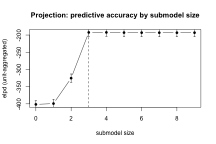

You have a model you trust and a list of covariates somebody wants added to
it. The question is what the covariates buy, and which of them buy it.

`fb_select()` answers that question without changing the model you trust. The
fixed effects already in the base are *protected*: they are never penalised
and never dropped. The candidates are *shrunk*, jointly, by a prior you
declare, and the submodel is chosen by projecting the reference posterior onto
each candidate subset and scoring the projection out of fold.

Three things are true of every answer on this page, and the software will not
let you write a sentence that contradicts them.

1. **A shrinkage posterior contains no exact zeros.** "Selected" is a decision
   somebody made under a stated rule. It is never a property of the draws.
2. **Every comparison against another tool declares what it claims.** There
   are three levels, and the strongest of them needs a numerical oracle
   behind it.
3. **Nothing runs under a label that is not what ran.** Each result records
   four independent things -- what was fitted, what fitted it, under what
   prior, and how the answer was read off.

# 1. The data

A clustered Gaussian design: 20 sites, ten plots each, eight candidate
covariates of which two carry signal. The signals vary within a site, so a
fold cut at the site does not remove them.


``` r
set.seed(20260912)

n_site <- 20L
per_site <- 10L
site <- factor(rep(sprintf("S%02d", seq_len(n_site)), each = per_site))
n <- length(site)

d <- data.frame(site = site)
for (v in paste0("x", 1:8)) {
  d[[v]] <- stats::rnorm(n)
}
u <- stats::setNames(stats::rnorm(n_site, sd = 0.8), levels(site))

# x1 and x2 carry signal. x3 to x8 do not.
d$y <- 2 + 1.2 * d$x1 - 0.9 * d$x2 +
  as.numeric(u[as.character(d$site)]) + stats::rnorm(n, sd = 0.6)

str(d[, c("site", "y", "x1", "x2", "x3")])
#> 'data.frame':	200 obs. of  5 variables:
#>  $ site: Factor w/ 20 levels "S01","S02","S03",..: 1 1 1 1 1 1 1 1 1 1 ...
#>  $ y   : num  2.354 0.574 0.897 1.745 3.059 ...
#>  $ x1  : num  1.36 -1.699 0.366 0.106 1.53 ...
#>  $ x2  : num  0.159 -2.11 0.882 -0.558 0.76 ...
#>  $ x3  : num  1.018 1.187 0.366 -0.996 0.382 ...
```

The base model is the site structure and nothing else on the fixed side, and
that is a limitation of the horseshoe rather than a modelling choice. The
regularised horseshoe is a *class-wide* prior in brms: it applies to every
population-level coefficient except the intercept, and brms refuses a
coefficient-specific row beside it. So the candidate block is the whole class
-- and the request is exact -- only when the fixed part is the intercept
alone. That is not the model a multi-environment trial or a variety trial
starts from, and section 4 below fits the model that does, under a family
that can aim at a block.

A base carrying protected fixed effects beyond the intercept refuses under a
horseshoe, and the refusal names the two ways forward: an exactly-targetable
family (`ridge()`, `laplace()`, `elastic_net()`), or
`scope = "all_fixed"`, an explicit opt-in that puts the protected
coefficients under the global-local prior too and records the approximation
on the certificate.


``` r
base <- flexybayes(
  y ~ 1 + (1 | site),
  data = d,
  backend = "brms",
  chains = 2L,
  n_samples = 2000L,
  warmup = 1000L,
  seed = 20260912L,
  verbose = FALSE,
  mcmc_verbose = FALSE
)
#> Loading required namespace: rstan
```

# 2. Declaring the prior

`fb_penalty()` takes `target ~ family(...)` formulas. Targets are resolved
against the model matrix's own assignment map, so a factor's contrast columns
travel together and a term is never matched by string.


``` r
pen <- fb_penalty(term(everything()) ~ regularized_horseshoe(p0 = 2))
pen
#> <fb_penalty> 1 specification(s), resolution = "term", scaling = "train_fold_standardize"
#>   1. term(everything()) ~ regularized_horseshoe(p0 = 2, slab_scale = 2, slab_df = 4, df = 1, df_global = 1, scope = "candidates")
#>      route class_wide, hyperparameters learned
#>   columns resolve against the model matrix at fit time.
```

`p0` is the prior guess at how many candidates carry signal. It is not a
constraint: the posterior is free to disagree, and the diagnostics below
report what it actually did.

The global scale that `p0` implies is calibrated against the number of
*resampling units*, not the number of rows. Two hundred plots in twenty sites
are not two hundred independent pieces of evidence about a site-level
coefficient, and calibrating at the row count makes the global scale too
small and the prior over-shrink. The certificate prints the number it used
and the row count beside it.

# 3. Planning before paying

`plan = TRUE` resolves the four axes, compiles the prior and runs the
projection structure gate without fitting anything. The gate leads the
report, because it is what decides whether the default decision can run at
all: `decision = "auto"` resolves to the projection where every structural
feature of the reference model has an executed gate behind it, and to `full`
where one does not.


``` r
fb_select(
  base,
  candidates = ~ x1 + x2 + x3 + x4 + x5 + x6 + x7 + x8,
  penalty    = pen,
  resamples  = fb_resamples(unit = ~ site, v = 3L),
  plan       = TRUE,
  seed       = 20260912L
)
#> == flexyBayes selection plan ============================
#>   Projection structure gate:
#>     response family           supported  Gaussian response with an identity link
#>     population-level effects  supported  the fixed part is what the search selects over (probe C2)
#>     (1 | site)                supported  grouped random intercept: get_refmodel() accepted it and a validated grouped k-fold search ran (probes C1-C3)
#>   Workflow:     bayes
#>   Provider:     brms
#>   Prior:        regularized_horseshoe  (route class_wide)
#>   Decision:     projection (resolved from "auto")
#>                 every structural feature of the reference model has an executed projection gate behind it, so the decision is the projection
#>                  the search runs on 20 clustered draws and the predictive evaluation on 100
#>   Candidates:   x1, x2, x3, x4, x5, x6, x7, x8
#>   Prior blocks:
#>     1. term(everything()) ~ regularized_horseshoe over 8 coefficient(s), learned hyperparameters
#>   stanvars:     no
#>   Structure gate: supported
#>   Folds:        3, prediction new_cluster
#>   Cost estimate: 26.1s over 4 fit(s) at 6.53s each
#>                  the per-fit figure is the base model's own recorded wall time; the reference model carries a wider fixed part and a shrinkage prior, so this is a floor
#>   Approximations this route commits to:
#>     - calibration_n_at_the_resampling_unit: the prior scales are calibrated against 20 units of site rather than against 200 rows, because rows inside a cluster are not independent pieces of evidence about a coefficient
#>     - projection_search_folds_reuse_whole_sample_preprocessing: the projection's k-fold search refits the reference model through brms, which reuses the reference fit's standardised data, compiled prior and calibration, so the constants and prior scales inside the search's folds are the whole sample's and the elpd-by-size curve that chooses the submodel is not strictly out of fold. The benchmark's out-of-fold tables learn every constant on each fold's analysis rows
#>   Nothing was fitted.
```

The cost figure is the base model's own wall time. It is a floor, not an
estimate: the reference model carries eight more coefficients and a
global-local prior.

Most of what this package fits is red at that gate. A known-covariance
genomic or pedigree term -- `vm(g, K)`, `ped(a, A)` -- lowers to
`(1 | gr(g, cov = K))`, and projpred refuses a function call on the
right-hand side of a group term. Unstructured and factor-analytic
covariances, autoregressive fields and smooths have no executed gate at all,
and an unrun cell refuses exactly as a cell that was run and came back red.
For those models the answer is shrinkage without a selection: the prior
fits, the projection does not, and `"auto"` picks `full` for you rather than
sampling a reference model and then refusing.

# 4. The selection


``` r
sel <- fb_select(
  base,
  candidates = ~ x1 + x2 + x3 + x4 + x5 + x6 + x7 + x8,
  penalty    = pen,
  resamples  = fb_resamples(unit = ~ site, v = 3L),
  decision   = fb_decision(method = "projection", rule = "one_se"),
  engine     = list(chains = 4L, n_samples = 1500L,
                    warmup = 1500L, adapt_delta = 0.99),
  seed       = 20260912L
)
#> Warning: 49 of 6000 (1.0%) transitions hit the maximum treedepth limit of 10.
#> See https://mc-stan.org/misc/warnings for details.
#> Warning in parse_args_varsel(refmodel = refmodel, method = method, refit_prj =
#> refit_prj, : In case of the Gaussian family (also in case of the latent
#> projection) and multilevel terms, the projection onto the full model can be
#> instable and even lead to an error, see GitHub issue #323. If you experience
#> this and may refrain from the projection onto the full model, set `nterms_max`
#> to the number of predictor terms in the full model minus 1 (possibly accounting
#> for submodel sizes skipped by custom `search_terms`).
#> Warning in checkConv(attr(opt, "derivs"), opt$par, ctrl = control$checkConv, :
#> unable to evaluate scaled gradient
#> Warning in checkConv(attr(opt, "derivs"), opt$par, ctrl = control$checkConv, : Model failed to converge: degenerate  Hessian with 1 negative eigenvalues
#>   See ?lme4::convergence and ?lme4::troubleshooting.
#> Warning in checkConv(attr(opt, "derivs"), opt$par, ctrl = control$checkConv, :
#> unable to evaluate scaled gradient
#> Warning in checkConv(attr(opt, "derivs"), opt$par, ctrl = control$checkConv, : Model failed to converge: degenerate  Hessian with 1 negative eigenvalues
#>   See ?lme4::convergence and ?lme4::troubleshooting.
#> Warning in checkConv(attr(opt, "derivs"), opt$par, ctrl = control$checkConv, :
#> unable to evaluate scaled gradient
#> Warning in checkConv(attr(opt, "derivs"), opt$par, ctrl = control$checkConv, : Model failed to converge: degenerate  Hessian with 1 negative eigenvalues
#>   See ?lme4::convergence and ?lme4::troubleshooting.
#> Warning in checkConv(attr(opt, "derivs"), opt$par, ctrl = control$checkConv, :
#> unable to evaluate scaled gradient
#> Warning in checkConv(attr(opt, "derivs"), opt$par, ctrl = control$checkConv, : Model failed to converge: degenerate  Hessian with 1 negative eigenvalues
#>   See ?lme4::convergence and ?lme4::troubleshooting.
#> Warning in check_conv(outdmin, lengths(mssgs_warns_capts), do_check =
#> do_check_conv): 4 out of 20 submodel fits (there is one submodel fit per
#> projected draw) might not have converged (appropriately). It is recommended to
#> inspect this in detail and (if necessary) to adjust tuning parameters via `...`
#> (the ellipsis of the employed top-level function such as project(), varsel(),
#> or cv_varsel()) or via a custom `div_minimizer` function (an argument of
#> init_refmodel()). In the present case, the submodel fits are of class(es)
#> `c("lmerMod")`. Documentation for corresponding tuning parameters is linked in
#> section "Draw-wise divergence minimizers" of `` ?`projpred-package` ``. Current
#> submodel formula (right-hand side): ~x1 + x2 + x6 + x7 + x4 + x5 + (1 | site)
#> Warning in checkConv(attr(opt, "derivs"), opt$par, ctrl = control$checkConv, :
#> unable to evaluate scaled gradient
#> Warning in checkConv(attr(opt, "derivs"), opt$par, ctrl = control$checkConv, : Model failed to converge: degenerate  Hessian with 1 negative eigenvalues
#>   See ?lme4::convergence and ?lme4::troubleshooting.
#> Warning in checkConv(attr(opt, "derivs"), opt$par, ctrl = control$checkConv, :
#> unable to evaluate scaled gradient
#> Warning in checkConv(attr(opt, "derivs"), opt$par, ctrl = control$checkConv, : Model failed to converge: degenerate  Hessian with 1 negative eigenvalues
#>   See ?lme4::convergence and ?lme4::troubleshooting.
#> Warning in checkConv(attr(opt, "derivs"), opt$par, ctrl = control$checkConv, :
#> unable to evaluate scaled gradient
#> Warning in checkConv(attr(opt, "derivs"), opt$par, ctrl = control$checkConv, : Model failed to converge: degenerate  Hessian with 1 negative eigenvalues
#>   See ?lme4::convergence and ?lme4::troubleshooting.
#> Warning in check_conv(outdmin, lengths(mssgs_warns_capts), do_check =
#> do_check_conv): 3 out of 20 submodel fits (there is one submodel fit per
#> projected draw) might not have converged (appropriately). It is recommended to
#> inspect this in detail and (if necessary) to adjust tuning parameters via `...`
#> (the ellipsis of the employed top-level function such as project(), varsel(),
#> or cv_varsel()) or via a custom `div_minimizer` function (an argument of
#> init_refmodel()). In the present case, the submodel fits are of class(es)
#> `c("lmerMod")`. Documentation for corresponding tuning parameters is linked in
#> section "Draw-wise divergence minimizers" of `` ?`projpred-package` ``. Current
#> submodel formula (right-hand side): ~x1 + x2 + x6 + x7 + x4 + x5 + x3 + (1 |
#> site)
#> Warning in checkConv(attr(opt, "derivs"), opt$par, ctrl = control$checkConv, :
#> unable to evaluate scaled gradient
#> Warning in checkConv(attr(opt, "derivs"), opt$par, ctrl = control$checkConv, : Model failed to converge: degenerate  Hessian with 1 negative eigenvalues
#>   See ?lme4::convergence and ?lme4::troubleshooting.
#> Warning in checkConv(attr(opt, "derivs"), opt$par, ctrl = control$checkConv, :
#> unable to evaluate scaled gradient
#> Warning in checkConv(attr(opt, "derivs"), opt$par, ctrl = control$checkConv, : Model failed to converge: degenerate  Hessian with 1 negative eigenvalues
#>   See ?lme4::convergence and ?lme4::troubleshooting.
#> Warning in checkConv(attr(opt, "derivs"), opt$par, ctrl = control$checkConv, :
#> unable to evaluate scaled gradient
#> Warning in checkConv(attr(opt, "derivs"), opt$par, ctrl = control$checkConv, : Model failed to converge: degenerate  Hessian with 1 negative eigenvalues
#>   See ?lme4::convergence and ?lme4::troubleshooting.
#> Warning in checkConv(attr(opt, "derivs"), opt$par, ctrl = control$checkConv, :
#> unable to evaluate scaled gradient
#> Warning in checkConv(attr(opt, "derivs"), opt$par, ctrl = control$checkConv, : Model failed to converge: degenerate  Hessian with 1 negative eigenvalues
#>   See ?lme4::convergence and ?lme4::troubleshooting.
#> Warning in check_conv(outdmin, lengths(mssgs_warns_capts), do_check =
#> do_check_conv): 4 out of 20 submodel fits (there is one submodel fit per
#> projected draw) might not have converged (appropriately). It is recommended to
#> inspect this in detail and (if necessary) to adjust tuning parameters via `...`
#> (the ellipsis of the employed top-level function such as project(), varsel(),
#> or cv_varsel()) or via a custom `div_minimizer` function (an argument of
#> init_refmodel()). In the present case, the submodel fits are of class(es)
#> `c("lmerMod")`. Documentation for corresponding tuning parameters is linked in
#> section "Draw-wise divergence minimizers" of `` ?`projpred-package` ``. Current
#> submodel formula (right-hand side): ~x1 + x2 + x6 + x7 + x4 + x5 + x8 + (1 |
#> site)
#> Warning in checkConv(attr(opt, "derivs"), opt$par, ctrl = control$checkConv, : Model failed to converge with max|grad| = 0.0337837 (tol = 0.002, component 1)
#>   See ?lme4::convergence and ?lme4::troubleshooting.
#> Warning in checkConv(attr(opt, "derivs"), opt$par, ctrl = control$checkConv, : Model is nearly unidentifiable: very large eigenvalue
#>  - Rescale variables?
#> Warning in checkConv(attr(opt, "derivs"), opt$par, ctrl = control$checkConv, : Model failed to converge with max|grad| = 3.05429 (tol = 0.002, component 1)
#>   See ?lme4::convergence and ?lme4::troubleshooting.
#> Warning in checkConv(attr(opt, "derivs"), opt$par, ctrl = control$checkConv, : Model is nearly unidentifiable: very large eigenvalue
#>  - Rescale variables?
#> Warning in checkConv(attr(opt, "derivs"), opt$par, ctrl = control$checkConv, : Model failed to converge with max|grad| = 0.0554965 (tol = 0.002, component 1)
#>   See ?lme4::convergence and ?lme4::troubleshooting.
#> Warning in checkConv(attr(opt, "derivs"), opt$par, ctrl = control$checkConv, : Model is nearly unidentifiable: very large eigenvalue
#>  - Rescale variables?
#> Warning in optwrap(optimizer, devfun, start, lower = lower, upper = upper, :
#> convergence code -4 from nloptwrap: NLOPT_ROUNDOFF_LIMITED: Roundoff errors led
#> to a breakdown of the optimization algorithm. In this case, the returned
#> minimum may still be useful. (e.g. this error occurs in NEWUOA if one tries to
#> achieve a tolerance too close to machine precision.)
#> Warning in checkConv(attr(opt, "derivs"), opt$par, ctrl = control$checkConv, : Model failed to converge with max|grad| = 1.21733 (tol = 0.002, component 1)
#>   See ?lme4::convergence and ?lme4::troubleshooting.
#> Warning in checkConv(attr(opt, "derivs"), opt$par, ctrl = control$checkConv, : Model is nearly unidentifiable: very large eigenvalue
#>  - Rescale variables?
#> Warning in checkConv(attr(opt, "derivs"), opt$par, ctrl = control$checkConv, : Model failed to converge with max|grad| = 0.758785 (tol = 0.002, component 1)
#>   See ?lme4::convergence and ?lme4::troubleshooting.
#> Warning in checkConv(attr(opt, "derivs"), opt$par, ctrl = control$checkConv, : Model is nearly unidentifiable: very large eigenvalue
#>  - Rescale variables?
#> Warning in optwrap(optimizer, devfun, start, lower = lower, upper = upper, :
#> convergence code -4 from nloptwrap: NLOPT_ROUNDOFF_LIMITED: Roundoff errors led
#> to a breakdown of the optimization algorithm. In this case, the returned
#> minimum may still be useful. (e.g. this error occurs in NEWUOA if one tries to
#> achieve a tolerance too close to machine precision.)
#> Warning in checkConv(attr(opt, "derivs"), opt$par, ctrl = control$checkConv, :
#> unable to evaluate scaled gradient
#> Warning in checkConv(attr(opt, "derivs"), opt$par, ctrl = control$checkConv, : Model failed to converge: degenerate  Hessian with 1 negative eigenvalues
#>   See ?lme4::convergence and ?lme4::troubleshooting.
#> Warning in checkConv(attr(opt, "derivs"), opt$par, ctrl = control$checkConv, : Model failed to converge with max|grad| = 0.368667 (tol = 0.002, component 1)
#>   See ?lme4::convergence and ?lme4::troubleshooting.
#> Warning in checkConv(attr(opt, "derivs"), opt$par, ctrl = control$checkConv, : Model is nearly unidentifiable: very large eigenvalue
#>  - Rescale variables?
#> Warning in checkConv(attr(opt, "derivs"), opt$par, ctrl = control$checkConv, : Model failed to converge with max|grad| = 1.71478 (tol = 0.002, component 1)
#>   See ?lme4::convergence and ?lme4::troubleshooting.
#> Warning in checkConv(attr(opt, "derivs"), opt$par, ctrl = control$checkConv, : Model is nearly unidentifiable: very large eigenvalue
#>  - Rescale variables?
#> Warning in checkConv(attr(opt, "derivs"), opt$par, ctrl = control$checkConv, : Model failed to converge with max|grad| = 1.4366 (tol = 0.002, component 1)
#>   See ?lme4::convergence and ?lme4::troubleshooting.
#> Warning in checkConv(attr(opt, "derivs"), opt$par, ctrl = control$checkConv, : Model is nearly unidentifiable: very large eigenvalue
#>  - Rescale variables?
#> Warning in checkConv(attr(opt, "derivs"), opt$par, ctrl = control$checkConv, : Model failed to converge with max|grad| = 0.738044 (tol = 0.002, component 1)
#>   See ?lme4::convergence and ?lme4::troubleshooting.
#> Warning in checkConv(attr(opt, "derivs"), opt$par, ctrl = control$checkConv, : Model is nearly unidentifiable: very large eigenvalue
#>  - Rescale variables?
#> Warning in checkConv(attr(opt, "derivs"), opt$par, ctrl = control$checkConv, : Model failed to converge with max|grad| = 0.265448 (tol = 0.002, component 1)
#>   See ?lme4::convergence and ?lme4::troubleshooting.
#> Warning in checkConv(attr(opt, "derivs"), opt$par, ctrl = control$checkConv, : Model is nearly unidentifiable: very large eigenvalue
#>  - Rescale variables?
#> Warning in optwrap(optimizer, devfun, start, lower = lower, upper = upper, :
#> convergence code -4 from nloptwrap: NLOPT_ROUNDOFF_LIMITED: Roundoff errors led
#> to a breakdown of the optimization algorithm. In this case, the returned
#> minimum may still be useful. (e.g. this error occurs in NEWUOA if one tries to
#> achieve a tolerance too close to machine precision.)
#> Warning in checkConv(attr(opt, "derivs"), opt$par, ctrl = control$checkConv, :
#> unable to evaluate scaled gradient
#> Warning in checkConv(attr(opt, "derivs"), opt$par, ctrl = control$checkConv, : Model failed to converge: degenerate  Hessian with 1 negative eigenvalues
#>   See ?lme4::convergence and ?lme4::troubleshooting.
#> Warning in optwrap(optimizer, devfun, start, lower = lower, upper = upper, :
#> convergence code -4 from nloptwrap: NLOPT_ROUNDOFF_LIMITED: Roundoff errors led
#> to a breakdown of the optimization algorithm. In this case, the returned
#> minimum may still be useful. (e.g. this error occurs in NEWUOA if one tries to
#> achieve a tolerance too close to machine precision.)
#> Warning in checkConv(attr(opt, "derivs"), opt$par, ctrl = control$checkConv, :
#> unable to evaluate scaled gradient
#> Warning in checkConv(attr(opt, "derivs"), opt$par, ctrl = control$checkConv, : Model failed to converge: degenerate  Hessian with 1 negative eigenvalues
#>   See ?lme4::convergence and ?lme4::troubleshooting.
#> Warning in checkConv(attr(opt, "derivs"), opt$par, ctrl = control$checkConv, : Model failed to converge with max|grad| = 4.59854 (tol = 0.002, component 1)
#>   See ?lme4::convergence and ?lme4::troubleshooting.
#> Warning in checkConv(attr(opt, "derivs"), opt$par, ctrl = control$checkConv, : Model is nearly unidentifiable: very large eigenvalue
#>  - Rescale variables?
#> Warning in optwrap(optimizer, devfun, start, lower = lower, upper = upper, :
#> convergence code -4 from nloptwrap: NLOPT_ROUNDOFF_LIMITED: Roundoff errors led
#> to a breakdown of the optimization algorithm. In this case, the returned
#> minimum may still be useful. (e.g. this error occurs in NEWUOA if one tries to
#> achieve a tolerance too close to machine precision.)
#> Warning in checkConv(attr(opt, "derivs"), opt$par, ctrl = control$checkConv, :
#> unable to evaluate scaled gradient
#> Warning in checkConv(attr(opt, "derivs"), opt$par, ctrl = control$checkConv, : Model failed to converge: degenerate  Hessian with 1 negative eigenvalues
#>   See ?lme4::convergence and ?lme4::troubleshooting.
#> Warning in checkConv(attr(opt, "derivs"), opt$par, ctrl = control$checkConv, : Model failed to converge with max|grad| = 1.56605 (tol = 0.002, component 1)
#>   See ?lme4::convergence and ?lme4::troubleshooting.
#> Warning in checkConv(attr(opt, "derivs"), opt$par, ctrl = control$checkConv, : Model is nearly unidentifiable: very large eigenvalue
#>  - Rescale variables?
#> Warning in checkConv(attr(opt, "derivs"), opt$par, ctrl = control$checkConv, : Model failed to converge with max|grad| = 0.624457 (tol = 0.002, component 1)
#>   See ?lme4::convergence and ?lme4::troubleshooting.
#> Warning in checkConv(attr(opt, "derivs"), opt$par, ctrl = control$checkConv, : Model is nearly unidentifiable: very large eigenvalue
#>  - Rescale variables?
#> Warning in checkConv(attr(opt, "derivs"), opt$par, ctrl = control$checkConv, : Model failed to converge with max|grad| = 0.695917 (tol = 0.002, component 1)
#>   See ?lme4::convergence and ?lme4::troubleshooting.
#> Warning in checkConv(attr(opt, "derivs"), opt$par, ctrl = control$checkConv, : Model is nearly unidentifiable: very large eigenvalue
#>  - Rescale variables?
#> Warning in optwrap(optimizer, devfun, start, lower = lower, upper = upper, :
#> convergence code -4 from nloptwrap: NLOPT_ROUNDOFF_LIMITED: Roundoff errors led
#> to a breakdown of the optimization algorithm. In this case, the returned
#> minimum may still be useful. (e.g. this error occurs in NEWUOA if one tries to
#> achieve a tolerance too close to machine precision.)
#> Warning in checkConv(attr(opt, "derivs"), opt$par, ctrl = control$checkConv, :
#> unable to evaluate scaled gradient
#> Warning in checkConv(attr(opt, "derivs"), opt$par, ctrl = control$checkConv, : Model failed to converge: degenerate  Hessian with 1 negative eigenvalues
#>   See ?lme4::convergence and ?lme4::troubleshooting.
#> Warning in check_conv(outdmin, lengths(mssgs_warns_capts), do_check =
#> do_check_conv): 20 out of 20 submodel fits (there is one submodel fit per
#> projected draw) might not have converged (appropriately). It is recommended to
#> inspect this in detail and (if necessary) to adjust tuning parameters via `...`
#> (the ellipsis of the employed top-level function such as project(), varsel(),
#> or cv_varsel()) or via a custom `div_minimizer` function (an argument of
#> init_refmodel()). In the present case, the submodel fits are of class(es)
#> `c("lmerMod")`. Documentation for corresponding tuning parameters is linked in
#> section "Draw-wise divergence minimizers" of `` ?`projpred-package` ``. Current
#> submodel formula (right-hand side): ~x1 + x2 + x6 + x7 + x4 + x5 + x3 + x8 + (1
#> | site)
#> Setting 'K' to the number of folds (3)
#> Fitting model 1 out of 3
#> Warning: 11 of 6000 (0.0%) transitions hit the maximum treedepth limit of 10.
#> See https://mc-stan.org/misc/warnings for details.
#> Fitting model 2 out of 3
#> Warning: 1 of 6000 (0.0%) transitions hit the maximum treedepth limit of 10.
#> See https://mc-stan.org/misc/warnings for details.
#> Fitting model 3 out of 3
#> Warning: 6 of 6000 (0.0%) transitions hit the maximum treedepth limit of 10.
#> See https://mc-stan.org/misc/warnings for details.
#> Warning in checkConv(attr(opt, "derivs"), opt$par, ctrl = control$checkConv, : Model failed to converge with max|grad| = 1.20511 (tol = 0.002, component 1)
#>   See ?lme4::convergence and ?lme4::troubleshooting.
#> Warning in checkConv(attr(opt, "derivs"), opt$par, ctrl = control$checkConv, : Model is nearly unidentifiable: very large eigenvalue
#>  - Rescale variables?
#> Warning in checkConv(attr(opt, "derivs"), opt$par, ctrl = control$checkConv, : Model failed to converge with max|grad| = 0.105589 (tol = 0.002, component 1)
#>   See ?lme4::convergence and ?lme4::troubleshooting.
#> Warning in checkConv(attr(opt, "derivs"), opt$par, ctrl = control$checkConv, : Model is nearly unidentifiable: very large eigenvalue
#>  - Rescale variables?
#> Warning in checkConv(attr(opt, "derivs"), opt$par, ctrl = control$checkConv, : Model is nearly unidentifiable: very large eigenvalue
#>  - Rescale variables?
#> Warning in checkConv(attr(opt, "derivs"), opt$par, ctrl = control$checkConv, : Model failed to converge with max|grad| = 1.69527 (tol = 0.002, component 1)
#>   See ?lme4::convergence and ?lme4::troubleshooting.
#> Warning in checkConv(attr(opt, "derivs"), opt$par, ctrl = control$checkConv, : Model is nearly unidentifiable: very large eigenvalue
#>  - Rescale variables?
#> Warning in checkConv(attr(opt, "derivs"), opt$par, ctrl = control$checkConv, : Model failed to converge with max|grad| = 0.201388 (tol = 0.002, component 1)
#>   See ?lme4::convergence and ?lme4::troubleshooting.
#> Warning in checkConv(attr(opt, "derivs"), opt$par, ctrl = control$checkConv, : Model is nearly unidentifiable: very large eigenvalue
#>  - Rescale variables?
#> Warning in optwrap(optimizer, devfun, start, lower = lower, upper = upper, :
#> convergence code -4 from nloptwrap: NLOPT_ROUNDOFF_LIMITED: Roundoff errors led
#> to a breakdown of the optimization algorithm. In this case, the returned
#> minimum may still be useful. (e.g. this error occurs in NEWUOA if one tries to
#> achieve a tolerance too close to machine precision.)
#> Warning in checkConv(attr(opt, "derivs"), opt$par, ctrl = control$checkConv, : Model failed to converge with max|grad| = 0.145517 (tol = 0.002, component 1)
#>   See ?lme4::convergence and ?lme4::troubleshooting.
#> Warning in checkConv(attr(opt, "derivs"), opt$par, ctrl = control$checkConv, : Model is nearly unidentifiable: very large eigenvalue
#>  - Rescale variables?
#> Warning in checkConv(attr(opt, "derivs"), opt$par, ctrl = control$checkConv, : Model failed to converge with max|grad| = 0.00412952 (tol = 0.002, component 1)
#>   See ?lme4::convergence and ?lme4::troubleshooting.
#> Warning in checkConv(attr(opt, "derivs"), opt$par, ctrl = control$checkConv, : Model is nearly unidentifiable: very large eigenvalue
#>  - Rescale variables?
#> Warning in checkConv(attr(opt, "derivs"), opt$par, ctrl = control$checkConv, : Model failed to converge with max|grad| = 1.62179 (tol = 0.002, component 1)
#>   See ?lme4::convergence and ?lme4::troubleshooting.
#> Warning in checkConv(attr(opt, "derivs"), opt$par, ctrl = control$checkConv, : Model is nearly unidentifiable: very large eigenvalue
#>  - Rescale variables?
#> Warning in checkConv(attr(opt, "derivs"), opt$par, ctrl = control$checkConv, : Model failed to converge with max|grad| = 1.29778 (tol = 0.002, component 1)
#>   See ?lme4::convergence and ?lme4::troubleshooting.
#> Warning in checkConv(attr(opt, "derivs"), opt$par, ctrl = control$checkConv, : Model is nearly unidentifiable: very large eigenvalue
#>  - Rescale variables?
#> Warning in optwrap(optimizer, devfun, start, lower = lower, upper = upper, :
#> convergence code -4 from nloptwrap: NLOPT_ROUNDOFF_LIMITED: Roundoff errors led
#> to a breakdown of the optimization algorithm. In this case, the returned
#> minimum may still be useful. (e.g. this error occurs in NEWUOA if one tries to
#> achieve a tolerance too close to machine precision.)
#> Warning in checkConv(attr(opt, "derivs"), opt$par, ctrl = control$checkConv, :
#> unable to evaluate scaled gradient
#> Warning in checkConv(attr(opt, "derivs"), opt$par, ctrl = control$checkConv, : Model failed to converge: degenerate  Hessian with 1 negative eigenvalues
#>   See ?lme4::convergence and ?lme4::troubleshooting.
#> Warning in checkConv(attr(opt, "derivs"), opt$par, ctrl = control$checkConv, : Model failed to converge with max|grad| = 0.968253 (tol = 0.002, component 1)
#>   See ?lme4::convergence and ?lme4::troubleshooting.
#> Warning in checkConv(attr(opt, "derivs"), opt$par, ctrl = control$checkConv, : Model is nearly unidentifiable: very large eigenvalue
#>  - Rescale variables?
#> Warning in checkConv(attr(opt, "derivs"), opt$par, ctrl = control$checkConv, : Model failed to converge with max|grad| = 0.931273 (tol = 0.002, component 1)
#>   See ?lme4::convergence and ?lme4::troubleshooting.
#> Warning in checkConv(attr(opt, "derivs"), opt$par, ctrl = control$checkConv, : Model is nearly unidentifiable: very large eigenvalue
#>  - Rescale variables?
#> Warning in checkConv(attr(opt, "derivs"), opt$par, ctrl = control$checkConv, : Model failed to converge with max|grad| = 0.429547 (tol = 0.002, component 1)
#>   See ?lme4::convergence and ?lme4::troubleshooting.
#> Warning in checkConv(attr(opt, "derivs"), opt$par, ctrl = control$checkConv, : Model is nearly unidentifiable: very large eigenvalue
#>  - Rescale variables?
#> Warning in checkConv(attr(opt, "derivs"), opt$par, ctrl = control$checkConv, : Model failed to converge with max|grad| = 1.61343 (tol = 0.002, component 1)
#>   See ?lme4::convergence and ?lme4::troubleshooting.
#> Warning in checkConv(attr(opt, "derivs"), opt$par, ctrl = control$checkConv, : Model is nearly unidentifiable: very large eigenvalue
#>  - Rescale variables?
#> Warning in optwrap(optimizer, devfun, start, lower = lower, upper = upper, :
#> convergence code -4 from nloptwrap: NLOPT_ROUNDOFF_LIMITED: Roundoff errors led
#> to a breakdown of the optimization algorithm. In this case, the returned
#> minimum may still be useful. (e.g. this error occurs in NEWUOA if one tries to
#> achieve a tolerance too close to machine precision.)
#> Warning in checkConv(attr(opt, "derivs"), opt$par, ctrl = control$checkConv, :
#> unable to evaluate scaled gradient
#> Warning in checkConv(attr(opt, "derivs"), opt$par, ctrl = control$checkConv, : Model failed to converge: degenerate  Hessian with 1 negative eigenvalues
#>   See ?lme4::convergence and ?lme4::troubleshooting.
#> Warning in checkConv(attr(opt, "derivs"), opt$par, ctrl = control$checkConv, : Model failed to converge with max|grad| = 0.837268 (tol = 0.002, component 1)
#>   See ?lme4::convergence and ?lme4::troubleshooting.
#> Warning in checkConv(attr(opt, "derivs"), opt$par, ctrl = control$checkConv, : Model is nearly unidentifiable: very large eigenvalue
#>  - Rescale variables?
#> Warning in checkConv(attr(opt, "derivs"), opt$par, ctrl = control$checkConv, : Model failed to converge with max|grad| = 0.870051 (tol = 0.002, component 1)
#>   See ?lme4::convergence and ?lme4::troubleshooting.
#> Warning in checkConv(attr(opt, "derivs"), opt$par, ctrl = control$checkConv, : Model is nearly unidentifiable: very large eigenvalue
#>  - Rescale variables?
#> Warning in checkConv(attr(opt, "derivs"), opt$par, ctrl = control$checkConv, : Model failed to converge with max|grad| = 1.21614 (tol = 0.002, component 1)
#>   See ?lme4::convergence and ?lme4::troubleshooting.
#> Warning in checkConv(attr(opt, "derivs"), opt$par, ctrl = control$checkConv, : Model is nearly unidentifiable: very large eigenvalue
#>  - Rescale variables?
#> Warning in checkConv(attr(opt, "derivs"), opt$par, ctrl = control$checkConv, : Model failed to converge with max|grad| = 1.2676 (tol = 0.002, component 1)
#>   See ?lme4::convergence and ?lme4::troubleshooting.
#> Warning in checkConv(attr(opt, "derivs"), opt$par, ctrl = control$checkConv, : Model is nearly unidentifiable: very large eigenvalue
#>  - Rescale variables?
#> Warning in check_conv(outdmin, lengths(mssgs_warns_capts), do_check =
#> do_check_conv): 20 out of 20 submodel fits (there is one submodel fit per
#> projected draw) might not have converged (appropriately). It is recommended to
#> inspect this in detail and (if necessary) to adjust tuning parameters via `...`
#> (the ellipsis of the employed top-level function such as project(), varsel(),
#> or cv_varsel()) or via a custom `div_minimizer` function (an argument of
#> init_refmodel()). In the present case, the submodel fits are of class(es)
#> `c("lmerMod")`. Documentation for corresponding tuning parameters is linked in
#> section "Draw-wise divergence minimizers" of `` ?`projpred-package` ``. Current
#> submodel formula (right-hand side): ~x1 + x2 + x4 + x8 + x3 + x5 + x6 + x7 + (1
#> | site)
#> Warning in checkConv(attr(opt, "derivs"), opt$par, ctrl = control$checkConv, :
#> unable to evaluate scaled gradient
#> Warning in checkConv(attr(opt, "derivs"), opt$par, ctrl = control$checkConv, : Model failed to converge: degenerate  Hessian with 1 negative eigenvalues
#>   See ?lme4::convergence and ?lme4::troubleshooting.
#> Warning in check_conv(outdmin, lengths(mssgs_warns_capts), do_check =
#> do_check_conv): 1 out of 100 submodel fits (there is one submodel fit per
#> projected draw) might not have converged (appropriately). It is recommended to
#> inspect this in detail and (if necessary) to adjust tuning parameters via `...`
#> (the ellipsis of the employed top-level function such as project(), varsel(),
#> or cv_varsel()) or via a custom `div_minimizer` function (an argument of
#> init_refmodel()). In the present case, the submodel fits are of class(es)
#> `c("lmerMod")`. Documentation for corresponding tuning parameters is linked in
#> section "Draw-wise divergence minimizers" of `` ?`projpred-package` ``. Current
#> submodel formula (right-hand side): ~x1 + x2 + x4 + x8 + x3 + x5 + (1 | site)
#> Warning in checkConv(attr(opt, "derivs"), opt$par, ctrl = control$checkConv, :
#> unable to evaluate scaled gradient
#> Warning in checkConv(attr(opt, "derivs"), opt$par, ctrl = control$checkConv, : Model failed to converge: degenerate  Hessian with 1 negative eigenvalues
#>   See ?lme4::convergence and ?lme4::troubleshooting.
#> Warning in checkConv(attr(opt, "derivs"), opt$par, ctrl = control$checkConv, :
#> unable to evaluate scaled gradient
#> Warning in checkConv(attr(opt, "derivs"), opt$par, ctrl = control$checkConv, : Model failed to converge: degenerate  Hessian with 1 negative eigenvalues
#>   See ?lme4::convergence and ?lme4::troubleshooting.
#> Warning in checkConv(attr(opt, "derivs"), opt$par, ctrl = control$checkConv, :
#> unable to evaluate scaled gradient
#> Warning in checkConv(attr(opt, "derivs"), opt$par, ctrl = control$checkConv, : Model failed to converge: degenerate  Hessian with 1 negative eigenvalues
#>   See ?lme4::convergence and ?lme4::troubleshooting.
#> Warning in checkConv(attr(opt, "derivs"), opt$par, ctrl = control$checkConv, :
#> unable to evaluate scaled gradient
#> Warning in checkConv(attr(opt, "derivs"), opt$par, ctrl = control$checkConv, : Model failed to converge: degenerate  Hessian with 1 negative eigenvalues
#>   See ?lme4::convergence and ?lme4::troubleshooting.
#> Warning in checkConv(attr(opt, "derivs"), opt$par, ctrl = control$checkConv, :
#> unable to evaluate scaled gradient
#> Warning in checkConv(attr(opt, "derivs"), opt$par, ctrl = control$checkConv, : Model failed to converge: degenerate  Hessian with 1 negative eigenvalues
#>   See ?lme4::convergence and ?lme4::troubleshooting.
#> Warning in checkConv(attr(opt, "derivs"), opt$par, ctrl = control$checkConv, :
#> unable to evaluate scaled gradient
#> Warning in checkConv(attr(opt, "derivs"), opt$par, ctrl = control$checkConv, : Model failed to converge: degenerate  Hessian with 1 negative eigenvalues
#>   See ?lme4::convergence and ?lme4::troubleshooting.
#> Warning in checkConv(attr(opt, "derivs"), opt$par, ctrl = control$checkConv, :
#> unable to evaluate scaled gradient
#> Warning in checkConv(attr(opt, "derivs"), opt$par, ctrl = control$checkConv, : Model failed to converge: degenerate  Hessian with 1 negative eigenvalues
#>   See ?lme4::convergence and ?lme4::troubleshooting.
#> Warning in checkConv(attr(opt, "derivs"), opt$par, ctrl = control$checkConv, :
#> unable to evaluate scaled gradient
#> Warning in checkConv(attr(opt, "derivs"), opt$par, ctrl = control$checkConv, : Model failed to converge: degenerate  Hessian with 1 negative eigenvalues
#>   See ?lme4::convergence and ?lme4::troubleshooting.
#> Warning in checkConv(attr(opt, "derivs"), opt$par, ctrl = control$checkConv, :
#> unable to evaluate scaled gradient
#> Warning in checkConv(attr(opt, "derivs"), opt$par, ctrl = control$checkConv, : Model failed to converge: degenerate  Hessian with 1 negative eigenvalues
#>   See ?lme4::convergence and ?lme4::troubleshooting.
#> Warning in checkConv(attr(opt, "derivs"), opt$par, ctrl = control$checkConv, :
#> unable to evaluate scaled gradient
#> Warning in checkConv(attr(opt, "derivs"), opt$par, ctrl = control$checkConv, : Model failed to converge: degenerate  Hessian with 1 negative eigenvalues
#>   See ?lme4::convergence and ?lme4::troubleshooting.
#> Warning in check_conv(outdmin, lengths(mssgs_warns_capts), do_check =
#> do_check_conv): 10 out of 100 submodel fits (there is one submodel fit per
#> projected draw) might not have converged (appropriately). It is recommended to
#> inspect this in detail and (if necessary) to adjust tuning parameters via `...`
#> (the ellipsis of the employed top-level function such as project(), varsel(),
#> or cv_varsel()) or via a custom `div_minimizer` function (an argument of
#> init_refmodel()). In the present case, the submodel fits are of class(es)
#> `c("lmerMod")`. Documentation for corresponding tuning parameters is linked in
#> section "Draw-wise divergence minimizers" of `` ?`projpred-package` ``. Current
#> submodel formula (right-hand side): ~x1 + x2 + x4 + x8 + x3 + x5 + x6 + (1 |
#> site)
#> Warning in checkConv(attr(opt, "derivs"), opt$par, ctrl = control$checkConv, : Model failed to converge with max|grad| = 0.766244 (tol = 0.002, component 1)
#>   See ?lme4::convergence and ?lme4::troubleshooting.
#> Warning in checkConv(attr(opt, "derivs"), opt$par, ctrl = control$checkConv, : Model is nearly unidentifiable: very large eigenvalue
#>  - Rescale variables?
#> Warning in checkConv(attr(opt, "derivs"), opt$par, ctrl = control$checkConv, : Model failed to converge with max|grad| = 0.220521 (tol = 0.002, component 1)
#>   See ?lme4::convergence and ?lme4::troubleshooting.
#> Warning in checkConv(attr(opt, "derivs"), opt$par, ctrl = control$checkConv, : Model is nearly unidentifiable: very large eigenvalue
#>  - Rescale variables?
#> Warning in checkConv(attr(opt, "derivs"), opt$par, ctrl = control$checkConv, : Model failed to converge with max|grad| = 0.998696 (tol = 0.002, component 1)
#>   See ?lme4::convergence and ?lme4::troubleshooting.
#> Warning in checkConv(attr(opt, "derivs"), opt$par, ctrl = control$checkConv, : Model is nearly unidentifiable: very large eigenvalue
#>  - Rescale variables?
#> Warning in checkConv(attr(opt, "derivs"), opt$par, ctrl = control$checkConv, : Model failed to converge with max|grad| = 0.0444594 (tol = 0.002, component 1)
#>   See ?lme4::convergence and ?lme4::troubleshooting.
#> Warning in checkConv(attr(opt, "derivs"), opt$par, ctrl = control$checkConv, : Model is nearly unidentifiable: very large eigenvalue
#>  - Rescale variables?
#> Warning in checkConv(attr(opt, "derivs"), opt$par, ctrl = control$checkConv, : Model failed to converge with max|grad| = 1.11981 (tol = 0.002, component 1)
#>   See ?lme4::convergence and ?lme4::troubleshooting.
#> Warning in checkConv(attr(opt, "derivs"), opt$par, ctrl = control$checkConv, : Model is nearly unidentifiable: very large eigenvalue
#>  - Rescale variables?
#> Warning in optwrap(optimizer, devfun, start, lower = lower, upper = upper, :
#> convergence code -4 from nloptwrap: NLOPT_ROUNDOFF_LIMITED: Roundoff errors led
#> to a breakdown of the optimization algorithm. In this case, the returned
#> minimum may still be useful. (e.g. this error occurs in NEWUOA if one tries to
#> achieve a tolerance too close to machine precision.)
#> Warning in checkConv(attr(opt, "derivs"), opt$par, ctrl = control$checkConv, :
#> unable to evaluate scaled gradient
#> Warning in checkConv(attr(opt, "derivs"), opt$par, ctrl = control$checkConv, : Model failed to converge: degenerate  Hessian with 1 negative eigenvalues
#>   See ?lme4::convergence and ?lme4::troubleshooting.
#> Warning in optwrap(optimizer, devfun, start, lower = lower, upper = upper, :
#> convergence code -4 from nloptwrap: NLOPT_ROUNDOFF_LIMITED: Roundoff errors led
#> to a breakdown of the optimization algorithm. In this case, the returned
#> minimum may still be useful. (e.g. this error occurs in NEWUOA if one tries to
#> achieve a tolerance too close to machine precision.)
#> Warning in optwrap(optimizer, devfun, start, lower = lower, upper = upper, :
#> convergence code -4 from nloptwrap: NLOPT_ROUNDOFF_LIMITED: Roundoff errors led
#> to a breakdown of the optimization algorithm. In this case, the returned
#> minimum may still be useful. (e.g. this error occurs in NEWUOA if one tries to
#> achieve a tolerance too close to machine precision.)
#> Warning in checkConv(attr(opt, "derivs"), opt$par, ctrl = control$checkConv, :
#> unable to evaluate scaled gradient
#> Warning in checkConv(attr(opt, "derivs"), opt$par, ctrl = control$checkConv, : Model failed to converge: degenerate  Hessian with 1 negative eigenvalues
#>   See ?lme4::convergence and ?lme4::troubleshooting.
#> Warning in checkConv(attr(opt, "derivs"), opt$par, ctrl = control$checkConv, : Model failed to converge with max|grad| = 0.764835 (tol = 0.002, component 1)
#>   See ?lme4::convergence and ?lme4::troubleshooting.
#> Warning in checkConv(attr(opt, "derivs"), opt$par, ctrl = control$checkConv, : Model is nearly unidentifiable: very large eigenvalue
#>  - Rescale variables?
#> Warning in optwrap(optimizer, devfun, start, lower = lower, upper = upper, :
#> convergence code -4 from nloptwrap: NLOPT_ROUNDOFF_LIMITED: Roundoff errors led
#> to a breakdown of the optimization algorithm. In this case, the returned
#> minimum may still be useful. (e.g. this error occurs in NEWUOA if one tries to
#> achieve a tolerance too close to machine precision.)
#> Warning in checkConv(attr(opt, "derivs"), opt$par, ctrl = control$checkConv, :
#> unable to evaluate scaled gradient
#> Warning in checkConv(attr(opt, "derivs"), opt$par, ctrl = control$checkConv, : Model failed to converge: degenerate  Hessian with 1 negative eigenvalues
#>   See ?lme4::convergence and ?lme4::troubleshooting.
#> Warning in checkConv(attr(opt, "derivs"), opt$par, ctrl = control$checkConv, : Model failed to converge with max|grad| = 2.25203 (tol = 0.002, component 1)
#>   See ?lme4::convergence and ?lme4::troubleshooting.
#> Warning in checkConv(attr(opt, "derivs"), opt$par, ctrl = control$checkConv, : Model is nearly unidentifiable: very large eigenvalue
#>  - Rescale variables?
#> Warning in checkConv(attr(opt, "derivs"), opt$par, ctrl = control$checkConv, : Model failed to converge with max|grad| = 1.37474 (tol = 0.002, component 1)
#>   See ?lme4::convergence and ?lme4::troubleshooting.
#> Warning in checkConv(attr(opt, "derivs"), opt$par, ctrl = control$checkConv, : Model is nearly unidentifiable: very large eigenvalue
#>  - Rescale variables?
#> Warning in checkConv(attr(opt, "derivs"), opt$par, ctrl = control$checkConv, : Model failed to converge with max|grad| = 0.399945 (tol = 0.002, component 1)
#>   See ?lme4::convergence and ?lme4::troubleshooting.
#> Warning in checkConv(attr(opt, "derivs"), opt$par, ctrl = control$checkConv, : Model is nearly unidentifiable: very large eigenvalue
#>  - Rescale variables?
#> Warning in optwrap(optimizer, devfun, start, lower = lower, upper = upper, :
#> convergence code -4 from nloptwrap: NLOPT_ROUNDOFF_LIMITED: Roundoff errors led
#> to a breakdown of the optimization algorithm. In this case, the returned
#> minimum may still be useful. (e.g. this error occurs in NEWUOA if one tries to
#> achieve a tolerance too close to machine precision.)
#> Warning in checkConv(attr(opt, "derivs"), opt$par, ctrl = control$checkConv, : Model failed to converge with max|grad| = 0.0815873 (tol = 0.002, component 1)
#>   See ?lme4::convergence and ?lme4::troubleshooting.
#> Warning in checkConv(attr(opt, "derivs"), opt$par, ctrl = control$checkConv, : Model is nearly unidentifiable: very large eigenvalue
#>  - Rescale variables?
#> Warning in checkConv(attr(opt, "derivs"), opt$par, ctrl = control$checkConv, : Model failed to converge with max|grad| = 0.0105382 (tol = 0.002, component 1)
#>   See ?lme4::convergence and ?lme4::troubleshooting.
#> Warning in checkConv(attr(opt, "derivs"), opt$par, ctrl = control$checkConv, : Model is nearly unidentifiable: very large eigenvalue
#>  - Rescale variables?
#> Warning in checkConv(attr(opt, "derivs"), opt$par, ctrl = control$checkConv, : Model failed to converge with max|grad| = 0.948724 (tol = 0.002, component 1)
#>   See ?lme4::convergence and ?lme4::troubleshooting.
#> Warning in checkConv(attr(opt, "derivs"), opt$par, ctrl = control$checkConv, : Model is nearly unidentifiable: very large eigenvalue
#>  - Rescale variables?
#> Warning in checkConv(attr(opt, "derivs"), opt$par, ctrl = control$checkConv, : Model failed to converge with max|grad| = 1.22109 (tol = 0.002, component 1)
#>   See ?lme4::convergence and ?lme4::troubleshooting.
#> Warning in checkConv(attr(opt, "derivs"), opt$par, ctrl = control$checkConv, : Model is nearly unidentifiable: very large eigenvalue
#>  - Rescale variables?
#> Warning in optwrap(optimizer, devfun, start, lower = lower, upper = upper, :
#> convergence code -4 from nloptwrap: NLOPT_ROUNDOFF_LIMITED: Roundoff errors led
#> to a breakdown of the optimization algorithm. In this case, the returned
#> minimum may still be useful. (e.g. this error occurs in NEWUOA if one tries to
#> achieve a tolerance too close to machine precision.)
#> Warning in checkConv(attr(opt, "derivs"), opt$par, ctrl = control$checkConv, : Model failed to converge with max|grad| = 1.08883 (tol = 0.002, component 1)
#>   See ?lme4::convergence and ?lme4::troubleshooting.
#> Warning in checkConv(attr(opt, "derivs"), opt$par, ctrl = control$checkConv, : Model is nearly unidentifiable: very large eigenvalue
#>  - Rescale variables?
#> Warning in checkConv(attr(opt, "derivs"), opt$par, ctrl = control$checkConv, : Model failed to converge with max|grad| = 0.523006 (tol = 0.002, component 1)
#>   See ?lme4::convergence and ?lme4::troubleshooting.
#> Warning in checkConv(attr(opt, "derivs"), opt$par, ctrl = control$checkConv, : Model is nearly unidentifiable: very large eigenvalue
#>  - Rescale variables?
#> Warning in checkConv(attr(opt, "derivs"), opt$par, ctrl = control$checkConv, : Model failed to converge with max|grad| = 0.0543047 (tol = 0.002, component 1)
#>   See ?lme4::convergence and ?lme4::troubleshooting.
#> Warning in checkConv(attr(opt, "derivs"), opt$par, ctrl = control$checkConv, : Model is nearly unidentifiable: very large eigenvalue
#>  - Rescale variables?
#> Warning in checkConv(attr(opt, "derivs"), opt$par, ctrl = control$checkConv, : Model failed to converge with max|grad| = 1.14755 (tol = 0.002, component 1)
#>   See ?lme4::convergence and ?lme4::troubleshooting.
#> Warning in checkConv(attr(opt, "derivs"), opt$par, ctrl = control$checkConv, : Model is nearly unidentifiable: very large eigenvalue
#>  - Rescale variables?
#> Warning in checkConv(attr(opt, "derivs"), opt$par, ctrl = control$checkConv, : Model failed to converge with max|grad| = 3.40862 (tol = 0.002, component 1)
#>   See ?lme4::convergence and ?lme4::troubleshooting.
#> Warning in checkConv(attr(opt, "derivs"), opt$par, ctrl = control$checkConv, : Model is nearly unidentifiable: very large eigenvalue
#>  - Rescale variables?
#> Warning in optwrap(optimizer, devfun, start, lower = lower, upper = upper, :
#> convergence code -4 from nloptwrap: NLOPT_ROUNDOFF_LIMITED: Roundoff errors led
#> to a breakdown of the optimization algorithm. In this case, the returned
#> minimum may still be useful. (e.g. this error occurs in NEWUOA if one tries to
#> achieve a tolerance too close to machine precision.)
#> Warning in checkConv(attr(opt, "derivs"), opt$par, ctrl = control$checkConv, : Model failed to converge with max|grad| = 1.26888 (tol = 0.002, component 1)
#>   See ?lme4::convergence and ?lme4::troubleshooting.
#> Warning in checkConv(attr(opt, "derivs"), opt$par, ctrl = control$checkConv, : Model is nearly unidentifiable: very large eigenvalue
#>  - Rescale variables?
#> Warning in checkConv(attr(opt, "derivs"), opt$par, ctrl = control$checkConv, : Model failed to converge with max|grad| = 0.382064 (tol = 0.002, component 1)
#>   See ?lme4::convergence and ?lme4::troubleshooting.
#> Warning in checkConv(attr(opt, "derivs"), opt$par, ctrl = control$checkConv, : Model is nearly unidentifiable: very large eigenvalue
#>  - Rescale variables?
#> Warning in checkConv(attr(opt, "derivs"), opt$par, ctrl = control$checkConv, : Model failed to converge with max|grad| = 0.094948 (tol = 0.002, component 1)
#>   See ?lme4::convergence and ?lme4::troubleshooting.
#> Warning in checkConv(attr(opt, "derivs"), opt$par, ctrl = control$checkConv, : Model is nearly unidentifiable: very large eigenvalue
#>  - Rescale variables?
#> Warning in optwrap(optimizer, devfun, start, lower = lower, upper = upper, :
#> convergence code -4 from nloptwrap: NLOPT_ROUNDOFF_LIMITED: Roundoff errors led
#> to a breakdown of the optimization algorithm. In this case, the returned
#> minimum may still be useful. (e.g. this error occurs in NEWUOA if one tries to
#> achieve a tolerance too close to machine precision.)
#> Warning in checkConv(attr(opt, "derivs"), opt$par, ctrl = control$checkConv, : Model is nearly unidentifiable: very large eigenvalue
#>  - Rescale variables?
#> Warning in optwrap(optimizer, devfun, start, lower = lower, upper = upper, :
#> convergence code -4 from nloptwrap: NLOPT_ROUNDOFF_LIMITED: Roundoff errors led
#> to a breakdown of the optimization algorithm. In this case, the returned
#> minimum may still be useful. (e.g. this error occurs in NEWUOA if one tries to
#> achieve a tolerance too close to machine precision.)
#> Warning in checkConv(attr(opt, "derivs"), opt$par, ctrl = control$checkConv, : Model failed to converge with max|grad| = 0.965429 (tol = 0.002, component 1)
#>   See ?lme4::convergence and ?lme4::troubleshooting.
#> Warning in checkConv(attr(opt, "derivs"), opt$par, ctrl = control$checkConv, : Model is nearly unidentifiable: very large eigenvalue
#>  - Rescale variables?
#> Warning in optwrap(optimizer, devfun, start, lower = lower, upper = upper, :
#> convergence code -4 from nloptwrap: NLOPT_ROUNDOFF_LIMITED: Roundoff errors led
#> to a breakdown of the optimization algorithm. In this case, the returned
#> minimum may still be useful. (e.g. this error occurs in NEWUOA if one tries to
#> achieve a tolerance too close to machine precision.)
#> Warning in checkConv(attr(opt, "derivs"), opt$par, ctrl = control$checkConv, :
#> unable to evaluate scaled gradient
#> Warning in checkConv(attr(opt, "derivs"), opt$par, ctrl = control$checkConv, : Model failed to converge: degenerate  Hessian with 1 negative eigenvalues
#>   See ?lme4::convergence and ?lme4::troubleshooting.
#> Warning in optwrap(optimizer, devfun, start, lower = lower, upper = upper, :
#> convergence code -4 from nloptwrap: NLOPT_ROUNDOFF_LIMITED: Roundoff errors led
#> to a breakdown of the optimization algorithm. In this case, the returned
#> minimum may still be useful. (e.g. this error occurs in NEWUOA if one tries to
#> achieve a tolerance too close to machine precision.)
#> Warning in checkConv(attr(opt, "derivs"), opt$par, ctrl = control$checkConv, :
#> unable to evaluate scaled gradient
#> Warning in checkConv(attr(opt, "derivs"), opt$par, ctrl = control$checkConv, : Model failed to converge: degenerate  Hessian with 1 negative eigenvalues
#>   See ?lme4::convergence and ?lme4::troubleshooting.
#> Warning in checkConv(attr(opt, "derivs"), opt$par, ctrl = control$checkConv, : Model failed to converge with max|grad| = 0.103965 (tol = 0.002, component 1)
#>   See ?lme4::convergence and ?lme4::troubleshooting.
#> Warning in checkConv(attr(opt, "derivs"), opt$par, ctrl = control$checkConv, : Model is nearly unidentifiable: very large eigenvalue
#>  - Rescale variables?
#> Warning in checkConv(attr(opt, "derivs"), opt$par, ctrl = control$checkConv, : Model failed to converge with max|grad| = 0.761704 (tol = 0.002, component 1)
#>   See ?lme4::convergence and ?lme4::troubleshooting.
#> Warning in checkConv(attr(opt, "derivs"), opt$par, ctrl = control$checkConv, : Model is nearly unidentifiable: very large eigenvalue
#>  - Rescale variables?
#> Warning in checkConv(attr(opt, "derivs"), opt$par, ctrl = control$checkConv, : Model failed to converge with max|grad| = 2.15092 (tol = 0.002, component 1)
#>   See ?lme4::convergence and ?lme4::troubleshooting.
#> Warning in checkConv(attr(opt, "derivs"), opt$par, ctrl = control$checkConv, : Model is nearly unidentifiable: very large eigenvalue
#>  - Rescale variables?
#> Warning in optwrap(optimizer, devfun, start, lower = lower, upper = upper, :
#> convergence code -4 from nloptwrap: NLOPT_ROUNDOFF_LIMITED: Roundoff errors led
#> to a breakdown of the optimization algorithm. In this case, the returned
#> minimum may still be useful. (e.g. this error occurs in NEWUOA if one tries to
#> achieve a tolerance too close to machine precision.)
#> Warning in checkConv(attr(opt, "derivs"), opt$par, ctrl = control$checkConv, :
#> unable to evaluate scaled gradient
#> Warning in checkConv(attr(opt, "derivs"), opt$par, ctrl = control$checkConv, : Model failed to converge: degenerate  Hessian with 1 negative eigenvalues
#>   See ?lme4::convergence and ?lme4::troubleshooting.
#> Warning in checkConv(attr(opt, "derivs"), opt$par, ctrl = control$checkConv, : Model failed to converge with max|grad| = 0.613103 (tol = 0.002, component 1)
#>   See ?lme4::convergence and ?lme4::troubleshooting.
#> Warning in checkConv(attr(opt, "derivs"), opt$par, ctrl = control$checkConv, : Model is nearly unidentifiable: very large eigenvalue
#>  - Rescale variables?
#> Warning in checkConv(attr(opt, "derivs"), opt$par, ctrl = control$checkConv, : Model failed to converge with max|grad| = 0.190726 (tol = 0.002, component 1)
#>   See ?lme4::convergence and ?lme4::troubleshooting.
#> Warning in checkConv(attr(opt, "derivs"), opt$par, ctrl = control$checkConv, : Model is nearly unidentifiable: very large eigenvalue
#>  - Rescale variables?
#> Warning in checkConv(attr(opt, "derivs"), opt$par, ctrl = control$checkConv, : Model failed to converge with max|grad| = 0.468714 (tol = 0.002, component 1)
#>   See ?lme4::convergence and ?lme4::troubleshooting.
#> Warning in checkConv(attr(opt, "derivs"), opt$par, ctrl = control$checkConv, : Model is nearly unidentifiable: very large eigenvalue
#>  - Rescale variables?
#> Warning in checkConv(attr(opt, "derivs"), opt$par, ctrl = control$checkConv, : Model failed to converge with max|grad| = 1.93913 (tol = 0.002, component 1)
#>   See ?lme4::convergence and ?lme4::troubleshooting.
#> Warning in checkConv(attr(opt, "derivs"), opt$par, ctrl = control$checkConv, : Model is nearly unidentifiable: very large eigenvalue
#>  - Rescale variables?
#> Warning in checkConv(attr(opt, "derivs"), opt$par, ctrl = control$checkConv, : Model failed to converge with max|grad| = 0.840665 (tol = 0.002, component 1)
#>   See ?lme4::convergence and ?lme4::troubleshooting.
#> Warning in checkConv(attr(opt, "derivs"), opt$par, ctrl = control$checkConv, : Model is nearly unidentifiable: very large eigenvalue
#>  - Rescale variables?
#> Warning in checkConv(attr(opt, "derivs"), opt$par, ctrl = control$checkConv, : Model failed to converge with max|grad| = 1.3065 (tol = 0.002, component 1)
#>   See ?lme4::convergence and ?lme4::troubleshooting.
#> Warning in checkConv(attr(opt, "derivs"), opt$par, ctrl = control$checkConv, : Model is nearly unidentifiable: very large eigenvalue
#>  - Rescale variables?
#> Warning in optwrap(optimizer, devfun, start, lower = lower, upper = upper, :
#> convergence code -4 from nloptwrap: NLOPT_ROUNDOFF_LIMITED: Roundoff errors led
#> to a breakdown of the optimization algorithm. In this case, the returned
#> minimum may still be useful. (e.g. this error occurs in NEWUOA if one tries to
#> achieve a tolerance too close to machine precision.)
#> Warning in checkConv(attr(opt, "derivs"), opt$par, ctrl = control$checkConv, : Model failed to converge with max|grad| = 1.5612 (tol = 0.002, component 1)
#>   See ?lme4::convergence and ?lme4::troubleshooting.
#> Warning in checkConv(attr(opt, "derivs"), opt$par, ctrl = control$checkConv, : Model is nearly unidentifiable: very large eigenvalue
#>  - Rescale variables?
#> Warning in checkConv(attr(opt, "derivs"), opt$par, ctrl = control$checkConv, : Model failed to converge with max|grad| = 1.06024 (tol = 0.002, component 1)
#>   See ?lme4::convergence and ?lme4::troubleshooting.
#> Warning in checkConv(attr(opt, "derivs"), opt$par, ctrl = control$checkConv, : Model is nearly unidentifiable: very large eigenvalue
#>  - Rescale variables?
#> Warning in checkConv(attr(opt, "derivs"), opt$par, ctrl = control$checkConv, : Model failed to converge with max|grad| = 1.3024 (tol = 0.002, component 1)
#>   See ?lme4::convergence and ?lme4::troubleshooting.
#> Warning in checkConv(attr(opt, "derivs"), opt$par, ctrl = control$checkConv, : Model is nearly unidentifiable: very large eigenvalue
#>  - Rescale variables?
#> Warning in optwrap(optimizer, devfun, start, lower = lower, upper = upper, :
#> convergence code -4 from nloptwrap: NLOPT_ROUNDOFF_LIMITED: Roundoff errors led
#> to a breakdown of the optimization algorithm. In this case, the returned
#> minimum may still be useful. (e.g. this error occurs in NEWUOA if one tries to
#> achieve a tolerance too close to machine precision.)
#> Warning in checkConv(attr(opt, "derivs"), opt$par, ctrl = control$checkConv, :
#> unable to evaluate scaled gradient
#> Warning in checkConv(attr(opt, "derivs"), opt$par, ctrl = control$checkConv, : Model failed to converge: degenerate  Hessian with 1 negative eigenvalues
#>   See ?lme4::convergence and ?lme4::troubleshooting.
#> Warning in optwrap(optimizer, devfun, start, lower = lower, upper = upper, :
#> convergence code -4 from nloptwrap: NLOPT_ROUNDOFF_LIMITED: Roundoff errors led
#> to a breakdown of the optimization algorithm. In this case, the returned
#> minimum may still be useful. (e.g. this error occurs in NEWUOA if one tries to
#> achieve a tolerance too close to machine precision.)
#> Warning in checkConv(attr(opt, "derivs"), opt$par, ctrl = control$checkConv, : Model failed to converge with max|grad| = 0.00636539 (tol = 0.002, component 1)
#>   See ?lme4::convergence and ?lme4::troubleshooting.
#> Warning in checkConv(attr(opt, "derivs"), opt$par, ctrl = control$checkConv, : Model failed to converge with max|grad| = 0.199562 (tol = 0.002, component 1)
#>   See ?lme4::convergence and ?lme4::troubleshooting.
#> Warning in checkConv(attr(opt, "derivs"), opt$par, ctrl = control$checkConv, : Model is nearly unidentifiable: very large eigenvalue
#>  - Rescale variables?
#> Warning in checkConv(attr(opt, "derivs"), opt$par, ctrl = control$checkConv, : Model failed to converge with max|grad| = 0.0337317 (tol = 0.002, component 1)
#>   See ?lme4::convergence and ?lme4::troubleshooting.
#> Warning in checkConv(attr(opt, "derivs"), opt$par, ctrl = control$checkConv, : Model is nearly unidentifiable: very large eigenvalue
#>  - Rescale variables?
#> Warning in checkConv(attr(opt, "derivs"), opt$par, ctrl = control$checkConv, : Model failed to converge with max|grad| = 1.26214 (tol = 0.002, component 1)
#>   See ?lme4::convergence and ?lme4::troubleshooting.
#> Warning in checkConv(attr(opt, "derivs"), opt$par, ctrl = control$checkConv, : Model is nearly unidentifiable: very large eigenvalue
#>  - Rescale variables?
#> Warning in checkConv(attr(opt, "derivs"), opt$par, ctrl = control$checkConv, : Model failed to converge with max|grad| = 0.0698464 (tol = 0.002, component 1)
#>   See ?lme4::convergence and ?lme4::troubleshooting.
#> Warning in checkConv(attr(opt, "derivs"), opt$par, ctrl = control$checkConv, : Model is nearly unidentifiable: very large eigenvalue
#>  - Rescale variables?
#> Warning in checkConv(attr(opt, "derivs"), opt$par, ctrl = control$checkConv, : Model failed to converge with max|grad| = 0.243581 (tol = 0.002, component 1)
#>   See ?lme4::convergence and ?lme4::troubleshooting.
#> Warning in checkConv(attr(opt, "derivs"), opt$par, ctrl = control$checkConv, : Model is nearly unidentifiable: very large eigenvalue
#>  - Rescale variables?
#> Warning in optwrap(optimizer, devfun, start, lower = lower, upper = upper, :
#> convergence code -4 from nloptwrap: NLOPT_ROUNDOFF_LIMITED: Roundoff errors led
#> to a breakdown of the optimization algorithm. In this case, the returned
#> minimum may still be useful. (e.g. this error occurs in NEWUOA if one tries to
#> achieve a tolerance too close to machine precision.)
#> Warning in checkConv(attr(opt, "derivs"), opt$par, ctrl = control$checkConv, : Model failed to converge with max|grad| = 0.0153373 (tol = 0.002, component 1)
#>   See ?lme4::convergence and ?lme4::troubleshooting.
#> Warning in optwrap(optimizer, devfun, start, lower = lower, upper = upper, :
#> convergence code -4 from nloptwrap: NLOPT_ROUNDOFF_LIMITED: Roundoff errors led
#> to a breakdown of the optimization algorithm. In this case, the returned
#> minimum may still be useful. (e.g. this error occurs in NEWUOA if one tries to
#> achieve a tolerance too close to machine precision.)
#> Warning in checkConv(attr(opt, "derivs"), opt$par, ctrl = control$checkConv, : Model failed to converge with max|grad| = 1.92598 (tol = 0.002, component 1)
#>   See ?lme4::convergence and ?lme4::troubleshooting.
#> Warning in checkConv(attr(opt, "derivs"), opt$par, ctrl = control$checkConv, : Model is nearly unidentifiable: very large eigenvalue
#>  - Rescale variables?
#> Warning in checkConv(attr(opt, "derivs"), opt$par, ctrl = control$checkConv, : Model failed to converge with max|grad| = 0.0483971 (tol = 0.002, component 1)
#>   See ?lme4::convergence and ?lme4::troubleshooting.
#> Warning in checkConv(attr(opt, "derivs"), opt$par, ctrl = control$checkConv, : Model is nearly unidentifiable: very large eigenvalue
#>  - Rescale variables?
#> Warning in checkConv(attr(opt, "derivs"), opt$par, ctrl = control$checkConv, : Model failed to converge with max|grad| = 0.996433 (tol = 0.002, component 1)
#>   See ?lme4::convergence and ?lme4::troubleshooting.
#> Warning in checkConv(attr(opt, "derivs"), opt$par, ctrl = control$checkConv, : Model is nearly unidentifiable: very large eigenvalue
#>  - Rescale variables?
#> Warning in checkConv(attr(opt, "derivs"), opt$par, ctrl = control$checkConv, : Model failed to converge with max|grad| = 2.2859 (tol = 0.002, component 1)
#>   See ?lme4::convergence and ?lme4::troubleshooting.
#> Warning in checkConv(attr(opt, "derivs"), opt$par, ctrl = control$checkConv, : Model is nearly unidentifiable: very large eigenvalue
#>  - Rescale variables?
#> Warning in checkConv(attr(opt, "derivs"), opt$par, ctrl = control$checkConv, : Model failed to converge with max|grad| = 0.0230295 (tol = 0.002, component 1)
#>   See ?lme4::convergence and ?lme4::troubleshooting.
#> Warning in checkConv(attr(opt, "derivs"), opt$par, ctrl = control$checkConv, : Model is nearly unidentifiable: very large eigenvalue
#>  - Rescale variables?
#> Warning in checkConv(attr(opt, "derivs"), opt$par, ctrl = control$checkConv, : Model failed to converge with max|grad| = 0.627499 (tol = 0.002, component 1)
#>   See ?lme4::convergence and ?lme4::troubleshooting.
#> Warning in checkConv(attr(opt, "derivs"), opt$par, ctrl = control$checkConv, : Model is nearly unidentifiable: very large eigenvalue
#>  - Rescale variables?
#> Warning in checkConv(attr(opt, "derivs"), opt$par, ctrl = control$checkConv, : Model failed to converge with max|grad| = 0.806061 (tol = 0.002, component 1)
#>   See ?lme4::convergence and ?lme4::troubleshooting.
#> Warning in checkConv(attr(opt, "derivs"), opt$par, ctrl = control$checkConv, : Model is nearly unidentifiable: very large eigenvalue
#>  - Rescale variables?
#> Warning in optwrap(optimizer, devfun, start, lower = lower, upper = upper, :
#> convergence code -4 from nloptwrap: NLOPT_ROUNDOFF_LIMITED: Roundoff errors led
#> to a breakdown of the optimization algorithm. In this case, the returned
#> minimum may still be useful. (e.g. this error occurs in NEWUOA if one tries to
#> achieve a tolerance too close to machine precision.)
#> Warning in checkConv(attr(opt, "derivs"), opt$par, ctrl = control$checkConv, :
#> unable to evaluate scaled gradient
#> Warning in checkConv(attr(opt, "derivs"), opt$par, ctrl = control$checkConv, : Model failed to converge: degenerate  Hessian with 1 negative eigenvalues
#>   See ?lme4::convergence and ?lme4::troubleshooting.
#> Warning in checkConv(attr(opt, "derivs"), opt$par, ctrl = control$checkConv, : Model failed to converge with max|grad| = 0.713295 (tol = 0.002, component 1)
#>   See ?lme4::convergence and ?lme4::troubleshooting.
#> Warning in checkConv(attr(opt, "derivs"), opt$par, ctrl = control$checkConv, : Model is nearly unidentifiable: very large eigenvalue
#>  - Rescale variables?
#> Warning in checkConv(attr(opt, "derivs"), opt$par, ctrl = control$checkConv, : Model failed to converge with max|grad| = 0.0480046 (tol = 0.002, component 1)
#>   See ?lme4::convergence and ?lme4::troubleshooting.
#> Warning in checkConv(attr(opt, "derivs"), opt$par, ctrl = control$checkConv, : Model is nearly unidentifiable: very large eigenvalue
#>  - Rescale variables?
#> Warning in optwrap(optimizer, devfun, start, lower = lower, upper = upper, :
#> convergence code -4 from nloptwrap: NLOPT_ROUNDOFF_LIMITED: Roundoff errors led
#> to a breakdown of the optimization algorithm. In this case, the returned
#> minimum may still be useful. (e.g. this error occurs in NEWUOA if one tries to
#> achieve a tolerance too close to machine precision.)
#> Warning in optwrap(optimizer, devfun, start, lower = lower, upper = upper, :
#> convergence code -4 from nloptwrap: NLOPT_ROUNDOFF_LIMITED: Roundoff errors led
#> to a breakdown of the optimization algorithm. In this case, the returned
#> minimum may still be useful. (e.g. this error occurs in NEWUOA if one tries to
#> achieve a tolerance too close to machine precision.)
#> Warning in checkConv(attr(opt, "derivs"), opt$par, ctrl = control$checkConv, :
#> unable to evaluate scaled gradient
#> Warning in checkConv(attr(opt, "derivs"), opt$par, ctrl = control$checkConv, : Model failed to converge: degenerate  Hessian with 1 negative eigenvalues
#>   See ?lme4::convergence and ?lme4::troubleshooting.
#> Warning in checkConv(attr(opt, "derivs"), opt$par, ctrl = control$checkConv, : Model failed to converge with max|grad| = 0.287874 (tol = 0.002, component 1)
#>   See ?lme4::convergence and ?lme4::troubleshooting.
#> Warning in checkConv(attr(opt, "derivs"), opt$par, ctrl = control$checkConv, : Model is nearly unidentifiable: very large eigenvalue
#>  - Rescale variables?
#> Warning in checkConv(attr(opt, "derivs"), opt$par, ctrl = control$checkConv, : Model failed to converge with max|grad| = 2.05915 (tol = 0.002, component 1)
#>   See ?lme4::convergence and ?lme4::troubleshooting.
#> Warning in checkConv(attr(opt, "derivs"), opt$par, ctrl = control$checkConv, : Model is nearly unidentifiable: very large eigenvalue
#>  - Rescale variables?
#> Warning in checkConv(attr(opt, "derivs"), opt$par, ctrl = control$checkConv, : Model failed to converge with max|grad| = 0.0851617 (tol = 0.002, component 1)
#>   See ?lme4::convergence and ?lme4::troubleshooting.
#> Warning in checkConv(attr(opt, "derivs"), opt$par, ctrl = control$checkConv, : Model is nearly unidentifiable: very large eigenvalue
#>  - Rescale variables?
#> Warning in checkConv(attr(opt, "derivs"), opt$par, ctrl = control$checkConv, : Model failed to converge with max|grad| = 1.36613 (tol = 0.002, component 1)
#>   See ?lme4::convergence and ?lme4::troubleshooting.
#> Warning in checkConv(attr(opt, "derivs"), opt$par, ctrl = control$checkConv, : Model is nearly unidentifiable: very large eigenvalue
#>  - Rescale variables?
#> Warning in checkConv(attr(opt, "derivs"), opt$par, ctrl = control$checkConv, : Model failed to converge with max|grad| = 1.60473 (tol = 0.002, component 1)
#>   See ?lme4::convergence and ?lme4::troubleshooting.
#> Warning in checkConv(attr(opt, "derivs"), opt$par, ctrl = control$checkConv, : Model is nearly unidentifiable: very large eigenvalue
#>  - Rescale variables?
#> Warning in checkConv(attr(opt, "derivs"), opt$par, ctrl = control$checkConv, : Model failed to converge with max|grad| = 0.0307149 (tol = 0.002, component 1)
#>   See ?lme4::convergence and ?lme4::troubleshooting.
#> Warning in checkConv(attr(opt, "derivs"), opt$par, ctrl = control$checkConv, : Model is nearly unidentifiable: very large eigenvalue
#>  - Rescale variables?
#> Warning in checkConv(attr(opt, "derivs"), opt$par, ctrl = control$checkConv, : Model failed to converge with max|grad| = 1.20365 (tol = 0.002, component 1)
#>   See ?lme4::convergence and ?lme4::troubleshooting.
#> Warning in checkConv(attr(opt, "derivs"), opt$par, ctrl = control$checkConv, : Model is nearly unidentifiable: very large eigenvalue
#>  - Rescale variables?
#> Warning in checkConv(attr(opt, "derivs"), opt$par, ctrl = control$checkConv, : Model failed to converge with max|grad| = 0.711212 (tol = 0.002, component 1)
#>   See ?lme4::convergence and ?lme4::troubleshooting.
#> Warning in checkConv(attr(opt, "derivs"), opt$par, ctrl = control$checkConv, : Model is nearly unidentifiable: very large eigenvalue
#>  - Rescale variables?
#> Warning in checkConv(attr(opt, "derivs"), opt$par, ctrl = control$checkConv, : Model failed to converge with max|grad| = 0.381821 (tol = 0.002, component 1)
#>   See ?lme4::convergence and ?lme4::troubleshooting.
#> Warning in checkConv(attr(opt, "derivs"), opt$par, ctrl = control$checkConv, : Model is nearly unidentifiable: very large eigenvalue
#>  - Rescale variables?
#> Warning in checkConv(attr(opt, "derivs"), opt$par, ctrl = control$checkConv, : Model failed to converge with max|grad| = 2.09609 (tol = 0.002, component 1)
#>   See ?lme4::convergence and ?lme4::troubleshooting.
#> Warning in checkConv(attr(opt, "derivs"), opt$par, ctrl = control$checkConv, : Model is nearly unidentifiable: very large eigenvalue
#>  - Rescale variables?
#> Warning in optwrap(optimizer, devfun, start, lower = lower, upper = upper, :
#> convergence code -4 from nloptwrap: NLOPT_ROUNDOFF_LIMITED: Roundoff errors led
#> to a breakdown of the optimization algorithm. In this case, the returned
#> minimum may still be useful. (e.g. this error occurs in NEWUOA if one tries to
#> achieve a tolerance too close to machine precision.)
#> Warning in checkConv(attr(opt, "derivs"), opt$par, ctrl = control$checkConv, :
#> unable to evaluate scaled gradient
#> Warning in checkConv(attr(opt, "derivs"), opt$par, ctrl = control$checkConv, : Model failed to converge: degenerate  Hessian with 1 negative eigenvalues
#>   See ?lme4::convergence and ?lme4::troubleshooting.
#> Warning in checkConv(attr(opt, "derivs"), opt$par, ctrl = control$checkConv, : Model failed to converge with max|grad| = 2.36995 (tol = 0.002, component 1)
#>   See ?lme4::convergence and ?lme4::troubleshooting.
#> Warning in checkConv(attr(opt, "derivs"), opt$par, ctrl = control$checkConv, : Model is nearly unidentifiable: very large eigenvalue
#>  - Rescale variables?
#> Warning in optwrap(optimizer, devfun, start, lower = lower, upper = upper, :
#> convergence code -4 from nloptwrap: NLOPT_ROUNDOFF_LIMITED: Roundoff errors led
#> to a breakdown of the optimization algorithm. In this case, the returned
#> minimum may still be useful. (e.g. this error occurs in NEWUOA if one tries to
#> achieve a tolerance too close to machine precision.)
#> Warning in checkConv(attr(opt, "derivs"), opt$par, ctrl = control$checkConv, :
#> unable to evaluate scaled gradient
#> Warning in checkConv(attr(opt, "derivs"), opt$par, ctrl = control$checkConv, : Model failed to converge: degenerate  Hessian with 1 negative eigenvalues
#>   See ?lme4::convergence and ?lme4::troubleshooting.
#> Warning in optwrap(optimizer, devfun, start, lower = lower, upper = upper, :
#> convergence code -4 from nloptwrap: NLOPT_ROUNDOFF_LIMITED: Roundoff errors led
#> to a breakdown of the optimization algorithm. In this case, the returned
#> minimum may still be useful. (e.g. this error occurs in NEWUOA if one tries to
#> achieve a tolerance too close to machine precision.)
#> Warning in checkConv(attr(opt, "derivs"), opt$par, ctrl = control$checkConv, : Model failed to converge with max|grad| = 0.0183375 (tol = 0.002, component 1)
#>   See ?lme4::convergence and ?lme4::troubleshooting.
#> Warning in checkConv(attr(opt, "derivs"), opt$par, ctrl = control$checkConv, : Model failed to converge with max|grad| = 0.15313 (tol = 0.002, component 1)
#>   See ?lme4::convergence and ?lme4::troubleshooting.
#> Warning in checkConv(attr(opt, "derivs"), opt$par, ctrl = control$checkConv, : Model is nearly unidentifiable: very large eigenvalue
#>  - Rescale variables?
#> Warning in checkConv(attr(opt, "derivs"), opt$par, ctrl = control$checkConv, : Model failed to converge with max|grad| = 3.05597 (tol = 0.002, component 1)
#>   See ?lme4::convergence and ?lme4::troubleshooting.
#> Warning in checkConv(attr(opt, "derivs"), opt$par, ctrl = control$checkConv, : Model is nearly unidentifiable: very large eigenvalue
#>  - Rescale variables?
#> Warning in optwrap(optimizer, devfun, start, lower = lower, upper = upper, :
#> convergence code -4 from nloptwrap: NLOPT_ROUNDOFF_LIMITED: Roundoff errors led
#> to a breakdown of the optimization algorithm. In this case, the returned
#> minimum may still be useful. (e.g. this error occurs in NEWUOA if one tries to
#> achieve a tolerance too close to machine precision.)
#> Warning in optwrap(optimizer, devfun, start, lower = lower, upper = upper, :
#> convergence code -4 from nloptwrap: NLOPT_ROUNDOFF_LIMITED: Roundoff errors led
#> to a breakdown of the optimization algorithm. In this case, the returned
#> minimum may still be useful. (e.g. this error occurs in NEWUOA if one tries to
#> achieve a tolerance too close to machine precision.)
#> Warning in checkConv(attr(opt, "derivs"), opt$par, ctrl = control$checkConv, :
#> unable to evaluate scaled gradient
#> Warning in checkConv(attr(opt, "derivs"), opt$par, ctrl = control$checkConv, : Model failed to converge: degenerate  Hessian with 1 negative eigenvalues
#>   See ?lme4::convergence and ?lme4::troubleshooting.
#> Warning in checkConv(attr(opt, "derivs"), opt$par, ctrl = control$checkConv, : Model failed to converge with max|grad| = 1.56287 (tol = 0.002, component 1)
#>   See ?lme4::convergence and ?lme4::troubleshooting.
#> Warning in checkConv(attr(opt, "derivs"), opt$par, ctrl = control$checkConv, : Model is nearly unidentifiable: very large eigenvalue
#>  - Rescale variables?
#> Warning in checkConv(attr(opt, "derivs"), opt$par, ctrl = control$checkConv, : Model failed to converge with max|grad| = 0.0232803 (tol = 0.002, component 1)
#>   See ?lme4::convergence and ?lme4::troubleshooting.
#> Warning in checkConv(attr(opt, "derivs"), opt$par, ctrl = control$checkConv, : Model is nearly unidentifiable: very large eigenvalue
#>  - Rescale variables?
#> Warning in checkConv(attr(opt, "derivs"), opt$par, ctrl = control$checkConv, : Model failed to converge with max|grad| = 0.109386 (tol = 0.002, component 1)
#>   See ?lme4::convergence and ?lme4::troubleshooting.
#> Warning in checkConv(attr(opt, "derivs"), opt$par, ctrl = control$checkConv, : Model is nearly unidentifiable: very large eigenvalue
#>  - Rescale variables?
#> Warning in optwrap(optimizer, devfun, start, lower = lower, upper = upper, :
#> convergence code -4 from nloptwrap: NLOPT_ROUNDOFF_LIMITED: Roundoff errors led
#> to a breakdown of the optimization algorithm. In this case, the returned
#> minimum may still be useful. (e.g. this error occurs in NEWUOA if one tries to
#> achieve a tolerance too close to machine precision.)
#> Warning in checkConv(attr(opt, "derivs"), opt$par, ctrl = control$checkConv, :
#> unable to evaluate scaled gradient
#> Warning in checkConv(attr(opt, "derivs"), opt$par, ctrl = control$checkConv, : Model failed to converge: degenerate  Hessian with 1 negative eigenvalues
#>   See ?lme4::convergence and ?lme4::troubleshooting.
#> Warning in optwrap(optimizer, devfun, start, lower = lower, upper = upper, :
#> convergence code -4 from nloptwrap: NLOPT_ROUNDOFF_LIMITED: Roundoff errors led
#> to a breakdown of the optimization algorithm. In this case, the returned
#> minimum may still be useful. (e.g. this error occurs in NEWUOA if one tries to
#> achieve a tolerance too close to machine precision.)
#> Warning in optwrap(optimizer, devfun, start, lower = lower, upper = upper, :
#> convergence code -4 from nloptwrap: NLOPT_ROUNDOFF_LIMITED: Roundoff errors led
#> to a breakdown of the optimization algorithm. In this case, the returned
#> minimum may still be useful. (e.g. this error occurs in NEWUOA if one tries to
#> achieve a tolerance too close to machine precision.)
#> Warning in checkConv(attr(opt, "derivs"), opt$par, ctrl = control$checkConv, : Model failed to converge with max|grad| = 0.021812 (tol = 0.002, component 1)
#>   See ?lme4::convergence and ?lme4::troubleshooting.
#> Warning in checkConv(attr(opt, "derivs"), opt$par, ctrl = control$checkConv, : Model is nearly unidentifiable: very large eigenvalue
#>  - Rescale variables?
#> Warning in checkConv(attr(opt, "derivs"), opt$par, ctrl = control$checkConv, : Model failed to converge with max|grad| = 0.160404 (tol = 0.002, component 1)
#>   See ?lme4::convergence and ?lme4::troubleshooting.
#> Warning in checkConv(attr(opt, "derivs"), opt$par, ctrl = control$checkConv, : Model is nearly unidentifiable: very large eigenvalue
#>  - Rescale variables?
#> Warning in checkConv(attr(opt, "derivs"), opt$par, ctrl = control$checkConv, : Model failed to converge with max|grad| = 1.69198 (tol = 0.002, component 1)
#>   See ?lme4::convergence and ?lme4::troubleshooting.
#> Warning in checkConv(attr(opt, "derivs"), opt$par, ctrl = control$checkConv, : Model is nearly unidentifiable: very large eigenvalue
#>  - Rescale variables?
#> Warning in checkConv(attr(opt, "derivs"), opt$par, ctrl = control$checkConv, : Model failed to converge with max|grad| = 0.0839707 (tol = 0.002, component 1)
#>   See ?lme4::convergence and ?lme4::troubleshooting.
#> Warning in checkConv(attr(opt, "derivs"), opt$par, ctrl = control$checkConv, : Model is nearly unidentifiable: very large eigenvalue
#>  - Rescale variables?
#> Warning in checkConv(attr(opt, "derivs"), opt$par, ctrl = control$checkConv, : Model failed to converge with max|grad| = 1.06767 (tol = 0.002, component 1)
#>   See ?lme4::convergence and ?lme4::troubleshooting.
#> Warning in checkConv(attr(opt, "derivs"), opt$par, ctrl = control$checkConv, : Model is nearly unidentifiable: very large eigenvalue
#>  - Rescale variables?
#> Warning in checkConv(attr(opt, "derivs"), opt$par, ctrl = control$checkConv, : Model failed to converge with max|grad| = 1.4316 (tol = 0.002, component 1)
#>   See ?lme4::convergence and ?lme4::troubleshooting.
#> Warning in checkConv(attr(opt, "derivs"), opt$par, ctrl = control$checkConv, : Model is nearly unidentifiable: very large eigenvalue
#>  - Rescale variables?
#> Warning in optwrap(optimizer, devfun, start, lower = lower, upper = upper, :
#> convergence code -4 from nloptwrap: NLOPT_ROUNDOFF_LIMITED: Roundoff errors led
#> to a breakdown of the optimization algorithm. In this case, the returned
#> minimum may still be useful. (e.g. this error occurs in NEWUOA if one tries to
#> achieve a tolerance too close to machine precision.)
#> Warning in checkConv(attr(opt, "derivs"), opt$par, ctrl = control$checkConv, :
#> unable to evaluate scaled gradient
#> Warning in checkConv(attr(opt, "derivs"), opt$par, ctrl = control$checkConv, : Model failed to converge: degenerate  Hessian with 1 negative eigenvalues
#>   See ?lme4::convergence and ?lme4::troubleshooting.
#> Warning in check_conv(outdmin, lengths(mssgs_warns_capts), do_check =
#> do_check_conv): 100 out of 100 submodel fits (there is one submodel fit per
#> projected draw) might not have converged (appropriately). It is recommended to
#> inspect this in detail and (if necessary) to adjust tuning parameters via `...`
#> (the ellipsis of the employed top-level function such as project(), varsel(),
#> or cv_varsel()) or via a custom `div_minimizer` function (an argument of
#> init_refmodel()). In the present case, the submodel fits are of class(es)
#> `c("lmerMod")`. Documentation for corresponding tuning parameters is linked in
#> section "Draw-wise divergence minimizers" of `` ?`projpred-package` ``. Current
#> submodel formula (right-hand side): ~x1 + x2 + x4 + x8 + x3 + x5 + x6 + x7 + (1
#> | site)
#> Warning in checkConv(attr(opt, "derivs"), opt$par, ctrl = control$checkConv, :
#> unable to evaluate scaled gradient
#> Warning in checkConv(attr(opt, "derivs"), opt$par, ctrl = control$checkConv, : Model failed to converge: degenerate  Hessian with 1 negative eigenvalues
#>   See ?lme4::convergence and ?lme4::troubleshooting.
#> Warning in check_conv(outdmin, lengths(mssgs_warns_capts), do_check =
#> do_check_conv): 1 out of 20 submodel fits (there is one submodel fit per
#> projected draw) might not have converged (appropriately). It is recommended to
#> inspect this in detail and (if necessary) to adjust tuning parameters via `...`
#> (the ellipsis of the employed top-level function such as project(), varsel(),
#> or cv_varsel()) or via a custom `div_minimizer` function (an argument of
#> init_refmodel()). In the present case, the submodel fits are of class(es)
#> `c("lmerMod")`. Documentation for corresponding tuning parameters is linked in
#> section "Draw-wise divergence minimizers" of `` ?`projpred-package` ``. Current
#> submodel formula (right-hand side): ~x1 + x2 + x6 + x7 + x8 + x3 + (1 | site)
#> Warning in checkConv(attr(opt, "derivs"), opt$par, ctrl = control$checkConv, :
#> unable to evaluate scaled gradient
#> Warning in checkConv(attr(opt, "derivs"), opt$par, ctrl = control$checkConv, : Model failed to converge: degenerate  Hessian with 1 negative eigenvalues
#>   See ?lme4::convergence and ?lme4::troubleshooting.
#> Warning in checkConv(attr(opt, "derivs"), opt$par, ctrl = control$checkConv, :
#> unable to evaluate scaled gradient
#> Warning in checkConv(attr(opt, "derivs"), opt$par, ctrl = control$checkConv, : Model failed to converge: degenerate  Hessian with 1 negative eigenvalues
#>   See ?lme4::convergence and ?lme4::troubleshooting.
#> Warning in checkConv(attr(opt, "derivs"), opt$par, ctrl = control$checkConv, :
#> unable to evaluate scaled gradient
#> Warning in checkConv(attr(opt, "derivs"), opt$par, ctrl = control$checkConv, : Model failed to converge: degenerate  Hessian with 1 negative eigenvalues
#>   See ?lme4::convergence and ?lme4::troubleshooting.
#> Warning in checkConv(attr(opt, "derivs"), opt$par, ctrl = control$checkConv, :
#> unable to evaluate scaled gradient
#> Warning in checkConv(attr(opt, "derivs"), opt$par, ctrl = control$checkConv, : Model failed to converge: degenerate  Hessian with 1 negative eigenvalues
#>   See ?lme4::convergence and ?lme4::troubleshooting.
#> Warning in checkConv(attr(opt, "derivs"), opt$par, ctrl = control$checkConv, :
#> unable to evaluate scaled gradient
#> Warning in checkConv(attr(opt, "derivs"), opt$par, ctrl = control$checkConv, : Model failed to converge: degenerate  Hessian with 1 negative eigenvalues
#>   See ?lme4::convergence and ?lme4::troubleshooting.
#> Warning in checkConv(attr(opt, "derivs"), opt$par, ctrl = control$checkConv, :
#> unable to evaluate scaled gradient
#> Warning in checkConv(attr(opt, "derivs"), opt$par, ctrl = control$checkConv, : Model failed to converge: degenerate  Hessian with 1 negative eigenvalues
#>   See ?lme4::convergence and ?lme4::troubleshooting.
#> Warning in check_conv(outdmin, lengths(mssgs_warns_capts), do_check =
#> do_check_conv): 6 out of 20 submodel fits (there is one submodel fit per
#> projected draw) might not have converged (appropriately). It is recommended to
#> inspect this in detail and (if necessary) to adjust tuning parameters via `...`
#> (the ellipsis of the employed top-level function such as project(), varsel(),
#> or cv_varsel()) or via a custom `div_minimizer` function (an argument of
#> init_refmodel()). In the present case, the submodel fits are of class(es)
#> `c("lmerMod")`. Documentation for corresponding tuning parameters is linked in
#> section "Draw-wise divergence minimizers" of `` ?`projpred-package` ``. Current
#> submodel formula (right-hand side): ~x1 + x2 + x6 + x7 + x8 + x3 + x4 + (1 |
#> site)
#> Warning in checkConv(attr(opt, "derivs"), opt$par, ctrl = control$checkConv, :
#> unable to evaluate scaled gradient
#> Warning in checkConv(attr(opt, "derivs"), opt$par, ctrl = control$checkConv, : Model failed to converge: degenerate  Hessian with 1 negative eigenvalues
#>   See ?lme4::convergence and ?lme4::troubleshooting.
#> Warning in checkConv(attr(opt, "derivs"), opt$par, ctrl = control$checkConv, :
#> unable to evaluate scaled gradient
#> Warning in checkConv(attr(opt, "derivs"), opt$par, ctrl = control$checkConv, : Model failed to converge: degenerate  Hessian with 1 negative eigenvalues
#>   See ?lme4::convergence and ?lme4::troubleshooting.
#> Warning in checkConv(attr(opt, "derivs"), opt$par, ctrl = control$checkConv, :
#> unable to evaluate scaled gradient
#> Warning in checkConv(attr(opt, "derivs"), opt$par, ctrl = control$checkConv, : Model failed to converge: degenerate  Hessian with 1 negative eigenvalues
#>   See ?lme4::convergence and ?lme4::troubleshooting.
#> Warning in checkConv(attr(opt, "derivs"), opt$par, ctrl = control$checkConv, :
#> unable to evaluate scaled gradient
#> Warning in checkConv(attr(opt, "derivs"), opt$par, ctrl = control$checkConv, : Model failed to converge: degenerate  Hessian with 1 negative eigenvalues
#>   See ?lme4::convergence and ?lme4::troubleshooting.
#> Warning in checkConv(attr(opt, "derivs"), opt$par, ctrl = control$checkConv, :
#> unable to evaluate scaled gradient
#> Warning in checkConv(attr(opt, "derivs"), opt$par, ctrl = control$checkConv, : Model failed to converge: degenerate  Hessian with 1 negative eigenvalues
#>   See ?lme4::convergence and ?lme4::troubleshooting.
#> Warning in check_conv(outdmin, lengths(mssgs_warns_capts), do_check =
#> do_check_conv): 5 out of 20 submodel fits (there is one submodel fit per
#> projected draw) might not have converged (appropriately). It is recommended to
#> inspect this in detail and (if necessary) to adjust tuning parameters via `...`
#> (the ellipsis of the employed top-level function such as project(), varsel(),
#> or cv_varsel()) or via a custom `div_minimizer` function (an argument of
#> init_refmodel()). In the present case, the submodel fits are of class(es)
#> `c("lmerMod")`. Documentation for corresponding tuning parameters is linked in
#> section "Draw-wise divergence minimizers" of `` ?`projpred-package` ``. Current
#> submodel formula (right-hand side): ~x1 + x2 + x6 + x7 + x8 + x3 + x5 + (1 |
#> site)
#> Warning in optwrap(optimizer, devfun, start, lower = lower, upper = upper, :
#> convergence code -4 from nloptwrap: NLOPT_ROUNDOFF_LIMITED: Roundoff errors led
#> to a breakdown of the optimization algorithm. In this case, the returned
#> minimum may still be useful. (e.g. this error occurs in NEWUOA if one tries to
#> achieve a tolerance too close to machine precision.)
#> Warning in checkConv(attr(opt, "derivs"), opt$par, ctrl = control$checkConv, :
#> unable to evaluate scaled gradient
#> Warning in checkConv(attr(opt, "derivs"), opt$par, ctrl = control$checkConv, : Model failed to converge: degenerate  Hessian with 1 negative eigenvalues
#>   See ?lme4::convergence and ?lme4::troubleshooting.
#> Warning in checkConv(attr(opt, "derivs"), opt$par, ctrl = control$checkConv, : Model failed to converge with max|grad| = 0.025484 (tol = 0.002, component 1)
#>   See ?lme4::convergence and ?lme4::troubleshooting.
#> Warning in checkConv(attr(opt, "derivs"), opt$par, ctrl = control$checkConv, : Model is nearly unidentifiable: very large eigenvalue
#>  - Rescale variables?
#> Warning in optwrap(optimizer, devfun, start, lower = lower, upper = upper, :
#> convergence code -4 from nloptwrap: NLOPT_ROUNDOFF_LIMITED: Roundoff errors led
#> to a breakdown of the optimization algorithm. In this case, the returned
#> minimum may still be useful. (e.g. this error occurs in NEWUOA if one tries to
#> achieve a tolerance too close to machine precision.)
#> Warning in checkConv(attr(opt, "derivs"), opt$par, ctrl = control$checkConv, : Model failed to converge with max|grad| = 0.489019 (tol = 0.002, component 1)
#>   See ?lme4::convergence and ?lme4::troubleshooting.
#> Warning in checkConv(attr(opt, "derivs"), opt$par, ctrl = control$checkConv, : Model is nearly unidentifiable: very large eigenvalue
#>  - Rescale variables?
#> Warning in optwrap(optimizer, devfun, start, lower = lower, upper = upper, :
#> convergence code -4 from nloptwrap: NLOPT_ROUNDOFF_LIMITED: Roundoff errors led
#> to a breakdown of the optimization algorithm. In this case, the returned
#> minimum may still be useful. (e.g. this error occurs in NEWUOA if one tries to
#> achieve a tolerance too close to machine precision.)
#> Warning in checkConv(attr(opt, "derivs"), opt$par, ctrl = control$checkConv, : Model failed to converge with max|grad| = 0.00245571 (tol = 0.002, component 1)
#>   See ?lme4::convergence and ?lme4::troubleshooting.
#> Warning in checkConv(attr(opt, "derivs"), opt$par, ctrl = control$checkConv, : Model failed to converge with max|grad| = 0.723763 (tol = 0.002, component 1)
#>   See ?lme4::convergence and ?lme4::troubleshooting.
#> Warning in checkConv(attr(opt, "derivs"), opt$par, ctrl = control$checkConv, : Model is nearly unidentifiable: very large eigenvalue
#>  - Rescale variables?
#> Warning in checkConv(attr(opt, "derivs"), opt$par, ctrl = control$checkConv, : Model failed to converge with max|grad| = 0.0510399 (tol = 0.002, component 1)
#>   See ?lme4::convergence and ?lme4::troubleshooting.
#> Warning in checkConv(attr(opt, "derivs"), opt$par, ctrl = control$checkConv, : Model is nearly unidentifiable: very large eigenvalue
#>  - Rescale variables?
#> Warning in optwrap(optimizer, devfun, start, lower = lower, upper = upper, :
#> convergence code -4 from nloptwrap: NLOPT_ROUNDOFF_LIMITED: Roundoff errors led
#> to a breakdown of the optimization algorithm. In this case, the returned
#> minimum may still be useful. (e.g. this error occurs in NEWUOA if one tries to
#> achieve a tolerance too close to machine precision.)
#> Warning in optwrap(optimizer, devfun, start, lower = lower, upper = upper, :
#> convergence code -4 from nloptwrap: NLOPT_ROUNDOFF_LIMITED: Roundoff errors led
#> to a breakdown of the optimization algorithm. In this case, the returned
#> minimum may still be useful. (e.g. this error occurs in NEWUOA if one tries to
#> achieve a tolerance too close to machine precision.)
#> Warning in checkConv(attr(opt, "derivs"), opt$par, ctrl = control$checkConv, : Model failed to converge with max|grad| = 0.62138 (tol = 0.002, component 1)
#>   See ?lme4::convergence and ?lme4::troubleshooting.
#> Warning in checkConv(attr(opt, "derivs"), opt$par, ctrl = control$checkConv, : Model is nearly unidentifiable: very large eigenvalue
#>  - Rescale variables?
#> Warning in checkConv(attr(opt, "derivs"), opt$par, ctrl = control$checkConv, : Model failed to converge with max|grad| = 0.853463 (tol = 0.002, component 1)
#>   See ?lme4::convergence and ?lme4::troubleshooting.
#> Warning in checkConv(attr(opt, "derivs"), opt$par, ctrl = control$checkConv, : Model is nearly unidentifiable: very large eigenvalue
#>  - Rescale variables?
#> Warning in checkConv(attr(opt, "derivs"), opt$par, ctrl = control$checkConv, : Model failed to converge with max|grad| = 0.011359 (tol = 0.002, component 1)
#>   See ?lme4::convergence and ?lme4::troubleshooting.
#> Warning in checkConv(attr(opt, "derivs"), opt$par, ctrl = control$checkConv, : Model is nearly unidentifiable: very large eigenvalue
#>  - Rescale variables?
#> Warning in optwrap(optimizer, devfun, start, lower = lower, upper = upper, :
#> convergence code -4 from nloptwrap: NLOPT_ROUNDOFF_LIMITED: Roundoff errors led
#> to a breakdown of the optimization algorithm. In this case, the returned
#> minimum may still be useful. (e.g. this error occurs in NEWUOA if one tries to
#> achieve a tolerance too close to machine precision.)
#> Warning in checkConv(attr(opt, "derivs"), opt$par, ctrl = control$checkConv, : Model failed to converge with max|grad| = 1.73486 (tol = 0.002, component 1)
#>   See ?lme4::convergence and ?lme4::troubleshooting.
#> Warning in checkConv(attr(opt, "derivs"), opt$par, ctrl = control$checkConv, : Model is nearly unidentifiable: very large eigenvalue
#>  - Rescale variables?
#> Warning in checkConv(attr(opt, "derivs"), opt$par, ctrl = control$checkConv, : Model failed to converge with max|grad| = 0.0685235 (tol = 0.002, component 1)
#>   See ?lme4::convergence and ?lme4::troubleshooting.
#> Warning in checkConv(attr(opt, "derivs"), opt$par, ctrl = control$checkConv, : Model is nearly unidentifiable: very large eigenvalue
#>  - Rescale variables?
#> Warning in checkConv(attr(opt, "derivs"), opt$par, ctrl = control$checkConv, : Model failed to converge with max|grad| = 0.847784 (tol = 0.002, component 1)
#>   See ?lme4::convergence and ?lme4::troubleshooting.
#> Warning in checkConv(attr(opt, "derivs"), opt$par, ctrl = control$checkConv, : Model is nearly unidentifiable: very large eigenvalue
#>  - Rescale variables?
#> Warning in optwrap(optimizer, devfun, start, lower = lower, upper = upper, :
#> convergence code -4 from nloptwrap: NLOPT_ROUNDOFF_LIMITED: Roundoff errors led
#> to a breakdown of the optimization algorithm. In this case, the returned
#> minimum may still be useful. (e.g. this error occurs in NEWUOA if one tries to
#> achieve a tolerance too close to machine precision.)
#> Warning in checkConv(attr(opt, "derivs"), opt$par, ctrl = control$checkConv, :
#> unable to evaluate scaled gradient
#> Warning in checkConv(attr(opt, "derivs"), opt$par, ctrl = control$checkConv, : Model failed to converge: degenerate  Hessian with 1 negative eigenvalues
#>   See ?lme4::convergence and ?lme4::troubleshooting.
#> Warning in checkConv(attr(opt, "derivs"), opt$par, ctrl = control$checkConv, : Model failed to converge with max|grad| = 0.570203 (tol = 0.002, component 1)
#>   See ?lme4::convergence and ?lme4::troubleshooting.
#> Warning in checkConv(attr(opt, "derivs"), opt$par, ctrl = control$checkConv, : Model is nearly unidentifiable: very large eigenvalue
#>  - Rescale variables?
#> Warning in optwrap(optimizer, devfun, start, lower = lower, upper = upper, :
#> convergence code -4 from nloptwrap: NLOPT_ROUNDOFF_LIMITED: Roundoff errors led
#> to a breakdown of the optimization algorithm. In this case, the returned
#> minimum may still be useful. (e.g. this error occurs in NEWUOA if one tries to
#> achieve a tolerance too close to machine precision.)
#> Warning in optwrap(optimizer, devfun, start, lower = lower, upper = upper, :
#> convergence code -4 from nloptwrap: NLOPT_ROUNDOFF_LIMITED: Roundoff errors led
#> to a breakdown of the optimization algorithm. In this case, the returned
#> minimum may still be useful. (e.g. this error occurs in NEWUOA if one tries to
#> achieve a tolerance too close to machine precision.)
#> Warning in checkConv(attr(opt, "derivs"), opt$par, ctrl = control$checkConv, :
#> unable to evaluate scaled gradient
#> Warning in checkConv(attr(opt, "derivs"), opt$par, ctrl = control$checkConv, : Model failed to converge: degenerate  Hessian with 1 negative eigenvalues
#>   See ?lme4::convergence and ?lme4::troubleshooting.
#> Warning in check_conv(outdmin, lengths(mssgs_warns_capts), do_check =
#> do_check_conv): 20 out of 20 submodel fits (there is one submodel fit per
#> projected draw) might not have converged (appropriately). It is recommended to
#> inspect this in detail and (if necessary) to adjust tuning parameters via `...`
#> (the ellipsis of the employed top-level function such as project(), varsel(),
#> or cv_varsel()) or via a custom `div_minimizer` function (an argument of
#> init_refmodel()). In the present case, the submodel fits are of class(es)
#> `c("lmerMod")`. Documentation for corresponding tuning parameters is linked in
#> section "Draw-wise divergence minimizers" of `` ?`projpred-package` ``. Current
#> submodel formula (right-hand side): ~x1 + x2 + x6 + x7 + x8 + x3 + x5 + x4 + (1
#> | site)
#> Warning in checkConv(attr(opt, "derivs"), opt$par, ctrl = control$checkConv, :
#> unable to evaluate scaled gradient
#> Warning in checkConv(attr(opt, "derivs"), opt$par, ctrl = control$checkConv, : Model failed to converge: degenerate  Hessian with 1 negative eigenvalues
#>   See ?lme4::convergence and ?lme4::troubleshooting.
#> Warning in check_conv(outdmin, lengths(mssgs_warns_capts), do_check =
#> do_check_conv): 1 out of 100 submodel fits (there is one submodel fit per
#> projected draw) might not have converged (appropriately). It is recommended to
#> inspect this in detail and (if necessary) to adjust tuning parameters via `...`
#> (the ellipsis of the employed top-level function such as project(), varsel(),
#> or cv_varsel()) or via a custom `div_minimizer` function (an argument of
#> init_refmodel()). In the present case, the submodel fits are of class(es)
#> `c("lmerMod")`. Documentation for corresponding tuning parameters is linked in
#> section "Draw-wise divergence minimizers" of `` ?`projpred-package` ``. Current
#> submodel formula (right-hand side): ~x1 + x2 + x6 + x7 + x8 + (1 | site)
#> Warning in checkConv(attr(opt, "derivs"), opt$par, ctrl = control$checkConv, :
#> unable to evaluate scaled gradient
#> Warning in checkConv(attr(opt, "derivs"), opt$par, ctrl = control$checkConv, : Model failed to converge: degenerate  Hessian with 1 negative eigenvalues
#>   See ?lme4::convergence and ?lme4::troubleshooting.
#> Warning in checkConv(attr(opt, "derivs"), opt$par, ctrl = control$checkConv, :
#> unable to evaluate scaled gradient
#> Warning in checkConv(attr(opt, "derivs"), opt$par, ctrl = control$checkConv, : Model failed to converge: degenerate  Hessian with 1 negative eigenvalues
#>   See ?lme4::convergence and ?lme4::troubleshooting.
#> Warning in checkConv(attr(opt, "derivs"), opt$par, ctrl = control$checkConv, :
#> unable to evaluate scaled gradient
#> Warning in checkConv(attr(opt, "derivs"), opt$par, ctrl = control$checkConv, : Model failed to converge: degenerate  Hessian with 1 negative eigenvalues
#>   See ?lme4::convergence and ?lme4::troubleshooting.
#> Warning in checkConv(attr(opt, "derivs"), opt$par, ctrl = control$checkConv, :
#> unable to evaluate scaled gradient
#> Warning in checkConv(attr(opt, "derivs"), opt$par, ctrl = control$checkConv, : Model failed to converge: degenerate  Hessian with 1 negative eigenvalues
#>   See ?lme4::convergence and ?lme4::troubleshooting.
#> Warning in checkConv(attr(opt, "derivs"), opt$par, ctrl = control$checkConv, :
#> unable to evaluate scaled gradient
#> Warning in checkConv(attr(opt, "derivs"), opt$par, ctrl = control$checkConv, : Model failed to converge: degenerate  Hessian with 1 negative eigenvalues
#>   See ?lme4::convergence and ?lme4::troubleshooting.
#> Warning in checkConv(attr(opt, "derivs"), opt$par, ctrl = control$checkConv, :
#> unable to evaluate scaled gradient
#> Warning in checkConv(attr(opt, "derivs"), opt$par, ctrl = control$checkConv, : Model failed to converge: degenerate  Hessian with 1 negative eigenvalues
#>   See ?lme4::convergence and ?lme4::troubleshooting.
#> Warning in checkConv(attr(opt, "derivs"), opt$par, ctrl = control$checkConv, :
#> unable to evaluate scaled gradient
#> Warning in checkConv(attr(opt, "derivs"), opt$par, ctrl = control$checkConv, : Model failed to converge: degenerate  Hessian with 1 negative eigenvalues
#>   See ?lme4::convergence and ?lme4::troubleshooting.
#> Warning in checkConv(attr(opt, "derivs"), opt$par, ctrl = control$checkConv, :
#> unable to evaluate scaled gradient
#> Warning in checkConv(attr(opt, "derivs"), opt$par, ctrl = control$checkConv, : Model failed to converge: degenerate  Hessian with 1 negative eigenvalues
#>   See ?lme4::convergence and ?lme4::troubleshooting.
#> Warning in checkConv(attr(opt, "derivs"), opt$par, ctrl = control$checkConv, :
#> unable to evaluate scaled gradient
#> Warning in checkConv(attr(opt, "derivs"), opt$par, ctrl = control$checkConv, : Model failed to converge: degenerate  Hessian with 1 negative eigenvalues
#>   See ?lme4::convergence and ?lme4::troubleshooting.
#> Warning in check_conv(outdmin, lengths(mssgs_warns_capts), do_check =
#> do_check_conv): 9 out of 100 submodel fits (there is one submodel fit per
#> projected draw) might not have converged (appropriately). It is recommended to
#> inspect this in detail and (if necessary) to adjust tuning parameters via `...`
#> (the ellipsis of the employed top-level function such as project(), varsel(),
#> or cv_varsel()) or via a custom `div_minimizer` function (an argument of
#> init_refmodel()). In the present case, the submodel fits are of class(es)
#> `c("lmerMod")`. Documentation for corresponding tuning parameters is linked in
#> section "Draw-wise divergence minimizers" of `` ?`projpred-package` ``. Current
#> submodel formula (right-hand side): ~x1 + x2 + x6 + x7 + x8 + x3 + (1 | site)
#> Warning in checkConv(attr(opt, "derivs"), opt$par, ctrl = control$checkConv, :
#> unable to evaluate scaled gradient
#> Warning in checkConv(attr(opt, "derivs"), opt$par, ctrl = control$checkConv, : Model failed to converge: degenerate  Hessian with 1 negative eigenvalues
#>   See ?lme4::convergence and ?lme4::troubleshooting.
#> Warning in checkConv(attr(opt, "derivs"), opt$par, ctrl = control$checkConv, :
#> unable to evaluate scaled gradient
#> Warning in checkConv(attr(opt, "derivs"), opt$par, ctrl = control$checkConv, : Model failed to converge: degenerate  Hessian with 1 negative eigenvalues
#>   See ?lme4::convergence and ?lme4::troubleshooting.
#> Warning in checkConv(attr(opt, "derivs"), opt$par, ctrl = control$checkConv, :
#> unable to evaluate scaled gradient
#> Warning in checkConv(attr(opt, "derivs"), opt$par, ctrl = control$checkConv, : Model failed to converge: degenerate  Hessian with 1 negative eigenvalues
#>   See ?lme4::convergence and ?lme4::troubleshooting.
#> Warning in checkConv(attr(opt, "derivs"), opt$par, ctrl = control$checkConv, :
#> unable to evaluate scaled gradient
#> Warning in checkConv(attr(opt, "derivs"), opt$par, ctrl = control$checkConv, : Model failed to converge: degenerate  Hessian with 1 negative eigenvalues
#>   See ?lme4::convergence and ?lme4::troubleshooting.
#> Warning in checkConv(attr(opt, "derivs"), opt$par, ctrl = control$checkConv, :
#> unable to evaluate scaled gradient
#> Warning in checkConv(attr(opt, "derivs"), opt$par, ctrl = control$checkConv, : Model failed to converge: degenerate  Hessian with 1 negative eigenvalues
#>   See ?lme4::convergence and ?lme4::troubleshooting.
#> Warning in checkConv(attr(opt, "derivs"), opt$par, ctrl = control$checkConv, :
#> unable to evaluate scaled gradient
#> Warning in checkConv(attr(opt, "derivs"), opt$par, ctrl = control$checkConv, : Model failed to converge: degenerate  Hessian with 1 negative eigenvalues
#>   See ?lme4::convergence and ?lme4::troubleshooting.
#> Warning in checkConv(attr(opt, "derivs"), opt$par, ctrl = control$checkConv, :
#> unable to evaluate scaled gradient
#> Warning in checkConv(attr(opt, "derivs"), opt$par, ctrl = control$checkConv, : Model failed to converge: degenerate  Hessian with 1 negative eigenvalues
#>   See ?lme4::convergence and ?lme4::troubleshooting.
#> Warning in checkConv(attr(opt, "derivs"), opt$par, ctrl = control$checkConv, :
#> unable to evaluate scaled gradient
#> Warning in checkConv(attr(opt, "derivs"), opt$par, ctrl = control$checkConv, : Model failed to converge: degenerate  Hessian with 1 negative eigenvalues
#>   See ?lme4::convergence and ?lme4::troubleshooting.
#> Warning in checkConv(attr(opt, "derivs"), opt$par, ctrl = control$checkConv, :
#> unable to evaluate scaled gradient
#> Warning in checkConv(attr(opt, "derivs"), opt$par, ctrl = control$checkConv, : Model failed to converge: degenerate  Hessian with 1 negative eigenvalues
#>   See ?lme4::convergence and ?lme4::troubleshooting.
#> Warning in checkConv(attr(opt, "derivs"), opt$par, ctrl = control$checkConv, :
#> unable to evaluate scaled gradient
#> Warning in checkConv(attr(opt, "derivs"), opt$par, ctrl = control$checkConv, : Model failed to converge: degenerate  Hessian with 1 negative eigenvalues
#>   See ?lme4::convergence and ?lme4::troubleshooting.
#> Warning in checkConv(attr(opt, "derivs"), opt$par, ctrl = control$checkConv, :
#> unable to evaluate scaled gradient
#> Warning in checkConv(attr(opt, "derivs"), opt$par, ctrl = control$checkConv, : Model failed to converge: degenerate  Hessian with 1 negative eigenvalues
#>   See ?lme4::convergence and ?lme4::troubleshooting.
#> Warning in checkConv(attr(opt, "derivs"), opt$par, ctrl = control$checkConv, :
#> unable to evaluate scaled gradient
#> Warning in checkConv(attr(opt, "derivs"), opt$par, ctrl = control$checkConv, : Model failed to converge: degenerate  Hessian with 1 negative eigenvalues
#>   See ?lme4::convergence and ?lme4::troubleshooting.
#> Warning in checkConv(attr(opt, "derivs"), opt$par, ctrl = control$checkConv, :
#> unable to evaluate scaled gradient
#> Warning in checkConv(attr(opt, "derivs"), opt$par, ctrl = control$checkConv, : Model failed to converge: degenerate  Hessian with 1 negative eigenvalues
#>   See ?lme4::convergence and ?lme4::troubleshooting.
#> Warning in checkConv(attr(opt, "derivs"), opt$par, ctrl = control$checkConv, :
#> unable to evaluate scaled gradient
#> Warning in checkConv(attr(opt, "derivs"), opt$par, ctrl = control$checkConv, : Model failed to converge: degenerate  Hessian with 1 negative eigenvalues
#>   See ?lme4::convergence and ?lme4::troubleshooting.
#> Warning in checkConv(attr(opt, "derivs"), opt$par, ctrl = control$checkConv, :
#> unable to evaluate scaled gradient
#> Warning in checkConv(attr(opt, "derivs"), opt$par, ctrl = control$checkConv, : Model failed to converge: degenerate  Hessian with 1 negative eigenvalues
#>   See ?lme4::convergence and ?lme4::troubleshooting.
#> Warning in checkConv(attr(opt, "derivs"), opt$par, ctrl = control$checkConv, :
#> unable to evaluate scaled gradient
#> Warning in checkConv(attr(opt, "derivs"), opt$par, ctrl = control$checkConv, : Model failed to converge: degenerate  Hessian with 1 negative eigenvalues
#>   See ?lme4::convergence and ?lme4::troubleshooting.
#> Warning in checkConv(attr(opt, "derivs"), opt$par, ctrl = control$checkConv, :
#> unable to evaluate scaled gradient
#> Warning in checkConv(attr(opt, "derivs"), opt$par, ctrl = control$checkConv, : Model failed to converge: degenerate  Hessian with 1 negative eigenvalues
#>   See ?lme4::convergence and ?lme4::troubleshooting.
#> Warning in check_conv(outdmin, lengths(mssgs_warns_capts), do_check =
#> do_check_conv): 17 out of 100 submodel fits (there is one submodel fit per
#> projected draw) might not have converged (appropriately). It is recommended to
#> inspect this in detail and (if necessary) to adjust tuning parameters via `...`
#> (the ellipsis of the employed top-level function such as project(), varsel(),
#> or cv_varsel()) or via a custom `div_minimizer` function (an argument of
#> init_refmodel()). In the present case, the submodel fits are of class(es)
#> `c("lmerMod")`. Documentation for corresponding tuning parameters is linked in
#> section "Draw-wise divergence minimizers" of `` ?`projpred-package` ``. Current
#> submodel formula (right-hand side): ~x1 + x2 + x6 + x7 + x8 + x3 + x5 + (1 |
#> site)
#> Warning in optwrap(optimizer, devfun, start, lower = lower, upper = upper, :
#> convergence code -4 from nloptwrap: NLOPT_ROUNDOFF_LIMITED: Roundoff errors led
#> to a breakdown of the optimization algorithm. In this case, the returned
#> minimum may still be useful. (e.g. this error occurs in NEWUOA if one tries to
#> achieve a tolerance too close to machine precision.)
#> Warning in checkConv(attr(opt, "derivs"), opt$par, ctrl = control$checkConv, :
#> unable to evaluate scaled gradient
#> Warning in checkConv(attr(opt, "derivs"), opt$par, ctrl = control$checkConv, : Model failed to converge: degenerate  Hessian with 1 negative eigenvalues
#>   See ?lme4::convergence and ?lme4::troubleshooting.
#> Warning in checkConv(attr(opt, "derivs"), opt$par, ctrl = control$checkConv, : Model failed to converge with max|grad| = 0.717561 (tol = 0.002, component 1)
#>   See ?lme4::convergence and ?lme4::troubleshooting.
#> Warning in checkConv(attr(opt, "derivs"), opt$par, ctrl = control$checkConv, : Model is nearly unidentifiable: very large eigenvalue
#>  - Rescale variables?
#> Warning in optwrap(optimizer, devfun, start, lower = lower, upper = upper, :
#> convergence code -4 from nloptwrap: NLOPT_ROUNDOFF_LIMITED: Roundoff errors led
#> to a breakdown of the optimization algorithm. In this case, the returned
#> minimum may still be useful. (e.g. this error occurs in NEWUOA if one tries to
#> achieve a tolerance too close to machine precision.)
#> Warning in checkConv(attr(opt, "derivs"), opt$par, ctrl = control$checkConv, :
#> unable to evaluate scaled gradient
#> Warning in checkConv(attr(opt, "derivs"), opt$par, ctrl = control$checkConv, : Model failed to converge: degenerate  Hessian with 1 negative eigenvalues
#>   See ?lme4::convergence and ?lme4::troubleshooting.
#> Warning in checkConv(attr(opt, "derivs"), opt$par, ctrl = control$checkConv, : Model failed to converge with max|grad| = 2.21377 (tol = 0.002, component 1)
#>   See ?lme4::convergence and ?lme4::troubleshooting.
#> Warning in checkConv(attr(opt, "derivs"), opt$par, ctrl = control$checkConv, : Model is nearly unidentifiable: very large eigenvalue
#>  - Rescale variables?
#> Warning in checkConv(attr(opt, "derivs"), opt$par, ctrl = control$checkConv, : Model failed to converge with max|grad| = 0.0686973 (tol = 0.002, component 1)
#>   See ?lme4::convergence and ?lme4::troubleshooting.
#> Warning in checkConv(attr(opt, "derivs"), opt$par, ctrl = control$checkConv, : Model is nearly unidentifiable: very large eigenvalue
#>  - Rescale variables?
#> Warning in optwrap(optimizer, devfun, start, lower = lower, upper = upper, :
#> convergence code -4 from nloptwrap: NLOPT_ROUNDOFF_LIMITED: Roundoff errors led
#> to a breakdown of the optimization algorithm. In this case, the returned
#> minimum may still be useful. (e.g. this error occurs in NEWUOA if one tries to
#> achieve a tolerance too close to machine precision.)
#> Warning in optwrap(optimizer, devfun, start, lower = lower, upper = upper, :
#> convergence code -4 from nloptwrap: NLOPT_ROUNDOFF_LIMITED: Roundoff errors led
#> to a breakdown of the optimization algorithm. In this case, the returned
#> minimum may still be useful. (e.g. this error occurs in NEWUOA if one tries to
#> achieve a tolerance too close to machine precision.)
#> Warning in optwrap(optimizer, devfun, start, lower = lower, upper = upper, :
#> convergence code -4 from nloptwrap: NLOPT_ROUNDOFF_LIMITED: Roundoff errors led
#> to a breakdown of the optimization algorithm. In this case, the returned
#> minimum may still be useful. (e.g. this error occurs in NEWUOA if one tries to
#> achieve a tolerance too close to machine precision.)
#> Warning in checkConv(attr(opt, "derivs"), opt$par, ctrl = control$checkConv, : Model failed to converge with max|grad| = 0.874036 (tol = 0.002, component 1)
#>   See ?lme4::convergence and ?lme4::troubleshooting.
#> Warning in checkConv(attr(opt, "derivs"), opt$par, ctrl = control$checkConv, : Model is nearly unidentifiable: very large eigenvalue
#>  - Rescale variables?
#> Warning in checkConv(attr(opt, "derivs"), opt$par, ctrl = control$checkConv, : Model failed to converge with max|grad| = 0.936948 (tol = 0.002, component 1)
#>   See ?lme4::convergence and ?lme4::troubleshooting.
#> Warning in checkConv(attr(opt, "derivs"), opt$par, ctrl = control$checkConv, : Model is nearly unidentifiable: very large eigenvalue
#>  - Rescale variables?
#> Warning in optwrap(optimizer, devfun, start, lower = lower, upper = upper, :
#> convergence code -4 from nloptwrap: NLOPT_ROUNDOFF_LIMITED: Roundoff errors led
#> to a breakdown of the optimization algorithm. In this case, the returned
#> minimum may still be useful. (e.g. this error occurs in NEWUOA if one tries to
#> achieve a tolerance too close to machine precision.)
#> Warning in checkConv(attr(opt, "derivs"), opt$par, ctrl = control$checkConv, : Model failed to converge with max|grad| = 0.989206 (tol = 0.002, component 1)
#>   See ?lme4::convergence and ?lme4::troubleshooting.
#> Warning in checkConv(attr(opt, "derivs"), opt$par, ctrl = control$checkConv, : Model is nearly unidentifiable: very large eigenvalue
#>  - Rescale variables?
#> Warning in checkConv(attr(opt, "derivs"), opt$par, ctrl = control$checkConv, : Model failed to converge with max|grad| = 1.12067 (tol = 0.002, component 1)
#>   See ?lme4::convergence and ?lme4::troubleshooting.
#> Warning in checkConv(attr(opt, "derivs"), opt$par, ctrl = control$checkConv, : Model is nearly unidentifiable: very large eigenvalue
#>  - Rescale variables?
#> Warning in checkConv(attr(opt, "derivs"), opt$par, ctrl = control$checkConv, : Model failed to converge with max|grad| = 1.7924 (tol = 0.002, component 1)
#>   See ?lme4::convergence and ?lme4::troubleshooting.
#> Warning in checkConv(attr(opt, "derivs"), opt$par, ctrl = control$checkConv, : Model is nearly unidentifiable: very large eigenvalue
#>  - Rescale variables?
#> Warning in checkConv(attr(opt, "derivs"), opt$par, ctrl = control$checkConv, : Model failed to converge with max|grad| = 0.666034 (tol = 0.002, component 1)
#>   See ?lme4::convergence and ?lme4::troubleshooting.
#> Warning in checkConv(attr(opt, "derivs"), opt$par, ctrl = control$checkConv, : Model is nearly unidentifiable: very large eigenvalue
#>  - Rescale variables?
#> Warning in checkConv(attr(opt, "derivs"), opt$par, ctrl = control$checkConv, : Model failed to converge with max|grad| = 1.64355 (tol = 0.002, component 1)
#>   See ?lme4::convergence and ?lme4::troubleshooting.
#> Warning in checkConv(attr(opt, "derivs"), opt$par, ctrl = control$checkConv, : Model is nearly unidentifiable: very large eigenvalue
#>  - Rescale variables?
#> Warning in checkConv(attr(opt, "derivs"), opt$par, ctrl = control$checkConv, : Model failed to converge with max|grad| = 2.20536 (tol = 0.002, component 1)
#>   See ?lme4::convergence and ?lme4::troubleshooting.
#> Warning in checkConv(attr(opt, "derivs"), opt$par, ctrl = control$checkConv, : Model is nearly unidentifiable: very large eigenvalue
#>  - Rescale variables?
#> Warning in optwrap(optimizer, devfun, start, lower = lower, upper = upper, :
#> convergence code -4 from nloptwrap: NLOPT_ROUNDOFF_LIMITED: Roundoff errors led
#> to a breakdown of the optimization algorithm. In this case, the returned
#> minimum may still be useful. (e.g. this error occurs in NEWUOA if one tries to
#> achieve a tolerance too close to machine precision.)
#> Warning in checkConv(attr(opt, "derivs"), opt$par, ctrl = control$checkConv, :
#> unable to evaluate scaled gradient
#> Warning in checkConv(attr(opt, "derivs"), opt$par, ctrl = control$checkConv, : Model failed to converge: degenerate  Hessian with 1 negative eigenvalues
#>   See ?lme4::convergence and ?lme4::troubleshooting.
#> Warning in checkConv(attr(opt, "derivs"), opt$par, ctrl = control$checkConv, : Model failed to converge with max|grad| = 0.0510407 (tol = 0.002, component 1)
#>   See ?lme4::convergence and ?lme4::troubleshooting.
#> Warning in checkConv(attr(opt, "derivs"), opt$par, ctrl = control$checkConv, : Model is nearly unidentifiable: very large eigenvalue
#>  - Rescale variables?
#> Warning in checkConv(attr(opt, "derivs"), opt$par, ctrl = control$checkConv, : Model failed to converge with max|grad| = 1.63186 (tol = 0.002, component 1)
#>   See ?lme4::convergence and ?lme4::troubleshooting.
#> Warning in checkConv(attr(opt, "derivs"), opt$par, ctrl = control$checkConv, : Model is nearly unidentifiable: very large eigenvalue
#>  - Rescale variables?
#> Warning in checkConv(attr(opt, "derivs"), opt$par, ctrl = control$checkConv, : Model failed to converge with max|grad| = 1.19797 (tol = 0.002, component 1)
#>   See ?lme4::convergence and ?lme4::troubleshooting.
#> Warning in checkConv(attr(opt, "derivs"), opt$par, ctrl = control$checkConv, : Model is nearly unidentifiable: very large eigenvalue
#>  - Rescale variables?
#> Warning in checkConv(attr(opt, "derivs"), opt$par, ctrl = control$checkConv, : Model failed to converge with max|grad| = 0.86244 (tol = 0.002, component 1)
#>   See ?lme4::convergence and ?lme4::troubleshooting.
#> Warning in checkConv(attr(opt, "derivs"), opt$par, ctrl = control$checkConv, : Model is nearly unidentifiable: very large eigenvalue
#>  - Rescale variables?
#> Warning in checkConv(attr(opt, "derivs"), opt$par, ctrl = control$checkConv, : Model failed to converge with max|grad| = 1.47637 (tol = 0.002, component 1)
#>   See ?lme4::convergence and ?lme4::troubleshooting.
#> Warning in checkConv(attr(opt, "derivs"), opt$par, ctrl = control$checkConv, : Model is nearly unidentifiable: very large eigenvalue
#>  - Rescale variables?
#> Warning in checkConv(attr(opt, "derivs"), opt$par, ctrl = control$checkConv, : Model failed to converge with max|grad| = 0.770942 (tol = 0.002, component 1)
#>   See ?lme4::convergence and ?lme4::troubleshooting.
#> Warning in checkConv(attr(opt, "derivs"), opt$par, ctrl = control$checkConv, : Model is nearly unidentifiable: very large eigenvalue
#>  - Rescale variables?
#> Warning in checkConv(attr(opt, "derivs"), opt$par, ctrl = control$checkConv, : Model failed to converge with max|grad| = 0.0877544 (tol = 0.002, component 1)
#>   See ?lme4::convergence and ?lme4::troubleshooting.
#> Warning in checkConv(attr(opt, "derivs"), opt$par, ctrl = control$checkConv, : Model is nearly unidentifiable: very large eigenvalue
#>  - Rescale variables?
#> Warning in checkConv(attr(opt, "derivs"), opt$par, ctrl = control$checkConv, : Model failed to converge with max|grad| = 0.132919 (tol = 0.002, component 1)
#>   See ?lme4::convergence and ?lme4::troubleshooting.
#> Warning in checkConv(attr(opt, "derivs"), opt$par, ctrl = control$checkConv, : Model is nearly unidentifiable: very large eigenvalue
#>  - Rescale variables?
#> Warning in checkConv(attr(opt, "derivs"), opt$par, ctrl = control$checkConv, : Model failed to converge with max|grad| = 0.237163 (tol = 0.002, component 1)
#>   See ?lme4::convergence and ?lme4::troubleshooting.
#> Warning in checkConv(attr(opt, "derivs"), opt$par, ctrl = control$checkConv, : Model is nearly unidentifiable: very large eigenvalue
#>  - Rescale variables?
#> Warning in optwrap(optimizer, devfun, start, lower = lower, upper = upper, :
#> convergence code -4 from nloptwrap: NLOPT_ROUNDOFF_LIMITED: Roundoff errors led
#> to a breakdown of the optimization algorithm. In this case, the returned
#> minimum may still be useful. (e.g. this error occurs in NEWUOA if one tries to
#> achieve a tolerance too close to machine precision.)
#> Warning in optwrap(optimizer, devfun, start, lower = lower, upper = upper, :
#> convergence code -4 from nloptwrap: NLOPT_ROUNDOFF_LIMITED: Roundoff errors led
#> to a breakdown of the optimization algorithm. In this case, the returned
#> minimum may still be useful. (e.g. this error occurs in NEWUOA if one tries to
#> achieve a tolerance too close to machine precision.)
#> Warning in checkConv(attr(opt, "derivs"), opt$par, ctrl = control$checkConv, :
#> unable to evaluate scaled gradient
#> Warning in checkConv(attr(opt, "derivs"), opt$par, ctrl = control$checkConv, : Model failed to converge: degenerate  Hessian with 1 negative eigenvalues
#>   See ?lme4::convergence and ?lme4::troubleshooting.
#> Warning in optwrap(optimizer, devfun, start, lower = lower, upper = upper, :
#> convergence code -4 from nloptwrap: NLOPT_ROUNDOFF_LIMITED: Roundoff errors led
#> to a breakdown of the optimization algorithm. In this case, the returned
#> minimum may still be useful. (e.g. this error occurs in NEWUOA if one tries to
#> achieve a tolerance too close to machine precision.)
#> Warning in checkConv(attr(opt, "derivs"), opt$par, ctrl = control$checkConv, : Model failed to converge with max|grad| = 0.0092193 (tol = 0.002, component 1)
#>   See ?lme4::convergence and ?lme4::troubleshooting.
#> Warning in checkConv(attr(opt, "derivs"), opt$par, ctrl = control$checkConv, : Model is nearly unidentifiable: very large eigenvalue
#>  - Rescale variables?
#> Warning in checkConv(attr(opt, "derivs"), opt$par, ctrl = control$checkConv, : Model failed to converge with max|grad| = 0.0102389 (tol = 0.002, component 1)
#>   See ?lme4::convergence and ?lme4::troubleshooting.
#> Warning in checkConv(attr(opt, "derivs"), opt$par, ctrl = control$checkConv, : Model is nearly unidentifiable: very large eigenvalue
#>  - Rescale variables?
#> Warning in checkConv(attr(opt, "derivs"), opt$par, ctrl = control$checkConv, : Model failed to converge with max|grad| = 0.00957695 (tol = 0.002, component 1)
#>   See ?lme4::convergence and ?lme4::troubleshooting.
#> Warning in checkConv(attr(opt, "derivs"), opt$par, ctrl = control$checkConv, : Model is nearly unidentifiable: very large eigenvalue
#>  - Rescale variables?
#> Warning in optwrap(optimizer, devfun, start, lower = lower, upper = upper, :
#> convergence code -4 from nloptwrap: NLOPT_ROUNDOFF_LIMITED: Roundoff errors led
#> to a breakdown of the optimization algorithm. In this case, the returned
#> minimum may still be useful. (e.g. this error occurs in NEWUOA if one tries to
#> achieve a tolerance too close to machine precision.)
#> Warning in optwrap(optimizer, devfun, start, lower = lower, upper = upper, :
#> convergence code -4 from nloptwrap: NLOPT_ROUNDOFF_LIMITED: Roundoff errors led
#> to a breakdown of the optimization algorithm. In this case, the returned
#> minimum may still be useful. (e.g. this error occurs in NEWUOA if one tries to
#> achieve a tolerance too close to machine precision.)
#> Warning in checkConv(attr(opt, "derivs"), opt$par, ctrl = control$checkConv, : Model failed to converge with max|grad| = 0.0912047 (tol = 0.002, component 1)
#>   See ?lme4::convergence and ?lme4::troubleshooting.
#> Warning in checkConv(attr(opt, "derivs"), opt$par, ctrl = control$checkConv, : Model is nearly unidentifiable: very large eigenvalue
#>  - Rescale variables?
#> Warning in checkConv(attr(opt, "derivs"), opt$par, ctrl = control$checkConv, : Model failed to converge with max|grad| = 0.0778544 (tol = 0.002, component 1)
#>   See ?lme4::convergence and ?lme4::troubleshooting.
#> Warning in checkConv(attr(opt, "derivs"), opt$par, ctrl = control$checkConv, : Model is nearly unidentifiable: very large eigenvalue
#>  - Rescale variables?
#> Warning in checkConv(attr(opt, "derivs"), opt$par, ctrl = control$checkConv, : Model failed to converge with max|grad| = 0.846074 (tol = 0.002, component 1)
#>   See ?lme4::convergence and ?lme4::troubleshooting.
#> Warning in checkConv(attr(opt, "derivs"), opt$par, ctrl = control$checkConv, : Model is nearly unidentifiable: very large eigenvalue
#>  - Rescale variables?
#> Warning in checkConv(attr(opt, "derivs"), opt$par, ctrl = control$checkConv, : Model failed to converge with max|grad| = 0.231376 (tol = 0.002, component 1)
#>   See ?lme4::convergence and ?lme4::troubleshooting.
#> Warning in checkConv(attr(opt, "derivs"), opt$par, ctrl = control$checkConv, : Model is nearly unidentifiable: very large eigenvalue
#>  - Rescale variables?
#> Warning in checkConv(attr(opt, "derivs"), opt$par, ctrl = control$checkConv, : Model failed to converge with max|grad| = 0.0437796 (tol = 0.002, component 1)
#>   See ?lme4::convergence and ?lme4::troubleshooting.
#> Warning in checkConv(attr(opt, "derivs"), opt$par, ctrl = control$checkConv, : Model is nearly unidentifiable: very large eigenvalue
#>  - Rescale variables?
#> Warning in checkConv(attr(opt, "derivs"), opt$par, ctrl = control$checkConv, : Model failed to converge with max|grad| = 0.0510852 (tol = 0.002, component 1)
#>   See ?lme4::convergence and ?lme4::troubleshooting.
#> Warning in checkConv(attr(opt, "derivs"), opt$par, ctrl = control$checkConv, : Model is nearly unidentifiable: very large eigenvalue
#>  - Rescale variables?
#> Warning in checkConv(attr(opt, "derivs"), opt$par, ctrl = control$checkConv, : Model failed to converge with max|grad| = 1.49293 (tol = 0.002, component 1)
#>   See ?lme4::convergence and ?lme4::troubleshooting.
#> Warning in checkConv(attr(opt, "derivs"), opt$par, ctrl = control$checkConv, : Model is nearly unidentifiable: very large eigenvalue
#>  - Rescale variables?
#> Warning in checkConv(attr(opt, "derivs"), opt$par, ctrl = control$checkConv, : Model failed to converge with max|grad| = 0.800928 (tol = 0.002, component 1)
#>   See ?lme4::convergence and ?lme4::troubleshooting.
#> Warning in checkConv(attr(opt, "derivs"), opt$par, ctrl = control$checkConv, : Model is nearly unidentifiable: very large eigenvalue
#>  - Rescale variables?
#> Warning in optwrap(optimizer, devfun, start, lower = lower, upper = upper, :
#> convergence code -4 from nloptwrap: NLOPT_ROUNDOFF_LIMITED: Roundoff errors led
#> to a breakdown of the optimization algorithm. In this case, the returned
#> minimum may still be useful. (e.g. this error occurs in NEWUOA if one tries to
#> achieve a tolerance too close to machine precision.)
#> Warning in checkConv(attr(opt, "derivs"), opt$par, ctrl = control$checkConv, :
#> unable to evaluate scaled gradient
#> Warning in checkConv(attr(opt, "derivs"), opt$par, ctrl = control$checkConv, : Model failed to converge: degenerate  Hessian with 1 negative eigenvalues
#>   See ?lme4::convergence and ?lme4::troubleshooting.
#> Warning in optwrap(optimizer, devfun, start, lower = lower, upper = upper, :
#> convergence code -4 from nloptwrap: NLOPT_ROUNDOFF_LIMITED: Roundoff errors led
#> to a breakdown of the optimization algorithm. In this case, the returned
#> minimum may still be useful. (e.g. this error occurs in NEWUOA if one tries to
#> achieve a tolerance too close to machine precision.)
#> Warning in checkConv(attr(opt, "derivs"), opt$par, ctrl = control$checkConv, :
#> unable to evaluate scaled gradient
#> Warning in checkConv(attr(opt, "derivs"), opt$par, ctrl = control$checkConv, : Model failed to converge: degenerate  Hessian with 1 negative eigenvalues
#>   See ?lme4::convergence and ?lme4::troubleshooting.
#> Warning in checkConv(attr(opt, "derivs"), opt$par, ctrl = control$checkConv, : Model failed to converge with max|grad| = 5.73723 (tol = 0.002, component 1)
#>   See ?lme4::convergence and ?lme4::troubleshooting.
#> Warning in checkConv(attr(opt, "derivs"), opt$par, ctrl = control$checkConv, : Model is nearly unidentifiable: very large eigenvalue
#>  - Rescale variables?
#> Warning in checkConv(attr(opt, "derivs"), opt$par, ctrl = control$checkConv, : Model failed to converge with max|grad| = 0.0758717 (tol = 0.002, component 1)
#>   See ?lme4::convergence and ?lme4::troubleshooting.
#> Warning in checkConv(attr(opt, "derivs"), opt$par, ctrl = control$checkConv, : Model is nearly unidentifiable: very large eigenvalue
#>  - Rescale variables?
#> Warning in checkConv(attr(opt, "derivs"), opt$par, ctrl = control$checkConv, : Model failed to converge with max|grad| = 0.00818174 (tol = 0.002, component 1)
#>   See ?lme4::convergence and ?lme4::troubleshooting.
#> Warning in checkConv(attr(opt, "derivs"), opt$par, ctrl = control$checkConv, : Model is nearly unidentifiable: very large eigenvalue
#>  - Rescale variables?
#> Warning in checkConv(attr(opt, "derivs"), opt$par, ctrl = control$checkConv, : Model failed to converge with max|grad| = 0.1852 (tol = 0.002, component 1)
#>   See ?lme4::convergence and ?lme4::troubleshooting.
#> Warning in checkConv(attr(opt, "derivs"), opt$par, ctrl = control$checkConv, : Model is nearly unidentifiable: very large eigenvalue
#>  - Rescale variables?
#> Warning in optwrap(optimizer, devfun, start, lower = lower, upper = upper, :
#> convergence code -4 from nloptwrap: NLOPT_ROUNDOFF_LIMITED: Roundoff errors led
#> to a breakdown of the optimization algorithm. In this case, the returned
#> minimum may still be useful. (e.g. this error occurs in NEWUOA if one tries to
#> achieve a tolerance too close to machine precision.)
#> Warning in checkConv(attr(opt, "derivs"), opt$par, ctrl = control$checkConv, :
#> unable to evaluate scaled gradient
#> Warning in checkConv(attr(opt, "derivs"), opt$par, ctrl = control$checkConv, : Model failed to converge: degenerate  Hessian with 1 negative eigenvalues
#>   See ?lme4::convergence and ?lme4::troubleshooting.
#> Warning in optwrap(optimizer, devfun, start, lower = lower, upper = upper, :
#> convergence code -4 from nloptwrap: NLOPT_ROUNDOFF_LIMITED: Roundoff errors led
#> to a breakdown of the optimization algorithm. In this case, the returned
#> minimum may still be useful. (e.g. this error occurs in NEWUOA if one tries to
#> achieve a tolerance too close to machine precision.)
#> Warning in checkConv(attr(opt, "derivs"), opt$par, ctrl = control$checkConv, :
#> unable to evaluate scaled gradient
#> Warning in checkConv(attr(opt, "derivs"), opt$par, ctrl = control$checkConv, : Model failed to converge: degenerate  Hessian with 1 negative eigenvalues
#>   See ?lme4::convergence and ?lme4::troubleshooting.
#> Warning in optwrap(optimizer, devfun, start, lower = lower, upper = upper, :
#> convergence code -4 from nloptwrap: NLOPT_ROUNDOFF_LIMITED: Roundoff errors led
#> to a breakdown of the optimization algorithm. In this case, the returned
#> minimum may still be useful. (e.g. this error occurs in NEWUOA if one tries to
#> achieve a tolerance too close to machine precision.)
#> Warning in checkConv(attr(opt, "derivs"), opt$par, ctrl = control$checkConv, :
#> unable to evaluate scaled gradient
#> Warning in checkConv(attr(opt, "derivs"), opt$par, ctrl = control$checkConv, : Model failed to converge: degenerate  Hessian with 1 negative eigenvalues
#>   See ?lme4::convergence and ?lme4::troubleshooting.
#> Warning in checkConv(attr(opt, "derivs"), opt$par, ctrl = control$checkConv, : Model failed to converge with max|grad| = 0.114255 (tol = 0.002, component 1)
#>   See ?lme4::convergence and ?lme4::troubleshooting.
#> Warning in checkConv(attr(opt, "derivs"), opt$par, ctrl = control$checkConv, : Model is nearly unidentifiable: very large eigenvalue
#>  - Rescale variables?
#> Warning in checkConv(attr(opt, "derivs"), opt$par, ctrl = control$checkConv, : Model failed to converge with max|grad| = 1.138 (tol = 0.002, component 1)
#>   See ?lme4::convergence and ?lme4::troubleshooting.
#> Warning in checkConv(attr(opt, "derivs"), opt$par, ctrl = control$checkConv, : Model is nearly unidentifiable: very large eigenvalue
#>  - Rescale variables?
#> Warning in checkConv(attr(opt, "derivs"), opt$par, ctrl = control$checkConv, : Model failed to converge with max|grad| = 0.0716685 (tol = 0.002, component 1)
#>   See ?lme4::convergence and ?lme4::troubleshooting.
#> Warning in checkConv(attr(opt, "derivs"), opt$par, ctrl = control$checkConv, : Model is nearly unidentifiable: very large eigenvalue
#>  - Rescale variables?
#> Warning in checkConv(attr(opt, "derivs"), opt$par, ctrl = control$checkConv, : Model failed to converge with max|grad| = 0.54574 (tol = 0.002, component 1)
#>   See ?lme4::convergence and ?lme4::troubleshooting.
#> Warning in checkConv(attr(opt, "derivs"), opt$par, ctrl = control$checkConv, : Model is nearly unidentifiable: very large eigenvalue
#>  - Rescale variables?
#> Warning in checkConv(attr(opt, "derivs"), opt$par, ctrl = control$checkConv, : Model failed to converge with max|grad| = 0.0475245 (tol = 0.002, component 1)
#>   See ?lme4::convergence and ?lme4::troubleshooting.
#> Warning in checkConv(attr(opt, "derivs"), opt$par, ctrl = control$checkConv, : Model is nearly unidentifiable: very large eigenvalue
#>  - Rescale variables?
#> Warning in optwrap(optimizer, devfun, start, lower = lower, upper = upper, :
#> convergence code -4 from nloptwrap: NLOPT_ROUNDOFF_LIMITED: Roundoff errors led
#> to a breakdown of the optimization algorithm. In this case, the returned
#> minimum may still be useful. (e.g. this error occurs in NEWUOA if one tries to
#> achieve a tolerance too close to machine precision.)
#> Warning in checkConv(attr(opt, "derivs"), opt$par, ctrl = control$checkConv, : Model failed to converge with max|grad| = 0.782629 (tol = 0.002, component 1)
#>   See ?lme4::convergence and ?lme4::troubleshooting.
#> Warning in checkConv(attr(opt, "derivs"), opt$par, ctrl = control$checkConv, : Model is nearly unidentifiable: very large eigenvalue
#>  - Rescale variables?
#> Warning in checkConv(attr(opt, "derivs"), opt$par, ctrl = control$checkConv, : Model failed to converge with max|grad| = 0.542114 (tol = 0.002, component 1)
#>   See ?lme4::convergence and ?lme4::troubleshooting.
#> Warning in checkConv(attr(opt, "derivs"), opt$par, ctrl = control$checkConv, : Model is nearly unidentifiable: very large eigenvalue
#>  - Rescale variables?
#> Warning in checkConv(attr(opt, "derivs"), opt$par, ctrl = control$checkConv, : Model failed to converge with max|grad| = 0.674188 (tol = 0.002, component 1)
#>   See ?lme4::convergence and ?lme4::troubleshooting.
#> Warning in checkConv(attr(opt, "derivs"), opt$par, ctrl = control$checkConv, : Model is nearly unidentifiable: very large eigenvalue
#>  - Rescale variables?
#> Warning in checkConv(attr(opt, "derivs"), opt$par, ctrl = control$checkConv, : Model failed to converge with max|grad| = 0.86509 (tol = 0.002, component 1)
#>   See ?lme4::convergence and ?lme4::troubleshooting.
#> Warning in checkConv(attr(opt, "derivs"), opt$par, ctrl = control$checkConv, : Model is nearly unidentifiable: very large eigenvalue
#>  - Rescale variables?
#> Warning in checkConv(attr(opt, "derivs"), opt$par, ctrl = control$checkConv, : Model is nearly unidentifiable: very large eigenvalue
#>  - Rescale variables?
#> Warning in checkConv(attr(opt, "derivs"), opt$par, ctrl = control$checkConv, : Model failed to converge with max|grad| = 1.0024 (tol = 0.002, component 1)
#>   See ?lme4::convergence and ?lme4::troubleshooting.
#> Warning in checkConv(attr(opt, "derivs"), opt$par, ctrl = control$checkConv, : Model is nearly unidentifiable: very large eigenvalue
#>  - Rescale variables?
#> Warning in checkConv(attr(opt, "derivs"), opt$par, ctrl = control$checkConv, : Model failed to converge with max|grad| = 0.550475 (tol = 0.002, component 1)
#>   See ?lme4::convergence and ?lme4::troubleshooting.
#> Warning in checkConv(attr(opt, "derivs"), opt$par, ctrl = control$checkConv, : Model is nearly unidentifiable: very large eigenvalue
#>  - Rescale variables?
#> Warning in checkConv(attr(opt, "derivs"), opt$par, ctrl = control$checkConv, : Model failed to converge with max|grad| = 1.53299 (tol = 0.002, component 1)
#>   See ?lme4::convergence and ?lme4::troubleshooting.
#> Warning in checkConv(attr(opt, "derivs"), opt$par, ctrl = control$checkConv, : Model is nearly unidentifiable: very large eigenvalue
#>  - Rescale variables?
#> Warning in checkConv(attr(opt, "derivs"), opt$par, ctrl = control$checkConv, : Model failed to converge with max|grad| = 1.08584 (tol = 0.002, component 1)
#>   See ?lme4::convergence and ?lme4::troubleshooting.
#> Warning in checkConv(attr(opt, "derivs"), opt$par, ctrl = control$checkConv, : Model is nearly unidentifiable: very large eigenvalue
#>  - Rescale variables?
#> Warning in optwrap(optimizer, devfun, start, lower = lower, upper = upper, :
#> convergence code -4 from nloptwrap: NLOPT_ROUNDOFF_LIMITED: Roundoff errors led
#> to a breakdown of the optimization algorithm. In this case, the returned
#> minimum may still be useful. (e.g. this error occurs in NEWUOA if one tries to
#> achieve a tolerance too close to machine precision.)
#> Warning in checkConv(attr(opt, "derivs"), opt$par, ctrl = control$checkConv, :
#> unable to evaluate scaled gradient
#> Warning in checkConv(attr(opt, "derivs"), opt$par, ctrl = control$checkConv, : Model failed to converge: degenerate  Hessian with 1 negative eigenvalues
#>   See ?lme4::convergence and ?lme4::troubleshooting.
#> Warning in checkConv(attr(opt, "derivs"), opt$par, ctrl = control$checkConv, : Model failed to converge with max|grad| = 2.29425 (tol = 0.002, component 1)
#>   See ?lme4::convergence and ?lme4::troubleshooting.
#> Warning in checkConv(attr(opt, "derivs"), opt$par, ctrl = control$checkConv, : Model is nearly unidentifiable: very large eigenvalue
#>  - Rescale variables?
#> Warning in checkConv(attr(opt, "derivs"), opt$par, ctrl = control$checkConv, : Model failed to converge with max|grad| = 0.0116366 (tol = 0.002, component 1)
#>   See ?lme4::convergence and ?lme4::troubleshooting.
#> Warning in checkConv(attr(opt, "derivs"), opt$par, ctrl = control$checkConv, : Model is nearly unidentifiable: very large eigenvalue
#>  - Rescale variables?
#> Warning in optwrap(optimizer, devfun, start, lower = lower, upper = upper, :
#> convergence code -4 from nloptwrap: NLOPT_ROUNDOFF_LIMITED: Roundoff errors led
#> to a breakdown of the optimization algorithm. In this case, the returned
#> minimum may still be useful. (e.g. this error occurs in NEWUOA if one tries to
#> achieve a tolerance too close to machine precision.)
#> Warning in optwrap(optimizer, devfun, start, lower = lower, upper = upper, :
#> convergence code -4 from nloptwrap: NLOPT_ROUNDOFF_LIMITED: Roundoff errors led
#> to a breakdown of the optimization algorithm. In this case, the returned
#> minimum may still be useful. (e.g. this error occurs in NEWUOA if one tries to
#> achieve a tolerance too close to machine precision.)
#> Warning in checkConv(attr(opt, "derivs"), opt$par, ctrl = control$checkConv, :
#> unable to evaluate scaled gradient
#> Warning in checkConv(attr(opt, "derivs"), opt$par, ctrl = control$checkConv, : Model failed to converge: degenerate  Hessian with 1 negative eigenvalues
#>   See ?lme4::convergence and ?lme4::troubleshooting.
#> Warning in checkConv(attr(opt, "derivs"), opt$par, ctrl = control$checkConv, : Model failed to converge with max|grad| = 1.33166 (tol = 0.002, component 1)
#>   See ?lme4::convergence and ?lme4::troubleshooting.
#> Warning in checkConv(attr(opt, "derivs"), opt$par, ctrl = control$checkConv, : Model is nearly unidentifiable: very large eigenvalue
#>  - Rescale variables?
#> Warning in checkConv(attr(opt, "derivs"), opt$par, ctrl = control$checkConv, : Model failed to converge with max|grad| = 1.01938 (tol = 0.002, component 1)
#>   See ?lme4::convergence and ?lme4::troubleshooting.
#> Warning in checkConv(attr(opt, "derivs"), opt$par, ctrl = control$checkConv, : Model is nearly unidentifiable: very large eigenvalue
#>  - Rescale variables?
#> Warning in checkConv(attr(opt, "derivs"), opt$par, ctrl = control$checkConv, : Model failed to converge with max|grad| = 2.8478 (tol = 0.002, component 1)
#>   See ?lme4::convergence and ?lme4::troubleshooting.
#> Warning in checkConv(attr(opt, "derivs"), opt$par, ctrl = control$checkConv, : Model is nearly unidentifiable: very large eigenvalue
#>  - Rescale variables?
#> Warning in checkConv(attr(opt, "derivs"), opt$par, ctrl = control$checkConv, : Model failed to converge with max|grad| = 0.0704804 (tol = 0.002, component 1)
#>   See ?lme4::convergence and ?lme4::troubleshooting.
#> Warning in checkConv(attr(opt, "derivs"), opt$par, ctrl = control$checkConv, : Model is nearly unidentifiable: very large eigenvalue
#>  - Rescale variables?
#> Warning in optwrap(optimizer, devfun, start, lower = lower, upper = upper, :
#> convergence code -4 from nloptwrap: NLOPT_ROUNDOFF_LIMITED: Roundoff errors led
#> to a breakdown of the optimization algorithm. In this case, the returned
#> minimum may still be useful. (e.g. this error occurs in NEWUOA if one tries to
#> achieve a tolerance too close to machine precision.)
#> Warning in checkConv(attr(opt, "derivs"), opt$par, ctrl = control$checkConv, : Model failed to converge with max|grad| = 0.0837119 (tol = 0.002, component 1)
#>   See ?lme4::convergence and ?lme4::troubleshooting.
#> Warning in checkConv(attr(opt, "derivs"), opt$par, ctrl = control$checkConv, : Model is nearly unidentifiable: very large eigenvalue
#>  - Rescale variables?
#> Warning in checkConv(attr(opt, "derivs"), opt$par, ctrl = control$checkConv, : Model failed to converge with max|grad| = 1.01681 (tol = 0.002, component 1)
#>   See ?lme4::convergence and ?lme4::troubleshooting.
#> Warning in checkConv(attr(opt, "derivs"), opt$par, ctrl = control$checkConv, : Model is nearly unidentifiable: very large eigenvalue
#>  - Rescale variables?
#> Warning in checkConv(attr(opt, "derivs"), opt$par, ctrl = control$checkConv, : Model failed to converge with max|grad| = 0.81504 (tol = 0.002, component 1)
#>   See ?lme4::convergence and ?lme4::troubleshooting.
#> Warning in checkConv(attr(opt, "derivs"), opt$par, ctrl = control$checkConv, : Model is nearly unidentifiable: very large eigenvalue
#>  - Rescale variables?
#> Warning in checkConv(attr(opt, "derivs"), opt$par, ctrl = control$checkConv, : Model failed to converge with max|grad| = 0.0341651 (tol = 0.002, component 1)
#>   See ?lme4::convergence and ?lme4::troubleshooting.
#> Warning in checkConv(attr(opt, "derivs"), opt$par, ctrl = control$checkConv, : Model is nearly unidentifiable: very large eigenvalue
#>  - Rescale variables?
#> Warning in checkConv(attr(opt, "derivs"), opt$par, ctrl = control$checkConv, : Model failed to converge with max|grad| = 0.274044 (tol = 0.002, component 1)
#>   See ?lme4::convergence and ?lme4::troubleshooting.
#> Warning in checkConv(attr(opt, "derivs"), opt$par, ctrl = control$checkConv, : Model is nearly unidentifiable: very large eigenvalue
#>  - Rescale variables?
#> Warning in optwrap(optimizer, devfun, start, lower = lower, upper = upper, :
#> convergence code -4 from nloptwrap: NLOPT_ROUNDOFF_LIMITED: Roundoff errors led
#> to a breakdown of the optimization algorithm. In this case, the returned
#> minimum may still be useful. (e.g. this error occurs in NEWUOA if one tries to
#> achieve a tolerance too close to machine precision.)
#> Warning in checkConv(attr(opt, "derivs"), opt$par, ctrl = control$checkConv, :
#> unable to evaluate scaled gradient
#> Warning in checkConv(attr(opt, "derivs"), opt$par, ctrl = control$checkConv, : Model failed to converge: degenerate  Hessian with 1 negative eigenvalues
#>   See ?lme4::convergence and ?lme4::troubleshooting.
#> Warning in checkConv(attr(opt, "derivs"), opt$par, ctrl = control$checkConv, : Model failed to converge with max|grad| = 0.91541 (tol = 0.002, component 1)
#>   See ?lme4::convergence and ?lme4::troubleshooting.
#> Warning in checkConv(attr(opt, "derivs"), opt$par, ctrl = control$checkConv, : Model is nearly unidentifiable: very large eigenvalue
#>  - Rescale variables?
#> Warning in checkConv(attr(opt, "derivs"), opt$par, ctrl = control$checkConv, : Model failed to converge with max|grad| = 2.60197 (tol = 0.002, component 1)
#>   See ?lme4::convergence and ?lme4::troubleshooting.
#> Warning in checkConv(attr(opt, "derivs"), opt$par, ctrl = control$checkConv, : Model is nearly unidentifiable: very large eigenvalue
#>  - Rescale variables?
#> Warning in checkConv(attr(opt, "derivs"), opt$par, ctrl = control$checkConv, : Model failed to converge with max|grad| = 1.27947 (tol = 0.002, component 1)
#>   See ?lme4::convergence and ?lme4::troubleshooting.
#> Warning in checkConv(attr(opt, "derivs"), opt$par, ctrl = control$checkConv, : Model is nearly unidentifiable: very large eigenvalue
#>  - Rescale variables?
#> Warning in optwrap(optimizer, devfun, start, lower = lower, upper = upper, :
#> convergence code -4 from nloptwrap: NLOPT_ROUNDOFF_LIMITED: Roundoff errors led
#> to a breakdown of the optimization algorithm. In this case, the returned
#> minimum may still be useful. (e.g. this error occurs in NEWUOA if one tries to
#> achieve a tolerance too close to machine precision.)
#> Warning in checkConv(attr(opt, "derivs"), opt$par, ctrl = control$checkConv, : Model failed to converge with max|grad| = 0.969554 (tol = 0.002, component 1)
#>   See ?lme4::convergence and ?lme4::troubleshooting.
#> Warning in checkConv(attr(opt, "derivs"), opt$par, ctrl = control$checkConv, : Model is nearly unidentifiable: very large eigenvalue
#>  - Rescale variables?
#> Warning in checkConv(attr(opt, "derivs"), opt$par, ctrl = control$checkConv, : Model failed to converge with max|grad| = 0.621412 (tol = 0.002, component 1)
#>   See ?lme4::convergence and ?lme4::troubleshooting.
#> Warning in checkConv(attr(opt, "derivs"), opt$par, ctrl = control$checkConv, : Model is nearly unidentifiable: very large eigenvalue
#>  - Rescale variables?
#> Warning in optwrap(optimizer, devfun, start, lower = lower, upper = upper, :
#> convergence code -4 from nloptwrap: NLOPT_ROUNDOFF_LIMITED: Roundoff errors led
#> to a breakdown of the optimization algorithm. In this case, the returned
#> minimum may still be useful. (e.g. this error occurs in NEWUOA if one tries to
#> achieve a tolerance too close to machine precision.)
#> Warning in checkConv(attr(opt, "derivs"), opt$par, ctrl = control$checkConv, : Model failed to converge with max|grad| = 0.892895 (tol = 0.002, component 1)
#>   See ?lme4::convergence and ?lme4::troubleshooting.
#> Warning in checkConv(attr(opt, "derivs"), opt$par, ctrl = control$checkConv, : Model is nearly unidentifiable: very large eigenvalue
#>  - Rescale variables?
#> Warning in optwrap(optimizer, devfun, start, lower = lower, upper = upper, :
#> convergence code -4 from nloptwrap: NLOPT_ROUNDOFF_LIMITED: Roundoff errors led
#> to a breakdown of the optimization algorithm. In this case, the returned
#> minimum may still be useful. (e.g. this error occurs in NEWUOA if one tries to
#> achieve a tolerance too close to machine precision.)
#> Warning in checkConv(attr(opt, "derivs"), opt$par, ctrl = control$checkConv, :
#> unable to evaluate scaled gradient
#> Warning in checkConv(attr(opt, "derivs"), opt$par, ctrl = control$checkConv, : Model failed to converge: degenerate  Hessian with 1 negative eigenvalues
#>   See ?lme4::convergence and ?lme4::troubleshooting.
#> Warning in checkConv(attr(opt, "derivs"), opt$par, ctrl = control$checkConv, : Model failed to converge with max|grad| = 1.42547 (tol = 0.002, component 1)
#>   See ?lme4::convergence and ?lme4::troubleshooting.
#> Warning in checkConv(attr(opt, "derivs"), opt$par, ctrl = control$checkConv, : Model is nearly unidentifiable: very large eigenvalue
#>  - Rescale variables?
#> Warning in checkConv(attr(opt, "derivs"), opt$par, ctrl = control$checkConv, : Model failed to converge with max|grad| = 0.947851 (tol = 0.002, component 1)
#>   See ?lme4::convergence and ?lme4::troubleshooting.
#> Warning in checkConv(attr(opt, "derivs"), opt$par, ctrl = control$checkConv, : Model is nearly unidentifiable: very large eigenvalue
#>  - Rescale variables?
#> Warning in checkConv(attr(opt, "derivs"), opt$par, ctrl = control$checkConv, : Model failed to converge with max|grad| = 0.726737 (tol = 0.002, component 1)
#>   See ?lme4::convergence and ?lme4::troubleshooting.
#> Warning in checkConv(attr(opt, "derivs"), opt$par, ctrl = control$checkConv, : Model is nearly unidentifiable: very large eigenvalue
#>  - Rescale variables?
#> Warning in checkConv(attr(opt, "derivs"), opt$par, ctrl = control$checkConv, : Model failed to converge with max|grad| = 0.643308 (tol = 0.002, component 1)
#>   See ?lme4::convergence and ?lme4::troubleshooting.
#> Warning in checkConv(attr(opt, "derivs"), opt$par, ctrl = control$checkConv, : Model is nearly unidentifiable: very large eigenvalue
#>  - Rescale variables?
#> Warning in checkConv(attr(opt, "derivs"), opt$par, ctrl = control$checkConv, : Model failed to converge with max|grad| = 1.10304 (tol = 0.002, component 1)
#>   See ?lme4::convergence and ?lme4::troubleshooting.
#> Warning in checkConv(attr(opt, "derivs"), opt$par, ctrl = control$checkConv, : Model is nearly unidentifiable: very large eigenvalue
#>  - Rescale variables?
#> Warning in checkConv(attr(opt, "derivs"), opt$par, ctrl = control$checkConv, : Model failed to converge with max|grad| = 0.840925 (tol = 0.002, component 1)
#>   See ?lme4::convergence and ?lme4::troubleshooting.
#> Warning in checkConv(attr(opt, "derivs"), opt$par, ctrl = control$checkConv, : Model is nearly unidentifiable: very large eigenvalue
#>  - Rescale variables?
#> Warning in optwrap(optimizer, devfun, start, lower = lower, upper = upper, :
#> convergence code -4 from nloptwrap: NLOPT_ROUNDOFF_LIMITED: Roundoff errors led
#> to a breakdown of the optimization algorithm. In this case, the returned
#> minimum may still be useful. (e.g. this error occurs in NEWUOA if one tries to
#> achieve a tolerance too close to machine precision.)
#> Warning in checkConv(attr(opt, "derivs"), opt$par, ctrl = control$checkConv, : Model failed to converge with max|grad| = 0.561859 (tol = 0.002, component 1)
#>   See ?lme4::convergence and ?lme4::troubleshooting.
#> Warning in checkConv(attr(opt, "derivs"), opt$par, ctrl = control$checkConv, : Model is nearly unidentifiable: very large eigenvalue
#>  - Rescale variables?
#> Warning in check_conv(outdmin, lengths(mssgs_warns_capts), do_check =
#> do_check_conv): 100 out of 100 submodel fits (there is one submodel fit per
#> projected draw) might not have converged (appropriately). It is recommended to
#> inspect this in detail and (if necessary) to adjust tuning parameters via `...`
#> (the ellipsis of the employed top-level function such as project(), varsel(),
#> or cv_varsel()) or via a custom `div_minimizer` function (an argument of
#> init_refmodel()). In the present case, the submodel fits are of class(es)
#> `c("lmerMod")`. Documentation for corresponding tuning parameters is linked in
#> section "Draw-wise divergence minimizers" of `` ?`projpred-package` ``. Current
#> submodel formula (right-hand side): ~x1 + x2 + x6 + x7 + x8 + x3 + x5 + x4 + (1
#> | site)
#> Warning in checkConv(attr(opt, "derivs"), opt$par, ctrl = control$checkConv, :
#> unable to evaluate scaled gradient
#> Warning in checkConv(attr(opt, "derivs"), opt$par, ctrl = control$checkConv, : Model failed to converge: degenerate  Hessian with 1 negative eigenvalues
#>   See ?lme4::convergence and ?lme4::troubleshooting.
#> Warning in checkConv(attr(opt, "derivs"), opt$par, ctrl = control$checkConv, :
#> unable to evaluate scaled gradient
#> Warning in checkConv(attr(opt, "derivs"), opt$par, ctrl = control$checkConv, : Model failed to converge: degenerate  Hessian with 1 negative eigenvalues
#>   See ?lme4::convergence and ?lme4::troubleshooting.
#> Warning in checkConv(attr(opt, "derivs"), opt$par, ctrl = control$checkConv, :
#> unable to evaluate scaled gradient
#> Warning in checkConv(attr(opt, "derivs"), opt$par, ctrl = control$checkConv, : Model failed to converge: degenerate  Hessian with 1 negative eigenvalues
#>   See ?lme4::convergence and ?lme4::troubleshooting.
#> Warning in checkConv(attr(opt, "derivs"), opt$par, ctrl = control$checkConv, :
#> unable to evaluate scaled gradient
#> Warning in checkConv(attr(opt, "derivs"), opt$par, ctrl = control$checkConv, : Model failed to converge: degenerate  Hessian with 1 negative eigenvalues
#>   See ?lme4::convergence and ?lme4::troubleshooting.
#> Warning in checkConv(attr(opt, "derivs"), opt$par, ctrl = control$checkConv, :
#> unable to evaluate scaled gradient
#> Warning in checkConv(attr(opt, "derivs"), opt$par, ctrl = control$checkConv, : Model failed to converge: degenerate  Hessian with 1 negative eigenvalues
#>   See ?lme4::convergence and ?lme4::troubleshooting.
#> Warning in optwrap(optimizer, devfun, start, lower = lower, upper = upper, :
#> convergence code -4 from nloptwrap: NLOPT_ROUNDOFF_LIMITED: Roundoff errors led
#> to a breakdown of the optimization algorithm. In this case, the returned
#> minimum may still be useful. (e.g. this error occurs in NEWUOA if one tries to
#> achieve a tolerance too close to machine precision.)
#> Warning in checkConv(attr(opt, "derivs"), opt$par, ctrl = control$checkConv, :
#> unable to evaluate scaled gradient
#> Warning in checkConv(attr(opt, "derivs"), opt$par, ctrl = control$checkConv, : Model failed to converge: degenerate  Hessian with 1 negative eigenvalues
#>   See ?lme4::convergence and ?lme4::troubleshooting.
#> Warning in checkConv(attr(opt, "derivs"), opt$par, ctrl = control$checkConv, :
#> unable to evaluate scaled gradient
#> Warning in checkConv(attr(opt, "derivs"), opt$par, ctrl = control$checkConv, : Model failed to converge: degenerate  Hessian with 1 negative eigenvalues
#>   See ?lme4::convergence and ?lme4::troubleshooting.
#> Warning in check_conv(outdmin, lengths(mssgs_warns_capts), do_check =
#> do_check_conv): 7 out of 20 submodel fits (there is one submodel fit per
#> projected draw) might not have converged (appropriately). It is recommended to
#> inspect this in detail and (if necessary) to adjust tuning parameters via `...`
#> (the ellipsis of the employed top-level function such as project(), varsel(),
#> or cv_varsel()) or via a custom `div_minimizer` function (an argument of
#> init_refmodel()). In the present case, the submodel fits are of class(es)
#> `c("lmerMod")`. Documentation for corresponding tuning parameters is linked in
#> section "Draw-wise divergence minimizers" of `` ?`projpred-package` ``. Current
#> submodel formula (right-hand side): ~x1 + x2 + x6 + x4 + x7 + x5 + x8 + (1 |
#> site)
#> Warning in checkConv(attr(opt, "derivs"), opt$par, ctrl = control$checkConv, : Model failed to converge with max|grad| = 0.0903847 (tol = 0.002, component 1)
#>   See ?lme4::convergence and ?lme4::troubleshooting.
#> Warning in checkConv(attr(opt, "derivs"), opt$par, ctrl = control$checkConv, : Model is nearly unidentifiable: very large eigenvalue
#>  - Rescale variables?
#> Warning in checkConv(attr(opt, "derivs"), opt$par, ctrl = control$checkConv, : Model failed to converge with max|grad| = 0.701876 (tol = 0.002, component 1)
#>   See ?lme4::convergence and ?lme4::troubleshooting.
#> Warning in checkConv(attr(opt, "derivs"), opt$par, ctrl = control$checkConv, : Model is nearly unidentifiable: very large eigenvalue
#>  - Rescale variables?
#> Warning in checkConv(attr(opt, "derivs"), opt$par, ctrl = control$checkConv, : Model failed to converge with max|grad| = 0.42421 (tol = 0.002, component 1)
#>   See ?lme4::convergence and ?lme4::troubleshooting.
#> Warning in checkConv(attr(opt, "derivs"), opt$par, ctrl = control$checkConv, : Model is nearly unidentifiable: very large eigenvalue
#>  - Rescale variables?
#> Warning in checkConv(attr(opt, "derivs"), opt$par, ctrl = control$checkConv, : Model failed to converge with max|grad| = 0.171624 (tol = 0.002, component 1)
#>   See ?lme4::convergence and ?lme4::troubleshooting.
#> Warning in checkConv(attr(opt, "derivs"), opt$par, ctrl = control$checkConv, : Model is nearly unidentifiable: very large eigenvalue
#>  - Rescale variables?
#> Warning in optwrap(optimizer, devfun, start, lower = lower, upper = upper, :
#> convergence code -4 from nloptwrap: NLOPT_ROUNDOFF_LIMITED: Roundoff errors led
#> to a breakdown of the optimization algorithm. In this case, the returned
#> minimum may still be useful. (e.g. this error occurs in NEWUOA if one tries to
#> achieve a tolerance too close to machine precision.)
#> Warning in checkConv(attr(opt, "derivs"), opt$par, ctrl = control$checkConv, :
#> unable to evaluate scaled gradient
#> Warning in checkConv(attr(opt, "derivs"), opt$par, ctrl = control$checkConv, : Model failed to converge: degenerate  Hessian with 1 negative eigenvalues
#>   See ?lme4::convergence and ?lme4::troubleshooting.
#> Warning in checkConv(attr(opt, "derivs"), opt$par, ctrl = control$checkConv, : Model failed to converge with max|grad| = 1.51091 (tol = 0.002, component 1)
#>   See ?lme4::convergence and ?lme4::troubleshooting.
#> Warning in checkConv(attr(opt, "derivs"), opt$par, ctrl = control$checkConv, : Model is nearly unidentifiable: very large eigenvalue
#>  - Rescale variables?
#> Warning in optwrap(optimizer, devfun, start, lower = lower, upper = upper, :
#> convergence code -4 from nloptwrap: NLOPT_ROUNDOFF_LIMITED: Roundoff errors led
#> to a breakdown of the optimization algorithm. In this case, the returned
#> minimum may still be useful. (e.g. this error occurs in NEWUOA if one tries to
#> achieve a tolerance too close to machine precision.)
#> Warning in checkConv(attr(opt, "derivs"), opt$par, ctrl = control$checkConv, :
#> unable to evaluate scaled gradient
#> Warning in checkConv(attr(opt, "derivs"), opt$par, ctrl = control$checkConv, : Model failed to converge: degenerate  Hessian with 1 negative eigenvalues
#>   See ?lme4::convergence and ?lme4::troubleshooting.
#> Warning in checkConv(attr(opt, "derivs"), opt$par, ctrl = control$checkConv, : Model failed to converge with max|grad| = 0.442814 (tol = 0.002, component 1)
#>   See ?lme4::convergence and ?lme4::troubleshooting.
#> Warning in checkConv(attr(opt, "derivs"), opt$par, ctrl = control$checkConv, : Model is nearly unidentifiable: very large eigenvalue
#>  - Rescale variables?
#> Warning in checkConv(attr(opt, "derivs"), opt$par, ctrl = control$checkConv, : Model failed to converge with max|grad| = 0.0626784 (tol = 0.002, component 1)
#>   See ?lme4::convergence and ?lme4::troubleshooting.
#> Warning in checkConv(attr(opt, "derivs"), opt$par, ctrl = control$checkConv, : Model is nearly unidentifiable: very large eigenvalue
#>  - Rescale variables?
#> Warning in checkConv(attr(opt, "derivs"), opt$par, ctrl = control$checkConv, : Model failed to converge with max|grad| = 0.00827878 (tol = 0.002, component 1)
#>   See ?lme4::convergence and ?lme4::troubleshooting.
#> Warning in checkConv(attr(opt, "derivs"), opt$par, ctrl = control$checkConv, : Model is nearly unidentifiable: very large eigenvalue
#>  - Rescale variables?
#> Warning in checkConv(attr(opt, "derivs"), opt$par, ctrl = control$checkConv, : Model failed to converge with max|grad| = 0.969305 (tol = 0.002, component 1)
#>   See ?lme4::convergence and ?lme4::troubleshooting.
#> Warning in checkConv(attr(opt, "derivs"), opt$par, ctrl = control$checkConv, : Model is nearly unidentifiable: very large eigenvalue
#>  - Rescale variables?
#> Warning in checkConv(attr(opt, "derivs"), opt$par, ctrl = control$checkConv, : Model failed to converge with max|grad| = 0.266968 (tol = 0.002, component 1)
#>   See ?lme4::convergence and ?lme4::troubleshooting.
#> Warning in checkConv(attr(opt, "derivs"), opt$par, ctrl = control$checkConv, : Model is nearly unidentifiable: very large eigenvalue
#>  - Rescale variables?
#> Warning in checkConv(attr(opt, "derivs"), opt$par, ctrl = control$checkConv, : Model failed to converge with max|grad| = 0.672478 (tol = 0.002, component 1)
#>   See ?lme4::convergence and ?lme4::troubleshooting.
#> Warning in checkConv(attr(opt, "derivs"), opt$par, ctrl = control$checkConv, : Model is nearly unidentifiable: very large eigenvalue
#>  - Rescale variables?
#> Warning in checkConv(attr(opt, "derivs"), opt$par, ctrl = control$checkConv, : Model failed to converge with max|grad| = 0.066759 (tol = 0.002, component 1)
#>   See ?lme4::convergence and ?lme4::troubleshooting.
#> Warning in checkConv(attr(opt, "derivs"), opt$par, ctrl = control$checkConv, : Model is nearly unidentifiable: very large eigenvalue
#>  - Rescale variables?
#> Warning in checkConv(attr(opt, "derivs"), opt$par, ctrl = control$checkConv, : Model failed to converge with max|grad| = 0.2895 (tol = 0.002, component 1)
#>   See ?lme4::convergence and ?lme4::troubleshooting.
#> Warning in checkConv(attr(opt, "derivs"), opt$par, ctrl = control$checkConv, : Model is nearly unidentifiable: very large eigenvalue
#>  - Rescale variables?
#> Warning in checkConv(attr(opt, "derivs"), opt$par, ctrl = control$checkConv, : Model failed to converge with max|grad| = 1.96043 (tol = 0.002, component 1)
#>   See ?lme4::convergence and ?lme4::troubleshooting.
#> Warning in checkConv(attr(opt, "derivs"), opt$par, ctrl = control$checkConv, : Model is nearly unidentifiable: very large eigenvalue
#>  - Rescale variables?
#> Warning in checkConv(attr(opt, "derivs"), opt$par, ctrl = control$checkConv, : Model failed to converge with max|grad| = 0.148204 (tol = 0.002, component 1)
#>   See ?lme4::convergence and ?lme4::troubleshooting.
#> Warning in checkConv(attr(opt, "derivs"), opt$par, ctrl = control$checkConv, : Model is nearly unidentifiable: very large eigenvalue
#>  - Rescale variables?
#> Warning in checkConv(attr(opt, "derivs"), opt$par, ctrl = control$checkConv, : Model failed to converge with max|grad| = 0.11455 (tol = 0.002, component 1)
#>   See ?lme4::convergence and ?lme4::troubleshooting.
#> Warning in checkConv(attr(opt, "derivs"), opt$par, ctrl = control$checkConv, : Model is nearly unidentifiable: very large eigenvalue
#>  - Rescale variables?
#> Warning in checkConv(attr(opt, "derivs"), opt$par, ctrl = control$checkConv, : Model failed to converge with max|grad| = 0.106258 (tol = 0.002, component 1)
#>   See ?lme4::convergence and ?lme4::troubleshooting.
#> Warning in checkConv(attr(opt, "derivs"), opt$par, ctrl = control$checkConv, : Model is nearly unidentifiable: very large eigenvalue
#>  - Rescale variables?
#> Warning in checkConv(attr(opt, "derivs"), opt$par, ctrl = control$checkConv, : Model failed to converge with max|grad| = 3.63137 (tol = 0.002, component 1)
#>   See ?lme4::convergence and ?lme4::troubleshooting.
#> Warning in checkConv(attr(opt, "derivs"), opt$par, ctrl = control$checkConv, : Model is nearly unidentifiable: very large eigenvalue
#>  - Rescale variables?
#> Warning in check_conv(outdmin, lengths(mssgs_warns_capts), do_check =
#> do_check_conv): 20 out of 20 submodel fits (there is one submodel fit per
#> projected draw) might not have converged (appropriately). It is recommended to
#> inspect this in detail and (if necessary) to adjust tuning parameters via `...`
#> (the ellipsis of the employed top-level function such as project(), varsel(),
#> or cv_varsel()) or via a custom `div_minimizer` function (an argument of
#> init_refmodel()). In the present case, the submodel fits are of class(es)
#> `c("lmerMod")`. Documentation for corresponding tuning parameters is linked in
#> section "Draw-wise divergence minimizers" of `` ?`projpred-package` ``. Current
#> submodel formula (right-hand side): ~x1 + x2 + x6 + x4 + x7 + x5 + x8 + x3 + (1
#> | site)
#> Warning in checkConv(attr(opt, "derivs"), opt$par, ctrl = control$checkConv, :
#> unable to evaluate scaled gradient
#> Warning in checkConv(attr(opt, "derivs"), opt$par, ctrl = control$checkConv, : Model failed to converge: degenerate  Hessian with 1 negative eigenvalues
#>   See ?lme4::convergence and ?lme4::troubleshooting.
#> Warning in check_conv(outdmin, lengths(mssgs_warns_capts), do_check =
#> do_check_conv): 1 out of 100 submodel fits (there is one submodel fit per
#> projected draw) might not have converged (appropriately). It is recommended to
#> inspect this in detail and (if necessary) to adjust tuning parameters via `...`
#> (the ellipsis of the employed top-level function such as project(), varsel(),
#> or cv_varsel()) or via a custom `div_minimizer` function (an argument of
#> init_refmodel()). In the present case, the submodel fits are of class(es)
#> `c("lmerMod")`. Documentation for corresponding tuning parameters is linked in
#> section "Draw-wise divergence minimizers" of `` ?`projpred-package` ``. Current
#> submodel formula (right-hand side): ~x1 + x2 + x6 + x4 + x7 + x5 + (1 | site)
#> Warning in checkConv(attr(opt, "derivs"), opt$par, ctrl = control$checkConv, :
#> unable to evaluate scaled gradient
#> Warning in checkConv(attr(opt, "derivs"), opt$par, ctrl = control$checkConv, : Model failed to converge: degenerate  Hessian with 1 negative eigenvalues
#>   See ?lme4::convergence and ?lme4::troubleshooting.
#> Warning in checkConv(attr(opt, "derivs"), opt$par, ctrl = control$checkConv, :
#> unable to evaluate scaled gradient
#> Warning in checkConv(attr(opt, "derivs"), opt$par, ctrl = control$checkConv, : Model failed to converge: degenerate  Hessian with 1 negative eigenvalues
#>   See ?lme4::convergence and ?lme4::troubleshooting.
#> Warning in checkConv(attr(opt, "derivs"), opt$par, ctrl = control$checkConv, :
#> unable to evaluate scaled gradient
#> Warning in checkConv(attr(opt, "derivs"), opt$par, ctrl = control$checkConv, : Model failed to converge: degenerate  Hessian with 1 negative eigenvalues
#>   See ?lme4::convergence and ?lme4::troubleshooting.
#> Warning in checkConv(attr(opt, "derivs"), opt$par, ctrl = control$checkConv, :
#> unable to evaluate scaled gradient
#> Warning in checkConv(attr(opt, "derivs"), opt$par, ctrl = control$checkConv, : Model failed to converge: degenerate  Hessian with 1 negative eigenvalues
#>   See ?lme4::convergence and ?lme4::troubleshooting.
#> Warning in checkConv(attr(opt, "derivs"), opt$par, ctrl = control$checkConv, :
#> unable to evaluate scaled gradient
#> Warning in checkConv(attr(opt, "derivs"), opt$par, ctrl = control$checkConv, : Model failed to converge: degenerate  Hessian with 1 negative eigenvalues
#>   See ?lme4::convergence and ?lme4::troubleshooting.
#> Warning in checkConv(attr(opt, "derivs"), opt$par, ctrl = control$checkConv, :
#> unable to evaluate scaled gradient
#> Warning in checkConv(attr(opt, "derivs"), opt$par, ctrl = control$checkConv, : Model failed to converge: degenerate  Hessian with 1 negative eigenvalues
#>   See ?lme4::convergence and ?lme4::troubleshooting.
#> Warning in checkConv(attr(opt, "derivs"), opt$par, ctrl = control$checkConv, :
#> unable to evaluate scaled gradient
#> Warning in checkConv(attr(opt, "derivs"), opt$par, ctrl = control$checkConv, : Model failed to converge: degenerate  Hessian with 1 negative eigenvalues
#>   See ?lme4::convergence and ?lme4::troubleshooting.
#> Warning in checkConv(attr(opt, "derivs"), opt$par, ctrl = control$checkConv, :
#> unable to evaluate scaled gradient
#> Warning in checkConv(attr(opt, "derivs"), opt$par, ctrl = control$checkConv, : Model failed to converge: degenerate  Hessian with 1 negative eigenvalues
#>   See ?lme4::convergence and ?lme4::troubleshooting.
#> Warning in checkConv(attr(opt, "derivs"), opt$par, ctrl = control$checkConv, :
#> unable to evaluate scaled gradient
#> Warning in checkConv(attr(opt, "derivs"), opt$par, ctrl = control$checkConv, : Model failed to converge: degenerate  Hessian with 1 negative eigenvalues
#>   See ?lme4::convergence and ?lme4::troubleshooting.
#> Warning in checkConv(attr(opt, "derivs"), opt$par, ctrl = control$checkConv, :
#> unable to evaluate scaled gradient
#> Warning in checkConv(attr(opt, "derivs"), opt$par, ctrl = control$checkConv, : Model failed to converge: degenerate  Hessian with 1 negative eigenvalues
#>   See ?lme4::convergence and ?lme4::troubleshooting.
#> Warning in checkConv(attr(opt, "derivs"), opt$par, ctrl = control$checkConv, :
#> unable to evaluate scaled gradient
#> Warning in checkConv(attr(opt, "derivs"), opt$par, ctrl = control$checkConv, : Model failed to converge: degenerate  Hessian with 1 negative eigenvalues
#>   See ?lme4::convergence and ?lme4::troubleshooting.
#> Warning in checkConv(attr(opt, "derivs"), opt$par, ctrl = control$checkConv, :
#> unable to evaluate scaled gradient
#> Warning in checkConv(attr(opt, "derivs"), opt$par, ctrl = control$checkConv, : Model failed to converge: degenerate  Hessian with 1 negative eigenvalues
#>   See ?lme4::convergence and ?lme4::troubleshooting.
#> Warning in checkConv(attr(opt, "derivs"), opt$par, ctrl = control$checkConv, :
#> unable to evaluate scaled gradient
#> Warning in checkConv(attr(opt, "derivs"), opt$par, ctrl = control$checkConv, : Model failed to converge: degenerate  Hessian with 1 negative eigenvalues
#>   See ?lme4::convergence and ?lme4::troubleshooting.
#> Warning in checkConv(attr(opt, "derivs"), opt$par, ctrl = control$checkConv, :
#> unable to evaluate scaled gradient
#> Warning in checkConv(attr(opt, "derivs"), opt$par, ctrl = control$checkConv, : Model failed to converge: degenerate  Hessian with 1 negative eigenvalues
#>   See ?lme4::convergence and ?lme4::troubleshooting.
#> Warning in check_conv(outdmin, lengths(mssgs_warns_capts), do_check =
#> do_check_conv): 14 out of 100 submodel fits (there is one submodel fit per
#> projected draw) might not have converged (appropriately). It is recommended to
#> inspect this in detail and (if necessary) to adjust tuning parameters via `...`
#> (the ellipsis of the employed top-level function such as project(), varsel(),
#> or cv_varsel()) or via a custom `div_minimizer` function (an argument of
#> init_refmodel()). In the present case, the submodel fits are of class(es)
#> `c("lmerMod")`. Documentation for corresponding tuning parameters is linked in
#> section "Draw-wise divergence minimizers" of `` ?`projpred-package` ``. Current
#> submodel formula (right-hand side): ~x1 + x2 + x6 + x4 + x7 + x5 + x8 + (1 |
#> site)
#> Warning in checkConv(attr(opt, "derivs"), opt$par, ctrl = control$checkConv, : Model failed to converge with max|grad| = 1.59705 (tol = 0.002, component 1)
#>   See ?lme4::convergence and ?lme4::troubleshooting.
#> Warning in checkConv(attr(opt, "derivs"), opt$par, ctrl = control$checkConv, : Model is nearly unidentifiable: very large eigenvalue
#>  - Rescale variables?
#> Warning in checkConv(attr(opt, "derivs"), opt$par, ctrl = control$checkConv, : Model failed to converge with max|grad| = 0.587514 (tol = 0.002, component 1)
#>   See ?lme4::convergence and ?lme4::troubleshooting.
#> Warning in checkConv(attr(opt, "derivs"), opt$par, ctrl = control$checkConv, : Model is nearly unidentifiable: very large eigenvalue
#>  - Rescale variables?
#> Warning in checkConv(attr(opt, "derivs"), opt$par, ctrl = control$checkConv, : Model failed to converge with max|grad| = 1.41095 (tol = 0.002, component 1)
#>   See ?lme4::convergence and ?lme4::troubleshooting.
#> Warning in checkConv(attr(opt, "derivs"), opt$par, ctrl = control$checkConv, : Model is nearly unidentifiable: very large eigenvalue
#>  - Rescale variables?
#> Warning in checkConv(attr(opt, "derivs"), opt$par, ctrl = control$checkConv, : Model failed to converge with max|grad| = 0.0840257 (tol = 0.002, component 1)
#>   See ?lme4::convergence and ?lme4::troubleshooting.
#> Warning in checkConv(attr(opt, "derivs"), opt$par, ctrl = control$checkConv, : Model is nearly unidentifiable: very large eigenvalue
#>  - Rescale variables?
#> Warning in optwrap(optimizer, devfun, start, lower = lower, upper = upper, :
#> convergence code -4 from nloptwrap: NLOPT_ROUNDOFF_LIMITED: Roundoff errors led
#> to a breakdown of the optimization algorithm. In this case, the returned
#> minimum may still be useful. (e.g. this error occurs in NEWUOA if one tries to
#> achieve a tolerance too close to machine precision.)
#> Warning in checkConv(attr(opt, "derivs"), opt$par, ctrl = control$checkConv, :
#> unable to evaluate scaled gradient
#> Warning in checkConv(attr(opt, "derivs"), opt$par, ctrl = control$checkConv, : Model failed to converge: degenerate  Hessian with 1 negative eigenvalues
#>   See ?lme4::convergence and ?lme4::troubleshooting.
#> Warning in optwrap(optimizer, devfun, start, lower = lower, upper = upper, :
#> convergence code -4 from nloptwrap: NLOPT_ROUNDOFF_LIMITED: Roundoff errors led
#> to a breakdown of the optimization algorithm. In this case, the returned
#> minimum may still be useful. (e.g. this error occurs in NEWUOA if one tries to
#> achieve a tolerance too close to machine precision.)
#> Warning in checkConv(attr(opt, "derivs"), opt$par, ctrl = control$checkConv, :
#> unable to evaluate scaled gradient
#> Warning in checkConv(attr(opt, "derivs"), opt$par, ctrl = control$checkConv, : Model failed to converge: degenerate  Hessian with 1 negative eigenvalues
#>   See ?lme4::convergence and ?lme4::troubleshooting.
#> Warning in checkConv(attr(opt, "derivs"), opt$par, ctrl = control$checkConv, : Model failed to converge with max|grad| = 0.751956 (tol = 0.002, component 1)
#>   See ?lme4::convergence and ?lme4::troubleshooting.
#> Warning in checkConv(attr(opt, "derivs"), opt$par, ctrl = control$checkConv, : Model is nearly unidentifiable: very large eigenvalue
#>  - Rescale variables?
#> Warning in optwrap(optimizer, devfun, start, lower = lower, upper = upper, :
#> convergence code -4 from nloptwrap: NLOPT_ROUNDOFF_LIMITED: Roundoff errors led
#> to a breakdown of the optimization algorithm. In this case, the returned
#> minimum may still be useful. (e.g. this error occurs in NEWUOA if one tries to
#> achieve a tolerance too close to machine precision.)
#> Warning in checkConv(attr(opt, "derivs"), opt$par, ctrl = control$checkConv, : Model failed to converge with max|grad| = 0.00513243 (tol = 0.002, component 1)
#>   See ?lme4::convergence and ?lme4::troubleshooting.
#> Warning in checkConv(attr(opt, "derivs"), opt$par, ctrl = control$checkConv, : Model is nearly unidentifiable: very large eigenvalue
#>  - Rescale variables?
#> Warning in optwrap(optimizer, devfun, start, lower = lower, upper = upper, :
#> convergence code -4 from nloptwrap: NLOPT_ROUNDOFF_LIMITED: Roundoff errors led
#> to a breakdown of the optimization algorithm. In this case, the returned
#> minimum may still be useful. (e.g. this error occurs in NEWUOA if one tries to
#> achieve a tolerance too close to machine precision.)
#> Warning in checkConv(attr(opt, "derivs"), opt$par, ctrl = control$checkConv, :
#> unable to evaluate scaled gradient
#> Warning in checkConv(attr(opt, "derivs"), opt$par, ctrl = control$checkConv, : Model failed to converge: degenerate  Hessian with 1 negative eigenvalues
#>   See ?lme4::convergence and ?lme4::troubleshooting.
#> Warning in checkConv(attr(opt, "derivs"), opt$par, ctrl = control$checkConv, : Model failed to converge with max|grad| = 0.0523263 (tol = 0.002, component 1)
#>   See ?lme4::convergence and ?lme4::troubleshooting.
#> Warning in checkConv(attr(opt, "derivs"), opt$par, ctrl = control$checkConv, : Model is nearly unidentifiable: very large eigenvalue
#>  - Rescale variables?
#> Warning in checkConv(attr(opt, "derivs"), opt$par, ctrl = control$checkConv, : Model failed to converge with max|grad| = 1.1792 (tol = 0.002, component 1)
#>   See ?lme4::convergence and ?lme4::troubleshooting.
#> Warning in checkConv(attr(opt, "derivs"), opt$par, ctrl = control$checkConv, : Model is nearly unidentifiable: very large eigenvalue
#>  - Rescale variables?
#> Warning in checkConv(attr(opt, "derivs"), opt$par, ctrl = control$checkConv, : Model failed to converge with max|grad| = 0.0551466 (tol = 0.002, component 1)
#>   See ?lme4::convergence and ?lme4::troubleshooting.
#> Warning in checkConv(attr(opt, "derivs"), opt$par, ctrl = control$checkConv, : Model is nearly unidentifiable: very large eigenvalue
#>  - Rescale variables?
#> Warning in checkConv(attr(opt, "derivs"), opt$par, ctrl = control$checkConv, : Model is nearly unidentifiable: very large eigenvalue
#>  - Rescale variables?
#> Warning in checkConv(attr(opt, "derivs"), opt$par, ctrl = control$checkConv, : Model failed to converge with max|grad| = 0.0843264 (tol = 0.002, component 1)
#>   See ?lme4::convergence and ?lme4::troubleshooting.
#> Warning in checkConv(attr(opt, "derivs"), opt$par, ctrl = control$checkConv, : Model is nearly unidentifiable: very large eigenvalue
#>  - Rescale variables?
#> Warning in optwrap(optimizer, devfun, start, lower = lower, upper = upper, :
#> convergence code -4 from nloptwrap: NLOPT_ROUNDOFF_LIMITED: Roundoff errors led
#> to a breakdown of the optimization algorithm. In this case, the returned
#> minimum may still be useful. (e.g. this error occurs in NEWUOA if one tries to
#> achieve a tolerance too close to machine precision.)
#> Warning in checkConv(attr(opt, "derivs"), opt$par, ctrl = control$checkConv, :
#> unable to evaluate scaled gradient
#> Warning in checkConv(attr(opt, "derivs"), opt$par, ctrl = control$checkConv, : Model failed to converge: degenerate  Hessian with 1 negative eigenvalues
#>   See ?lme4::convergence and ?lme4::troubleshooting.
#> Warning in checkConv(attr(opt, "derivs"), opt$par, ctrl = control$checkConv, : Model failed to converge with max|grad| = 3.83842 (tol = 0.002, component 1)
#>   See ?lme4::convergence and ?lme4::troubleshooting.
#> Warning in checkConv(attr(opt, "derivs"), opt$par, ctrl = control$checkConv, : Model is nearly unidentifiable: very large eigenvalue
#>  - Rescale variables?
#> Warning in checkConv(attr(opt, "derivs"), opt$par, ctrl = control$checkConv, : Model failed to converge with max|grad| = 0.0590489 (tol = 0.002, component 1)
#>   See ?lme4::convergence and ?lme4::troubleshooting.
#> Warning in checkConv(attr(opt, "derivs"), opt$par, ctrl = control$checkConv, : Model is nearly unidentifiable: very large eigenvalue
#>  - Rescale variables?
#> Warning in checkConv(attr(opt, "derivs"), opt$par, ctrl = control$checkConv, : Model failed to converge with max|grad| = 1.41646 (tol = 0.002, component 1)
#>   See ?lme4::convergence and ?lme4::troubleshooting.
#> Warning in checkConv(attr(opt, "derivs"), opt$par, ctrl = control$checkConv, : Model is nearly unidentifiable: very large eigenvalue
#>  - Rescale variables?
#> Warning in checkConv(attr(opt, "derivs"), opt$par, ctrl = control$checkConv, : Model failed to converge with max|grad| = 1.01458 (tol = 0.002, component 1)
#>   See ?lme4::convergence and ?lme4::troubleshooting.
#> Warning in checkConv(attr(opt, "derivs"), opt$par, ctrl = control$checkConv, : Model is nearly unidentifiable: very large eigenvalue
#>  - Rescale variables?
#> Warning in checkConv(attr(opt, "derivs"), opt$par, ctrl = control$checkConv, : Model failed to converge with max|grad| = 0.130383 (tol = 0.002, component 1)
#>   See ?lme4::convergence and ?lme4::troubleshooting.
#> Warning in checkConv(attr(opt, "derivs"), opt$par, ctrl = control$checkConv, : Model is nearly unidentifiable: very large eigenvalue
#>  - Rescale variables?
#> Warning in checkConv(attr(opt, "derivs"), opt$par, ctrl = control$checkConv, : Model failed to converge with max|grad| = 1.55461 (tol = 0.002, component 1)
#>   See ?lme4::convergence and ?lme4::troubleshooting.
#> Warning in checkConv(attr(opt, "derivs"), opt$par, ctrl = control$checkConv, : Model is nearly unidentifiable: very large eigenvalue
#>  - Rescale variables?
#> Warning in checkConv(attr(opt, "derivs"), opt$par, ctrl = control$checkConv, : Model failed to converge with max|grad| = 1.09908 (tol = 0.002, component 1)
#>   See ?lme4::convergence and ?lme4::troubleshooting.
#> Warning in checkConv(attr(opt, "derivs"), opt$par, ctrl = control$checkConv, : Model is nearly unidentifiable: very large eigenvalue
#>  - Rescale variables?
#> Warning in checkConv(attr(opt, "derivs"), opt$par, ctrl = control$checkConv, : Model failed to converge with max|grad| = 0.865146 (tol = 0.002, component 1)
#>   See ?lme4::convergence and ?lme4::troubleshooting.
#> Warning in checkConv(attr(opt, "derivs"), opt$par, ctrl = control$checkConv, : Model is nearly unidentifiable: very large eigenvalue
#>  - Rescale variables?
#> Warning in optwrap(optimizer, devfun, start, lower = lower, upper = upper, :
#> convergence code -4 from nloptwrap: NLOPT_ROUNDOFF_LIMITED: Roundoff errors led
#> to a breakdown of the optimization algorithm. In this case, the returned
#> minimum may still be useful. (e.g. this error occurs in NEWUOA if one tries to
#> achieve a tolerance too close to machine precision.)
#> Warning in checkConv(attr(opt, "derivs"), opt$par, ctrl = control$checkConv, : Model failed to converge with max|grad| = 0.699713 (tol = 0.002, component 1)
#>   See ?lme4::convergence and ?lme4::troubleshooting.
#> Warning in checkConv(attr(opt, "derivs"), opt$par, ctrl = control$checkConv, : Model is nearly unidentifiable: very large eigenvalue
#>  - Rescale variables?
#> Warning in optwrap(optimizer, devfun, start, lower = lower, upper = upper, :
#> convergence code -4 from nloptwrap: NLOPT_ROUNDOFF_LIMITED: Roundoff errors led
#> to a breakdown of the optimization algorithm. In this case, the returned
#> minimum may still be useful. (e.g. this error occurs in NEWUOA if one tries to
#> achieve a tolerance too close to machine precision.)
#> Warning in checkConv(attr(opt, "derivs"), opt$par, ctrl = control$checkConv, : Model failed to converge with max|grad| = 0.357216 (tol = 0.002, component 1)
#>   See ?lme4::convergence and ?lme4::troubleshooting.
#> Warning in checkConv(attr(opt, "derivs"), opt$par, ctrl = control$checkConv, : Model is nearly unidentifiable: very large eigenvalue
#>  - Rescale variables?
#> Warning in checkConv(attr(opt, "derivs"), opt$par, ctrl = control$checkConv, : Model failed to converge with max|grad| = 3.13833 (tol = 0.002, component 1)
#>   See ?lme4::convergence and ?lme4::troubleshooting.
#> Warning in checkConv(attr(opt, "derivs"), opt$par, ctrl = control$checkConv, : Model is nearly unidentifiable: very large eigenvalue
#>  - Rescale variables?
#> Warning in optwrap(optimizer, devfun, start, lower = lower, upper = upper, :
#> convergence code -4 from nloptwrap: NLOPT_ROUNDOFF_LIMITED: Roundoff errors led
#> to a breakdown of the optimization algorithm. In this case, the returned
#> minimum may still be useful. (e.g. this error occurs in NEWUOA if one tries to
#> achieve a tolerance too close to machine precision.)
#> Warning in checkConv(attr(opt, "derivs"), opt$par, ctrl = control$checkConv, : Model failed to converge with max|grad| = 0.0758477 (tol = 0.002, component 1)
#>   See ?lme4::convergence and ?lme4::troubleshooting.
#> Warning in checkConv(attr(opt, "derivs"), opt$par, ctrl = control$checkConv, : Model is nearly unidentifiable: very large eigenvalue
#>  - Rescale variables?
#> Warning in checkConv(attr(opt, "derivs"), opt$par, ctrl = control$checkConv, : Model failed to converge with max|grad| = 0.887299 (tol = 0.002, component 1)
#>   See ?lme4::convergence and ?lme4::troubleshooting.
#> Warning in checkConv(attr(opt, "derivs"), opt$par, ctrl = control$checkConv, : Model is nearly unidentifiable: very large eigenvalue
#>  - Rescale variables?
#> Warning in checkConv(attr(opt, "derivs"), opt$par, ctrl = control$checkConv, : Model failed to converge with max|grad| = 0.817249 (tol = 0.002, component 1)
#>   See ?lme4::convergence and ?lme4::troubleshooting.
#> Warning in checkConv(attr(opt, "derivs"), opt$par, ctrl = control$checkConv, : Model is nearly unidentifiable: very large eigenvalue
#>  - Rescale variables?
#> Warning in checkConv(attr(opt, "derivs"), opt$par, ctrl = control$checkConv, : Model failed to converge with max|grad| = 1.48305 (tol = 0.002, component 1)
#>   See ?lme4::convergence and ?lme4::troubleshooting.
#> Warning in checkConv(attr(opt, "derivs"), opt$par, ctrl = control$checkConv, : Model is nearly unidentifiable: very large eigenvalue
#>  - Rescale variables?
#> Warning in checkConv(attr(opt, "derivs"), opt$par, ctrl = control$checkConv, : Model failed to converge with max|grad| = 0.0282181 (tol = 0.002, component 1)
#>   See ?lme4::convergence and ?lme4::troubleshooting.
#> Warning in checkConv(attr(opt, "derivs"), opt$par, ctrl = control$checkConv, : Model is nearly unidentifiable: very large eigenvalue
#>  - Rescale variables?
#> Warning in checkConv(attr(opt, "derivs"), opt$par, ctrl = control$checkConv, : Model failed to converge with max|grad| = 0.348378 (tol = 0.002, component 1)
#>   See ?lme4::convergence and ?lme4::troubleshooting.
#> Warning in checkConv(attr(opt, "derivs"), opt$par, ctrl = control$checkConv, : Model is nearly unidentifiable: very large eigenvalue
#>  - Rescale variables?
#> Warning in optwrap(optimizer, devfun, start, lower = lower, upper = upper, :
#> convergence code -4 from nloptwrap: NLOPT_ROUNDOFF_LIMITED: Roundoff errors led
#> to a breakdown of the optimization algorithm. In this case, the returned
#> minimum may still be useful. (e.g. this error occurs in NEWUOA if one tries to
#> achieve a tolerance too close to machine precision.)
#> Warning in checkConv(attr(opt, "derivs"), opt$par, ctrl = control$checkConv, :
#> unable to evaluate scaled gradient
#> Warning in checkConv(attr(opt, "derivs"), opt$par, ctrl = control$checkConv, : Model failed to converge: degenerate  Hessian with 1 negative eigenvalues
#>   See ?lme4::convergence and ?lme4::troubleshooting.
#> Warning in optwrap(optimizer, devfun, start, lower = lower, upper = upper, :
#> convergence code -4 from nloptwrap: NLOPT_ROUNDOFF_LIMITED: Roundoff errors led
#> to a breakdown of the optimization algorithm. In this case, the returned
#> minimum may still be useful. (e.g. this error occurs in NEWUOA if one tries to
#> achieve a tolerance too close to machine precision.)
#> Warning in checkConv(attr(opt, "derivs"), opt$par, ctrl = control$checkConv, :
#> unable to evaluate scaled gradient
#> Warning in checkConv(attr(opt, "derivs"), opt$par, ctrl = control$checkConv, : Model failed to converge: degenerate  Hessian with 1 negative eigenvalues
#>   See ?lme4::convergence and ?lme4::troubleshooting.
#> Warning in checkConv(attr(opt, "derivs"), opt$par, ctrl = control$checkConv, : Model failed to converge with max|grad| = 1.55339 (tol = 0.002, component 1)
#>   See ?lme4::convergence and ?lme4::troubleshooting.
#> Warning in checkConv(attr(opt, "derivs"), opt$par, ctrl = control$checkConv, : Model is nearly unidentifiable: very large eigenvalue
#>  - Rescale variables?
#> Warning in checkConv(attr(opt, "derivs"), opt$par, ctrl = control$checkConv, : Model failed to converge with max|grad| = 1.92637 (tol = 0.002, component 1)
#>   See ?lme4::convergence and ?lme4::troubleshooting.
#> Warning in checkConv(attr(opt, "derivs"), opt$par, ctrl = control$checkConv, : Model is nearly unidentifiable: very large eigenvalue
#>  - Rescale variables?
#> Warning in checkConv(attr(opt, "derivs"), opt$par, ctrl = control$checkConv, : Model failed to converge with max|grad| = 1.20556 (tol = 0.002, component 1)
#>   See ?lme4::convergence and ?lme4::troubleshooting.
#> Warning in checkConv(attr(opt, "derivs"), opt$par, ctrl = control$checkConv, : Model is nearly unidentifiable: very large eigenvalue
#>  - Rescale variables?
#> Warning in checkConv(attr(opt, "derivs"), opt$par, ctrl = control$checkConv, : Model failed to converge with max|grad| = 0.0284536 (tol = 0.002, component 1)
#>   See ?lme4::convergence and ?lme4::troubleshooting.
#> Warning in checkConv(attr(opt, "derivs"), opt$par, ctrl = control$checkConv, : Model is nearly unidentifiable: very large eigenvalue
#>  - Rescale variables?
#> Warning in checkConv(attr(opt, "derivs"), opt$par, ctrl = control$checkConv, : Model failed to converge with max|grad| = 1.50053 (tol = 0.002, component 1)
#>   See ?lme4::convergence and ?lme4::troubleshooting.
#> Warning in checkConv(attr(opt, "derivs"), opt$par, ctrl = control$checkConv, : Model is nearly unidentifiable: very large eigenvalue
#>  - Rescale variables?
#> Warning in checkConv(attr(opt, "derivs"), opt$par, ctrl = control$checkConv, : Model failed to converge with max|grad| = 1.32251 (tol = 0.002, component 1)
#>   See ?lme4::convergence and ?lme4::troubleshooting.
#> Warning in checkConv(attr(opt, "derivs"), opt$par, ctrl = control$checkConv, : Model is nearly unidentifiable: very large eigenvalue
#>  - Rescale variables?
#> Warning in checkConv(attr(opt, "derivs"), opt$par, ctrl = control$checkConv, : Model failed to converge with max|grad| = 0.0118518 (tol = 0.002, component 1)
#>   See ?lme4::convergence and ?lme4::troubleshooting.
#> Warning in checkConv(attr(opt, "derivs"), opt$par, ctrl = control$checkConv, : Model is nearly unidentifiable: very large eigenvalue
#>  - Rescale variables?
#> Warning in optwrap(optimizer, devfun, start, lower = lower, upper = upper, :
#> convergence code -4 from nloptwrap: NLOPT_ROUNDOFF_LIMITED: Roundoff errors led
#> to a breakdown of the optimization algorithm. In this case, the returned
#> minimum may still be useful. (e.g. this error occurs in NEWUOA if one tries to
#> achieve a tolerance too close to machine precision.)
#> Warning in optwrap(optimizer, devfun, start, lower = lower, upper = upper, :
#> convergence code -4 from nloptwrap: NLOPT_ROUNDOFF_LIMITED: Roundoff errors led
#> to a breakdown of the optimization algorithm. In this case, the returned
#> minimum may still be useful. (e.g. this error occurs in NEWUOA if one tries to
#> achieve a tolerance too close to machine precision.)
#> Warning in optwrap(optimizer, devfun, start, lower = lower, upper = upper, :
#> convergence code -4 from nloptwrap: NLOPT_ROUNDOFF_LIMITED: Roundoff errors led
#> to a breakdown of the optimization algorithm. In this case, the returned
#> minimum may still be useful. (e.g. this error occurs in NEWUOA if one tries to
#> achieve a tolerance too close to machine precision.)
#> Warning in optwrap(optimizer, devfun, start, lower = lower, upper = upper, :
#> convergence code -4 from nloptwrap: NLOPT_ROUNDOFF_LIMITED: Roundoff errors led
#> to a breakdown of the optimization algorithm. In this case, the returned
#> minimum may still be useful. (e.g. this error occurs in NEWUOA if one tries to
#> achieve a tolerance too close to machine precision.)
#> Warning in checkConv(attr(opt, "derivs"), opt$par, ctrl = control$checkConv, : Model failed to converge with max|grad| = 1.23464 (tol = 0.002, component 1)
#>   See ?lme4::convergence and ?lme4::troubleshooting.
#> Warning in checkConv(attr(opt, "derivs"), opt$par, ctrl = control$checkConv, : Model is nearly unidentifiable: very large eigenvalue
#>  - Rescale variables?
#> Warning in optwrap(optimizer, devfun, start, lower = lower, upper = upper, :
#> convergence code -4 from nloptwrap: NLOPT_ROUNDOFF_LIMITED: Roundoff errors led
#> to a breakdown of the optimization algorithm. In this case, the returned
#> minimum may still be useful. (e.g. this error occurs in NEWUOA if one tries to
#> achieve a tolerance too close to machine precision.)
#> Warning in checkConv(attr(opt, "derivs"), opt$par, ctrl = control$checkConv, : Model failed to converge with max|grad| = 1.56601 (tol = 0.002, component 1)
#>   See ?lme4::convergence and ?lme4::troubleshooting.
#> Warning in checkConv(attr(opt, "derivs"), opt$par, ctrl = control$checkConv, : Model is nearly unidentifiable: very large eigenvalue
#>  - Rescale variables?
#> Warning in optwrap(optimizer, devfun, start, lower = lower, upper = upper, :
#> convergence code -4 from nloptwrap: NLOPT_ROUNDOFF_LIMITED: Roundoff errors led
#> to a breakdown of the optimization algorithm. In this case, the returned
#> minimum may still be useful. (e.g. this error occurs in NEWUOA if one tries to
#> achieve a tolerance too close to machine precision.)
#> Warning in checkConv(attr(opt, "derivs"), opt$par, ctrl = control$checkConv, :
#> unable to evaluate scaled gradient
#> Warning in checkConv(attr(opt, "derivs"), opt$par, ctrl = control$checkConv, : Model failed to converge: degenerate  Hessian with 1 negative eigenvalues
#>   See ?lme4::convergence and ?lme4::troubleshooting.
#> Warning in checkConv(attr(opt, "derivs"), opt$par, ctrl = control$checkConv, : Model failed to converge with max|grad| = 0.758898 (tol = 0.002, component 1)
#>   See ?lme4::convergence and ?lme4::troubleshooting.
#> Warning in checkConv(attr(opt, "derivs"), opt$par, ctrl = control$checkConv, : Model is nearly unidentifiable: very large eigenvalue
#>  - Rescale variables?
#> Warning in optwrap(optimizer, devfun, start, lower = lower, upper = upper, :
#> convergence code -4 from nloptwrap: NLOPT_ROUNDOFF_LIMITED: Roundoff errors led
#> to a breakdown of the optimization algorithm. In this case, the returned
#> minimum may still be useful. (e.g. this error occurs in NEWUOA if one tries to
#> achieve a tolerance too close to machine precision.)
#> Warning in optwrap(optimizer, devfun, start, lower = lower, upper = upper, :
#> convergence code -4 from nloptwrap: NLOPT_ROUNDOFF_LIMITED: Roundoff errors led
#> to a breakdown of the optimization algorithm. In this case, the returned
#> minimum may still be useful. (e.g. this error occurs in NEWUOA if one tries to
#> achieve a tolerance too close to machine precision.)
#> Warning in checkConv(attr(opt, "derivs"), opt$par, ctrl = control$checkConv, :
#> unable to evaluate scaled gradient
#> Warning in checkConv(attr(opt, "derivs"), opt$par, ctrl = control$checkConv, : Model failed to converge: degenerate  Hessian with 1 negative eigenvalues
#>   See ?lme4::convergence and ?lme4::troubleshooting.
#> Warning in checkConv(attr(opt, "derivs"), opt$par, ctrl = control$checkConv, : Model failed to converge with max|grad| = 0.0252488 (tol = 0.002, component 1)
#>   See ?lme4::convergence and ?lme4::troubleshooting.
#> Warning in checkConv(attr(opt, "derivs"), opt$par, ctrl = control$checkConv, : Model is nearly unidentifiable: very large eigenvalue
#>  - Rescale variables?
#> Warning in checkConv(attr(opt, "derivs"), opt$par, ctrl = control$checkConv, : Model failed to converge with max|grad| = 0.145101 (tol = 0.002, component 1)
#>   See ?lme4::convergence and ?lme4::troubleshooting.
#> Warning in checkConv(attr(opt, "derivs"), opt$par, ctrl = control$checkConv, : Model is nearly unidentifiable: very large eigenvalue
#>  - Rescale variables?
#> Warning in checkConv(attr(opt, "derivs"), opt$par, ctrl = control$checkConv, : Model failed to converge with max|grad| = 0.268263 (tol = 0.002, component 1)
#>   See ?lme4::convergence and ?lme4::troubleshooting.
#> Warning in checkConv(attr(opt, "derivs"), opt$par, ctrl = control$checkConv, : Model is nearly unidentifiable: very large eigenvalue
#>  - Rescale variables?
#> Warning in checkConv(attr(opt, "derivs"), opt$par, ctrl = control$checkConv, : Model failed to converge with max|grad| = 0.177109 (tol = 0.002, component 1)
#>   See ?lme4::convergence and ?lme4::troubleshooting.
#> Warning in checkConv(attr(opt, "derivs"), opt$par, ctrl = control$checkConv, : Model is nearly unidentifiable: very large eigenvalue
#>  - Rescale variables?
#> Warning in optwrap(optimizer, devfun, start, lower = lower, upper = upper, :
#> convergence code -4 from nloptwrap: NLOPT_ROUNDOFF_LIMITED: Roundoff errors led
#> to a breakdown of the optimization algorithm. In this case, the returned
#> minimum may still be useful. (e.g. this error occurs in NEWUOA if one tries to
#> achieve a tolerance too close to machine precision.)
#> Warning in checkConv(attr(opt, "derivs"), opt$par, ctrl = control$checkConv, :
#> unable to evaluate scaled gradient
#> Warning in checkConv(attr(opt, "derivs"), opt$par, ctrl = control$checkConv, : Model failed to converge: degenerate  Hessian with 1 negative eigenvalues
#>   See ?lme4::convergence and ?lme4::troubleshooting.
#> Warning in checkConv(attr(opt, "derivs"), opt$par, ctrl = control$checkConv, : Model failed to converge with max|grad| = 1.87534 (tol = 0.002, component 1)
#>   See ?lme4::convergence and ?lme4::troubleshooting.
#> Warning in checkConv(attr(opt, "derivs"), opt$par, ctrl = control$checkConv, : Model is nearly unidentifiable: very large eigenvalue
#>  - Rescale variables?
#> Warning in checkConv(attr(opt, "derivs"), opt$par, ctrl = control$checkConv, : Model failed to converge with max|grad| = 0.382308 (tol = 0.002, component 1)
#>   See ?lme4::convergence and ?lme4::troubleshooting.
#> Warning in checkConv(attr(opt, "derivs"), opt$par, ctrl = control$checkConv, : Model is nearly unidentifiable: very large eigenvalue
#>  - Rescale variables?
#> Warning in checkConv(attr(opt, "derivs"), opt$par, ctrl = control$checkConv, : Model failed to converge with max|grad| = 1.87827 (tol = 0.002, component 1)
#>   See ?lme4::convergence and ?lme4::troubleshooting.
#> Warning in checkConv(attr(opt, "derivs"), opt$par, ctrl = control$checkConv, : Model is nearly unidentifiable: very large eigenvalue
#>  - Rescale variables?
#> Warning in checkConv(attr(opt, "derivs"), opt$par, ctrl = control$checkConv, : Model failed to converge with max|grad| = 1.43867 (tol = 0.002, component 1)
#>   See ?lme4::convergence and ?lme4::troubleshooting.
#> Warning in checkConv(attr(opt, "derivs"), opt$par, ctrl = control$checkConv, : Model is nearly unidentifiable: very large eigenvalue
#>  - Rescale variables?
#> Warning in optwrap(optimizer, devfun, start, lower = lower, upper = upper, :
#> convergence code -4 from nloptwrap: NLOPT_ROUNDOFF_LIMITED: Roundoff errors led
#> to a breakdown of the optimization algorithm. In this case, the returned
#> minimum may still be useful. (e.g. this error occurs in NEWUOA if one tries to
#> achieve a tolerance too close to machine precision.)
#> Warning in checkConv(attr(opt, "derivs"), opt$par, ctrl = control$checkConv, :
#> unable to evaluate scaled gradient
#> Warning in checkConv(attr(opt, "derivs"), opt$par, ctrl = control$checkConv, : Model failed to converge: degenerate  Hessian with 1 negative eigenvalues
#>   See ?lme4::convergence and ?lme4::troubleshooting.
#> Warning in checkConv(attr(opt, "derivs"), opt$par, ctrl = control$checkConv, : Model failed to converge with max|grad| = 2.01146 (tol = 0.002, component 1)
#>   See ?lme4::convergence and ?lme4::troubleshooting.
#> Warning in checkConv(attr(opt, "derivs"), opt$par, ctrl = control$checkConv, : Model is nearly unidentifiable: very large eigenvalue
#>  - Rescale variables?
#> Warning in optwrap(optimizer, devfun, start, lower = lower, upper = upper, :
#> convergence code -4 from nloptwrap: NLOPT_ROUNDOFF_LIMITED: Roundoff errors led
#> to a breakdown of the optimization algorithm. In this case, the returned
#> minimum may still be useful. (e.g. this error occurs in NEWUOA if one tries to
#> achieve a tolerance too close to machine precision.)
#> Warning in checkConv(attr(opt, "derivs"), opt$par, ctrl = control$checkConv, : Model failed to converge with max|grad| = 0.0202289 (tol = 0.002, component 1)
#>   See ?lme4::convergence and ?lme4::troubleshooting.
#> Warning in checkConv(attr(opt, "derivs"), opt$par, ctrl = control$checkConv, : Model failed to converge with max|grad| = 2.19577 (tol = 0.002, component 1)
#>   See ?lme4::convergence and ?lme4::troubleshooting.
#> Warning in checkConv(attr(opt, "derivs"), opt$par, ctrl = control$checkConv, : Model is nearly unidentifiable: very large eigenvalue
#>  - Rescale variables?
#> Warning in checkConv(attr(opt, "derivs"), opt$par, ctrl = control$checkConv, : Model failed to converge with max|grad| = 0.0896946 (tol = 0.002, component 1)
#>   See ?lme4::convergence and ?lme4::troubleshooting.
#> Warning in checkConv(attr(opt, "derivs"), opt$par, ctrl = control$checkConv, : Model is nearly unidentifiable: very large eigenvalue
#>  - Rescale variables?
#> Warning in checkConv(attr(opt, "derivs"), opt$par, ctrl = control$checkConv, : Model failed to converge with max|grad| = 1.20073 (tol = 0.002, component 1)
#>   See ?lme4::convergence and ?lme4::troubleshooting.
#> Warning in checkConv(attr(opt, "derivs"), opt$par, ctrl = control$checkConv, : Model is nearly unidentifiable: very large eigenvalue
#>  - Rescale variables?
#> Warning in checkConv(attr(opt, "derivs"), opt$par, ctrl = control$checkConv, : Model failed to converge with max|grad| = 1.16663 (tol = 0.002, component 1)
#>   See ?lme4::convergence and ?lme4::troubleshooting.
#> Warning in checkConv(attr(opt, "derivs"), opt$par, ctrl = control$checkConv, : Model is nearly unidentifiable: very large eigenvalue
#>  - Rescale variables?
#> Warning in checkConv(attr(opt, "derivs"), opt$par, ctrl = control$checkConv, : Model failed to converge with max|grad| = 0.901237 (tol = 0.002, component 1)
#>   See ?lme4::convergence and ?lme4::troubleshooting.
#> Warning in checkConv(attr(opt, "derivs"), opt$par, ctrl = control$checkConv, : Model is nearly unidentifiable: very large eigenvalue
#>  - Rescale variables?
#> Warning in checkConv(attr(opt, "derivs"), opt$par, ctrl = control$checkConv, : Model failed to converge with max|grad| = 1.08755 (tol = 0.002, component 1)
#>   See ?lme4::convergence and ?lme4::troubleshooting.
#> Warning in checkConv(attr(opt, "derivs"), opt$par, ctrl = control$checkConv, : Model is nearly unidentifiable: very large eigenvalue
#>  - Rescale variables?
#> Warning in checkConv(attr(opt, "derivs"), opt$par, ctrl = control$checkConv, : Model failed to converge with max|grad| = 0.909913 (tol = 0.002, component 1)
#>   See ?lme4::convergence and ?lme4::troubleshooting.
#> Warning in checkConv(attr(opt, "derivs"), opt$par, ctrl = control$checkConv, : Model is nearly unidentifiable: very large eigenvalue
#>  - Rescale variables?
#> Warning in optwrap(optimizer, devfun, start, lower = lower, upper = upper, :
#> convergence code -4 from nloptwrap: NLOPT_ROUNDOFF_LIMITED: Roundoff errors led
#> to a breakdown of the optimization algorithm. In this case, the returned
#> minimum may still be useful. (e.g. this error occurs in NEWUOA if one tries to
#> achieve a tolerance too close to machine precision.)
#> Warning in checkConv(attr(opt, "derivs"), opt$par, ctrl = control$checkConv, : Model failed to converge with max|grad| = 0.00290598 (tol = 0.002, component 1)
#>   See ?lme4::convergence and ?lme4::troubleshooting.
#> Warning in checkConv(attr(opt, "derivs"), opt$par, ctrl = control$checkConv, : Model failed to converge with max|grad| = 0.115468 (tol = 0.002, component 1)
#>   See ?lme4::convergence and ?lme4::troubleshooting.
#> Warning in checkConv(attr(opt, "derivs"), opt$par, ctrl = control$checkConv, : Model is nearly unidentifiable: very large eigenvalue
#>  - Rescale variables?
#> Warning in checkConv(attr(opt, "derivs"), opt$par, ctrl = control$checkConv, : Model failed to converge with max|grad| = 0.460266 (tol = 0.002, component 1)
#>   See ?lme4::convergence and ?lme4::troubleshooting.
#> Warning in checkConv(attr(opt, "derivs"), opt$par, ctrl = control$checkConv, : Model is nearly unidentifiable: very large eigenvalue
#>  - Rescale variables?
#> Warning in optwrap(optimizer, devfun, start, lower = lower, upper = upper, :
#> convergence code -4 from nloptwrap: NLOPT_ROUNDOFF_LIMITED: Roundoff errors led
#> to a breakdown of the optimization algorithm. In this case, the returned
#> minimum may still be useful. (e.g. this error occurs in NEWUOA if one tries to
#> achieve a tolerance too close to machine precision.)
#> Warning in checkConv(attr(opt, "derivs"), opt$par, ctrl = control$checkConv, :
#> unable to evaluate scaled gradient
#> Warning in checkConv(attr(opt, "derivs"), opt$par, ctrl = control$checkConv, : Model failed to converge: degenerate  Hessian with 1 negative eigenvalues
#>   See ?lme4::convergence and ?lme4::troubleshooting.
#> Warning in optwrap(optimizer, devfun, start, lower = lower, upper = upper, :
#> convergence code -4 from nloptwrap: NLOPT_ROUNDOFF_LIMITED: Roundoff errors led
#> to a breakdown of the optimization algorithm. In this case, the returned
#> minimum may still be useful. (e.g. this error occurs in NEWUOA if one tries to
#> achieve a tolerance too close to machine precision.)
#> Warning in checkConv(attr(opt, "derivs"), opt$par, ctrl = control$checkConv, :
#> unable to evaluate scaled gradient
#> Warning in checkConv(attr(opt, "derivs"), opt$par, ctrl = control$checkConv, : Model failed to converge: degenerate  Hessian with 1 negative eigenvalues
#>   See ?lme4::convergence and ?lme4::troubleshooting.
#> Warning in checkConv(attr(opt, "derivs"), opt$par, ctrl = control$checkConv, : Model failed to converge with max|grad| = 1.21223 (tol = 0.002, component 1)
#>   See ?lme4::convergence and ?lme4::troubleshooting.
#> Warning in checkConv(attr(opt, "derivs"), opt$par, ctrl = control$checkConv, : Model is nearly unidentifiable: very large eigenvalue
#>  - Rescale variables?
#> Warning in optwrap(optimizer, devfun, start, lower = lower, upper = upper, :
#> convergence code -4 from nloptwrap: NLOPT_ROUNDOFF_LIMITED: Roundoff errors led
#> to a breakdown of the optimization algorithm. In this case, the returned
#> minimum may still be useful. (e.g. this error occurs in NEWUOA if one tries to
#> achieve a tolerance too close to machine precision.)
#> Warning in optwrap(optimizer, devfun, start, lower = lower, upper = upper, :
#> convergence code -4 from nloptwrap: NLOPT_ROUNDOFF_LIMITED: Roundoff errors led
#> to a breakdown of the optimization algorithm. In this case, the returned
#> minimum may still be useful. (e.g. this error occurs in NEWUOA if one tries to
#> achieve a tolerance too close to machine precision.)
#> Warning in checkConv(attr(opt, "derivs"), opt$par, ctrl = control$checkConv, : Model failed to converge with max|grad| = 0.0226704 (tol = 0.002, component 1)
#>   See ?lme4::convergence and ?lme4::troubleshooting.
#> Warning in checkConv(attr(opt, "derivs"), opt$par, ctrl = control$checkConv, : Model failed to converge with max|grad| = 2.29247 (tol = 0.002, component 1)
#>   See ?lme4::convergence and ?lme4::troubleshooting.
#> Warning in checkConv(attr(opt, "derivs"), opt$par, ctrl = control$checkConv, : Model is nearly unidentifiable: very large eigenvalue
#>  - Rescale variables?
#> Warning in checkConv(attr(opt, "derivs"), opt$par, ctrl = control$checkConv, : Model failed to converge with max|grad| = 0.314599 (tol = 0.002, component 1)
#>   See ?lme4::convergence and ?lme4::troubleshooting.
#> Warning in checkConv(attr(opt, "derivs"), opt$par, ctrl = control$checkConv, : Model is nearly unidentifiable: very large eigenvalue
#>  - Rescale variables?
#> Warning in checkConv(attr(opt, "derivs"), opt$par, ctrl = control$checkConv, :
#> unable to evaluate scaled gradient
#> Warning in checkConv(attr(opt, "derivs"), opt$par, ctrl = control$checkConv, : Model failed to converge: degenerate  Hessian with 1 negative eigenvalues
#>   See ?lme4::convergence and ?lme4::troubleshooting.
#> Warning in checkConv(attr(opt, "derivs"), opt$par, ctrl = control$checkConv, : Model failed to converge with max|grad| = 0.130957 (tol = 0.002, component 1)
#>   See ?lme4::convergence and ?lme4::troubleshooting.
#> Warning in checkConv(attr(opt, "derivs"), opt$par, ctrl = control$checkConv, : Model is nearly unidentifiable: very large eigenvalue
#>  - Rescale variables?
#> Warning in checkConv(attr(opt, "derivs"), opt$par, ctrl = control$checkConv, : Model failed to converge with max|grad| = 0.0276771 (tol = 0.002, component 1)
#>   See ?lme4::convergence and ?lme4::troubleshooting.
#> Warning in checkConv(attr(opt, "derivs"), opt$par, ctrl = control$checkConv, : Model is nearly unidentifiable: very large eigenvalue
#>  - Rescale variables?
#> Warning in checkConv(attr(opt, "derivs"), opt$par, ctrl = control$checkConv, : Model failed to converge with max|grad| = 0.0657738 (tol = 0.002, component 1)
#>   See ?lme4::convergence and ?lme4::troubleshooting.
#> Warning in checkConv(attr(opt, "derivs"), opt$par, ctrl = control$checkConv, : Model is nearly unidentifiable: very large eigenvalue
#>  - Rescale variables?
#> Warning in checkConv(attr(opt, "derivs"), opt$par, ctrl = control$checkConv, : Model failed to converge with max|grad| = 1.34218 (tol = 0.002, component 1)
#>   See ?lme4::convergence and ?lme4::troubleshooting.
#> Warning in checkConv(attr(opt, "derivs"), opt$par, ctrl = control$checkConv, : Model is nearly unidentifiable: very large eigenvalue
#>  - Rescale variables?
#> Warning in checkConv(attr(opt, "derivs"), opt$par, ctrl = control$checkConv, : Model failed to converge with max|grad| = 0.0549223 (tol = 0.002, component 1)
#>   See ?lme4::convergence and ?lme4::troubleshooting.
#> Warning in checkConv(attr(opt, "derivs"), opt$par, ctrl = control$checkConv, : Model is nearly unidentifiable: very large eigenvalue
#>  - Rescale variables?
#> Warning in optwrap(optimizer, devfun, start, lower = lower, upper = upper, :
#> convergence code -4 from nloptwrap: NLOPT_ROUNDOFF_LIMITED: Roundoff errors led
#> to a breakdown of the optimization algorithm. In this case, the returned
#> minimum may still be useful. (e.g. this error occurs in NEWUOA if one tries to
#> achieve a tolerance too close to machine precision.)
#> Warning in checkConv(attr(opt, "derivs"), opt$par, ctrl = control$checkConv, : Model failed to converge with max|grad| = 1.95195 (tol = 0.002, component 1)
#>   See ?lme4::convergence and ?lme4::troubleshooting.
#> Warning in checkConv(attr(opt, "derivs"), opt$par, ctrl = control$checkConv, : Model is nearly unidentifiable: very large eigenvalue
#>  - Rescale variables?
#> Warning in checkConv(attr(opt, "derivs"), opt$par, ctrl = control$checkConv, : Model failed to converge with max|grad| = 0.169573 (tol = 0.002, component 1)
#>   See ?lme4::convergence and ?lme4::troubleshooting.
#> Warning in checkConv(attr(opt, "derivs"), opt$par, ctrl = control$checkConv, : Model is nearly unidentifiable: very large eigenvalue
#>  - Rescale variables?
#> Warning in optwrap(optimizer, devfun, start, lower = lower, upper = upper, :
#> convergence code -4 from nloptwrap: NLOPT_ROUNDOFF_LIMITED: Roundoff errors led
#> to a breakdown of the optimization algorithm. In this case, the returned
#> minimum may still be useful. (e.g. this error occurs in NEWUOA if one tries to
#> achieve a tolerance too close to machine precision.)
#> Warning in checkConv(attr(opt, "derivs"), opt$par, ctrl = control$checkConv, :
#> unable to evaluate scaled gradient
#> Warning in checkConv(attr(opt, "derivs"), opt$par, ctrl = control$checkConv, : Model failed to converge: degenerate  Hessian with 1 negative eigenvalues
#>   See ?lme4::convergence and ?lme4::troubleshooting.
#> Warning in optwrap(optimizer, devfun, start, lower = lower, upper = upper, :
#> convergence code -4 from nloptwrap: NLOPT_ROUNDOFF_LIMITED: Roundoff errors led
#> to a breakdown of the optimization algorithm. In this case, the returned
#> minimum may still be useful. (e.g. this error occurs in NEWUOA if one tries to
#> achieve a tolerance too close to machine precision.)
#> Warning in optwrap(optimizer, devfun, start, lower = lower, upper = upper, :
#> convergence code -4 from nloptwrap: NLOPT_ROUNDOFF_LIMITED: Roundoff errors led
#> to a breakdown of the optimization algorithm. In this case, the returned
#> minimum may still be useful. (e.g. this error occurs in NEWUOA if one tries to
#> achieve a tolerance too close to machine precision.)
#> Warning in checkConv(attr(opt, "derivs"), opt$par, ctrl = control$checkConv, :
#> unable to evaluate scaled gradient
#> Warning in checkConv(attr(opt, "derivs"), opt$par, ctrl = control$checkConv, : Model failed to converge: degenerate  Hessian with 1 negative eigenvalues
#>   See ?lme4::convergence and ?lme4::troubleshooting.
#> Warning in checkConv(attr(opt, "derivs"), opt$par, ctrl = control$checkConv, : Model failed to converge with max|grad| = 1.0784 (tol = 0.002, component 1)
#>   See ?lme4::convergence and ?lme4::troubleshooting.
#> Warning in checkConv(attr(opt, "derivs"), opt$par, ctrl = control$checkConv, : Model is nearly unidentifiable: very large eigenvalue
#>  - Rescale variables?
#> Warning in optwrap(optimizer, devfun, start, lower = lower, upper = upper, :
#> convergence code -4 from nloptwrap: NLOPT_ROUNDOFF_LIMITED: Roundoff errors led
#> to a breakdown of the optimization algorithm. In this case, the returned
#> minimum may still be useful. (e.g. this error occurs in NEWUOA if one tries to
#> achieve a tolerance too close to machine precision.)
#> Warning in checkConv(attr(opt, "derivs"), opt$par, ctrl = control$checkConv, :
#> unable to evaluate scaled gradient
#> Warning in checkConv(attr(opt, "derivs"), opt$par, ctrl = control$checkConv, : Model failed to converge: degenerate  Hessian with 1 negative eigenvalues
#>   See ?lme4::convergence and ?lme4::troubleshooting.
#> Warning in checkConv(attr(opt, "derivs"), opt$par, ctrl = control$checkConv, : Model failed to converge with max|grad| = 0.448104 (tol = 0.002, component 1)
#>   See ?lme4::convergence and ?lme4::troubleshooting.
#> Warning in checkConv(attr(opt, "derivs"), opt$par, ctrl = control$checkConv, : Model is nearly unidentifiable: very large eigenvalue
#>  - Rescale variables?
#> Warning in check_conv(outdmin, lengths(mssgs_warns_capts), do_check =
#> do_check_conv): 100 out of 100 submodel fits (there is one submodel fit per
#> projected draw) might not have converged (appropriately). It is recommended to
#> inspect this in detail and (if necessary) to adjust tuning parameters via `...`
#> (the ellipsis of the employed top-level function such as project(), varsel(),
#> or cv_varsel()) or via a custom `div_minimizer` function (an argument of
#> init_refmodel()). In the present case, the submodel fits are of class(es)
#> `c("lmerMod")`. Documentation for corresponding tuning parameters is linked in
#> section "Draw-wise divergence minimizers" of `` ?`projpred-package` ``. Current
#> submodel formula (right-hand side): ~x1 + x2 + x6 + x4 + x7 + x5 + x8 + x3 + (1
#> | site)
#> Warning in checkConv(attr(opt, "derivs"), opt$par, ctrl = control$checkConv, :
#> unable to evaluate scaled gradient
#> Warning in checkConv(attr(opt, "derivs"), opt$par, ctrl = control$checkConv, : Model failed to converge: degenerate  Hessian with 1 negative eigenvalues
#>   See ?lme4::convergence and ?lme4::troubleshooting.
#> Warning in check_conv(outdmin, lengths(mssgs_warns_capts), do_check =
#> do_check_conv): 1 out of 400 submodel fits (there is one submodel fit per
#> projected draw) might not have converged (appropriately). It is recommended to
#> inspect this in detail and (if necessary) to adjust tuning parameters via `...`
#> (the ellipsis of the employed top-level function such as project(), varsel(),
#> or cv_varsel()) or via a custom `div_minimizer` function (an argument of
#> init_refmodel()). In the present case, the submodel fits are of class(es)
#> `c("lmerMod")`. Documentation for corresponding tuning parameters is linked in
#> section "Draw-wise divergence minimizers" of `` ?`projpred-package` ``. Current
#> submodel formula (right-hand side): ~x1 + x2 + (1 | site)

sel
#> <fb_select> workflow bayes / provider brms / prior regularized_horseshoe / decision projection, searched on 20 clustered draws and evaluated on 100
#>   Projection structure gate:
#>     response family           supported  Gaussian response with an identity link
#>     population-level effects  supported  the fixed part is what the search selects over (probe C2)
#>     (1 | site)                supported  grouped random intercept: get_refmodel() accepted it and a validated grouped k-fold search ran (probes C1-C3)
#>   base      : gaussian/identity, 200 rows, convergence ok
#>   prior n   : calibrated at 20 site, not at 200 rows
#>   covariance: none: covariance integrated by the engine / integrated (integrated by the engine, not plugged in)
#>   resampling: 3 folds, prediction new_cluster, scored at site
#>   reference : adequacy pass -- 49 transition(s) reached the treedepth ceiling of 10; reported, not decisive
#> 
#>   decision  : projection
#>     size    : 3  ((1 | site), x1, x2)
#> 
#>   approximations:
#>     - calibration_n_at_the_resampling_unit: the prior scales are calibrated against 20 units of site rather than against 200 rows, because rows inside a cluster are not independent pieces of evidence about a coefficient
#>     - projection_search_folds_reuse_whole_sample_preprocessing: the projection's k-fold search refits the reference model through brms, which reuses the reference fit's standardised data, compiled prior and calibration, so the constants and prior scales inside the search's folds are the whole sample's and the elpd-by-size curve that chooses the submodel is not strictly out of fold. The benchmark's out-of-fold tables learn every constant on each fold's analysis rows
```

The sampler settings are not decoration. A global-local prior has a funnel
in it, and at the contract's floor step-size target this reference model
produced a single divergent transition -- which the convergence gate refuses,
because a selection read off that posterior is a statement about the sampler.
`adapt_delta = 0.99` is the lever, and it is not free: it roughly quadruples
the fit's wall time.

Before any decision ran, the reference model had to pass two gates. The
sampler diagnostics are the tri-state convergence contract -- divergences,
treedepth, E-BFMI, bulk and tail effective sample size -- and a failure
refuses rather than warning. A posterior predictive check on the observed mean
and standard deviation must place both away from the tails, because a
projection inherits the reference model's misfit.


``` r
sel$diagnostics$adequacy[c("verdict", "ppc")]
#> $verdict
#> [1] "pass"
#> 
#> $ppc
#> $ppc$p_mean
#> [1] 0.486
#> 
#> $ppc$p_sd
#> [1] 0.498
```

## The elpd curve, and the size the rule chose

The search is cross-validated on the same folds as everything else, and the
standard error is aggregated at the site rather than at the row: ten plots in
a site are not ten independent pieces of evidence about it.

The search runs on clustered draws rather than on the whole posterior. That
is a deliberate trade: projecting a multilevel submodel is a fit per draw, so
projecting every draw at every step inside every fold does not finish on a
problem this size. The settings are on the object.


``` r
sel$projection$settings[c("search", "validate_search", "cv_method", "K",
                          "nclusters", "nclusters_pred")]
#> $search
#> [1] "forward"
#> 
#> $validate_search
#> [1] TRUE
#> 
#> $cv_method
#> [1] "kfold"
#> 
#> $K
#> [1] 3
#> 
#> $nclusters
#> [1] 20
#> 
#> $nclusters_pred
#> [1] 100
```


``` r
rnd(sel$projection$elpd_by_size[, c("size", "elpd", "se", "delta_to_ref")])
#>    size     elpd     se delta_to_ref
#> 1     0 -401.561 10.049     -208.038
#> 2     1 -399.124 10.735     -205.600
#> 3     2 -325.288 11.672     -131.765
#> 4     3 -192.557 12.864        0.966
#> 5     4 -192.576 12.785        0.947
#> 6     5 -193.270 12.931        0.253
#> 7     6 -193.470 12.687        0.053
#> 8     7 -193.609 12.468       -0.085
#> 9     8 -193.658 12.591       -0.135
#> 10    9 -193.566 12.520       -0.043
```


``` r
plot(sel, type = "elpd_by_size")
```




``` r
sel$selection$chosen_size
#> [1] 3
sel$selection$chosen_terms
#> [1] "(1 | site)" "x1"         "x2"
```

## Which candidates were shrunk

For the regularised horseshoe the package reports a shrinkage factor per
candidate. The label it carries is not decoration: the scalar formula is the
shrinkage factor of a standardised *orthogonal* design, and a correlated
candidate block does not have one shrinkage factor per coefficient at all.


``` r
kappa <- sel$diagnostics$kappa
kappa$label
#> [1] "orthogonal_design_kappa_approx"
round(sort(kappa$kappa), 3)
#>    x1    x2    x6    x7    x4    x5    x3    x8 
#> 0.002 0.004 0.453 0.537 0.537 0.567 0.594 0.596
kappa$effective_nonzero_at_half
#> [1] 3
```

`tidy()` puts the reference posterior on the scientific scale beside each
term's role and block.


``` r
rnd(tidy(sel))
#>          term source_term      role block                family retained
#> 1 (Intercept) (Intercept) protected    NA                  none     TRUE
#> 2          x1          x1 candidate     1 regularized_horseshoe     TRUE
#> 3          x2          x2 candidate     1 regularized_horseshoe     TRUE
#> 4          x3          x3 candidate     1 regularized_horseshoe    FALSE
#> 5          x4          x4 candidate     1 regularized_horseshoe    FALSE
#> 6          x5          x5 candidate     1 regularized_horseshoe    FALSE
#> 7          x6          x6 candidate     1 regularized_horseshoe    FALSE
#> 8          x7          x7 candidate     1 regularized_horseshoe    FALSE
#> 9          x8          x8 candidate     1 regularized_horseshoe    FALSE
#>   estimate std.error      scale folds_available folds_entered path_entry_s
#> 1       NA        NA scientific              NA            NA           NA
#> 2    1.273     0.042 scientific              NA            NA           NA
#> 3   -0.888     0.040 scientific              NA            NA           NA
#> 4   -0.006     0.028 scientific              NA            NA           NA
#> 5   -0.020     0.032 scientific              NA            NA           NA
#> 6   -0.016     0.032 scientific              NA            NA           NA
#> 7    0.040     0.040 scientific              NA            NA           NA
#> 8   -0.021     0.032 scientific              NA            NA           NA
#> 9    0.003     0.028 scientific              NA            NA           NA
#>   path_exit_s path_reentries entry_s_median entry_s_q25 entry_s_q75 entry_s_iqr
#> 1          NA             NA             NA          NA          NA          NA
#> 2          NA             NA             NA          NA          NA          NA
#> 3          NA             NA             NA          NA          NA          NA
#> 4          NA             NA             NA          NA          NA          NA
#> 5          NA             NA             NA          NA          NA          NA
#> 6          NA             NA             NA          NA          NA          NA
#> 7          NA             NA             NA          NA          NA          NA
#> 8          NA             NA             NA          NA          NA          NA
#> 9          NA             NA             NA          NA          NA          NA
#>   stability_available stability_max_frequency stability_selected
#> 1                  NA                      NA                 NA
#> 2                  NA                      NA                 NA
#> 3                  NA                      NA                 NA
#> 4                  NA                      NA                 NA
#> 5                  NA                      NA                 NA
#> 6                  NA                      NA                 NA
#> 7                  NA                      NA                 NA
#> 8                  NA                      NA                 NA
#> 9                  NA                      NA                 NA
#>   value_folds_in_support value_in_block
#> 1                     NA             NA
#> 2                     NA             NA
#> 3                     NA             NA
#> 4                     NA             NA
#> 5                     NA             NA
#> 6                     NA             NA
#> 7                     NA             NA
#> 8                     NA             NA
#> 9                     NA             NA
```

The estimates are the reference posterior, not the projected one. The
projected draws are a different object and carry a label saying so, because a
projection onto a submodel is not a marginal of the reference posterior and
must not be read as one.


``` r
sel$projection$projected_draws$label
#> [1] "projected_parameters"
```

## The model a trial actually starts from

Everything above ran on an intercept-only base, because that is the only
shape a class-wide horseshoe can target exactly. A real trial protects
something -- a treatment contrast, a covariate the agronomy requires -- and
for that base the family has to be one that puts a prior row on each
coefficient. `laplace()` does; so do `ridge()` and `elastic_net()`.


``` r
d$p1 <- stats::rnorm(nrow(d))
d$y_p <- d$y + 0.7 * d$p1

protected_base <- flexybayes(
  y_p ~ p1 + (1 | site),
  data = d,
  backend = "brms",
  chains = 2L,
  n_samples = 2000L,
  warmup = 1000L,
  seed = 20260912L,
  verbose = FALSE,
  mcmc_verbose = FALSE
)

protected_sel <- fb_select(
  protected_base,
  candidates = ~ x1 + x2 + x3 + x4 + x5 + x6 + x7 + x8,
  penalty    = fb_penalty(term(everything()) ~ laplace(scale = 0.3)),
  resamples  = fb_resamples(unit = ~ site, v = 3L),
  decision   = fb_decision(method = "full"),
  engine     = list(chains = 4L, n_samples = 1500L, warmup = 1500L),
  seed       = 20260912L
)

protected_sel
#> <fb_select> workflow bayes / provider brms / prior laplace / decision full
#>   Projection structure gate:
#>     response family           supported  Gaussian response with an identity link
#>     population-level effects  supported  the fixed part is what the search selects over (probe C2)
#>     (1 | site)                supported  grouped random intercept: get_refmodel() accepted it and a validated grouped k-fold search ran (probes C1-C3)
#>   base      : gaussian/identity, 200 rows, convergence ok
#>   prior n   : calibrated at 20 site, not at 200 rows
#>   covariance: none: covariance integrated by the engine / integrated (integrated by the engine, not plugged in)
#>   resampling: 3 folds, prediction new_cluster, no out-of-fold score on this route
#>   reference : adequacy pass
#> 
#>   decision  : the reference posterior under the joint shrinkage prior, with no selection: every candidate is retained and shrunk
#>     size    : 8  (x1, x2, x3, x4, x5, x6, x7, x8)
#> 
#>   approximations:
#>     - calibration_n_at_the_resampling_unit: the prior scales are calibrated against 20 units of site rather than against 200 rows, because rows inside a cluster are not independent pieces of evidence about a coefficient
```

`p1` is protected: it carries no shrinkage prior and appears in every answer.
The eight candidates carry one `double_exponential` row each, so the block is
targeted exactly and the protected coefficient is untouched.


``` r
rnd(tidy(protected_sel)[, c("term", "source_term", "role", "family",
                            "estimate")])
#>           term source_term      role  family estimate
#> 1  (Intercept) (Intercept) protected    none       NA
#> 2           p1          p1 protected    none    0.754
#> 3           x1          x1 candidate laplace    1.266
#> 4           x2          x2 candidate laplace   -0.889
#> 5           x3          x3 candidate laplace   -0.005
#> 6           x4          x4 candidate laplace   -0.041
#> 7           x5          x5 candidate laplace   -0.038
#> 8           x6          x6 candidate laplace    0.067
#> 9           x7          x7 candidate laplace   -0.044
#> 10          x8          x8 candidate laplace    0.005
```

The same request under `regularized_horseshoe()` refuses, because brms will
not put a coefficient-specific row beside a class-wide special prior.


``` r
fb_select(
  protected_base,
  candidates = ~ x1 + x2,
  penalty    = fb_penalty(term(everything()) ~ regularized_horseshoe(p0 = 1)),
  resamples  = fb_resamples(unit = ~ site, v = 3L),
  plan       = TRUE,
  seed       = 20260912L
)
#> Error:
#> ! fb_penalty(): regularized_horseshoe() is a class-wide prior -- brms applies it to every population-level coefficient except the intercept -- and these coefficients are outside the block: p1. Two ways forward: use ridge(), laplace() or elastic_net(), which target blocks exactly; or write regularized_horseshoe(scope = "all_fixed"), an explicit opt-in under which those coefficients also sit under the global-local prior, the projection search forces them into every submodel, and the certificate records approximations = "protected_under_global_shrinkage".
```

# 5. What a benchmark does and does not establish

`benchmark = TRUE` runs two more arms on the same folds, the same prediction
target and the same candidate design: the closed-form generalised-least-squares
fit on a plugged-in fold covariance, and `glmnet`.

Neither is Bayesian and neither is labelled Bayesian. Each carries an
*equivalence level* saying what the comparison is entitled to claim.


``` r
bench <- fb_select(
  base,
  candidates = ~ x1 + x2 + x3 + x4 + x5 + x6 + x7 + x8,
  penalty    = fb_penalty(term(everything()) ~ ridge(scale = 0.4)),
  resamples  = fb_resamples(unit = ~ site, v = 3L),
  decision   = fb_decision(method = "full"),
  benchmark  = TRUE,
  engine     = list(chains = 4L, n_samples = 1500L,
                    warmup = 1500L, adapt_delta = 0.99),
  seed       = 20260912L
)

data.frame(
  arm = names(bench$benchmark),
  workflow = vapply(bench$benchmark, function(a) a$workflow, character(1)),
  provider = vapply(bench$benchmark, function(a) a$provider, character(1)),
  equivalence = vapply(
    bench$benchmark, function(a) a$equivalence_level$level, character(1)
  ),
  row.names = NULL
)
#>      arm              workflow        provider                     equivalence
#> 1    gls unpenalized_benchmark gls_reml_plugin            no_identity_expected
#> 2 glmnet   penalized_optimizer          glmnet posterior_predictive_comparable
```

The three levels, and why each one is where it is here.

| Level | What it licenses |
|---|---|
| `map_exact_fixed_covariance` | The posterior mode under a *fixed* covariance and a *fixed* residual scale is the minimiser of a named penalised objective, and a numerical oracle gates the claim. |
| `posterior_predictive_comparable` | The provider expresses the family, but the covariance is integrated or the residual scale is free, so the estimands differ. Predictive risk on common folds compares; coefficients and supports do not. |
| `no_identity_expected` | The provider has no representation of the family at all. The arms are reported side by side and nothing is claimed. |

A Bayesian arm always integrates the covariance and leaves the residual scale
free, so no mode identity can hold against it whatever the provider can
express. `glmnet` can express a ridge penalty, which is why its comparison
reaches `posterior_predictive_comparable`; the generalised-least-squares arm
carries no penalty at all, which is why its comparison claims nothing.


``` r
cat(strwrap(bench$benchmark$glmnet$equivalence_level$reason, 72), sep = "\n")
#> `glmnet` expresses a `ridge` penalty, but the covariance is integrated
#> over rather than plugged in and the residual scale is free, so the two
#> arms estimate different objects. Scored on the same folds, target,
#> loss, unit and candidate design, their predictive risk is comparable;
#> their coefficients and supports are not.
```

The provider's own lambda convention is measured on the installed version
rather than recalled from its documentation, and it is stored on the
certificate. A change in the convention turns a test red rather than moving
the answer.


``` r
bench$benchmark$glmnet$provider_lambda_convention[c("l1", "l2")]
#> $l1
#> [1] "lambda_canonical / n"
#> 
#> $l2
#> [1] "lambda_canonical * rms(response) / n"
bench$benchmark$glmnet$provider_version
#> [1] "5.0"
```

# 6. What the candidates buy without any shrinkage

`penalty = NULL` protects every candidate. Under the Bayesian workflow it
refits the base's own engine inside every assessment fold and scores held-out
sites from posterior predictive draws, which is the correct baseline against
which a shrinkage prior is judged.

Here it runs on INLA, on a base with one protected covariate, to show the
route on the other engine.


``` r
d$p1 <- stats::rnorm(nrow(d))
d$y2 <- d$y + 0.4 * d$p1

inla_base <- flexybayes(
  y2 ~ p1,
  random  = ~ site,
  data    = d,
  backend = "inla",
  verbose = FALSE
)

increment <- fb_select(
  inla_base,
  candidates = ~ x1 + x2,
  resamples  = fb_resamples(unit = ~ site, v = 3L),
  seed       = 20260912L
)

increment
#> <fb_select> workflow bayes / provider inla / prior none / decision full (resolved from "auto")
#>   Projection structure gate:
#>     response family           supported  Gaussian response with an identity link
#>     population-level effects  supported  the fixed part is what the search selects over (probe C2)
#>     (1 | site)                supported  grouped random intercept: get_refmodel() accepted it and a validated grouped k-fold search ran (probes C1-C3)
#>     residual: units           supported  an independent homogeneous residual is the family's own error term
#>   decision  : every candidate is protected on this route, so there is no submodel to decide between and the answer is the extended model itself
#>   base      : gaussian/identity, 200 rows, convergence ok
#>   covariance: none: covariance integrated by the engine / integrated (integrated by the engine, not plugged in)
#>   resampling: 3 folds, prediction new_cluster, scored at cluster
#> 
#>   out-of-fold elpd:
#>     protected only : 20.2666
#>     with candidates: 14.0278
#>     improvement    : 6.2387  (20 independent cluster)
```


``` r
rnd(glance(increment)[, c(
  "workflow", "provider", "prior", "metric",
  "protected_only", "full", "improvement", "n_units"
)])
#>   workflow provider prior metric protected_only   full improvement n_units
#> 1    bayes     inla  none   elpd         20.267 14.028       6.239      20
```

The covariance estimand reads `integrated` because the engine integrated it,
and the certificate reads that off the fold objects rather than off an
argument. That is not a stylistic point: the field used to be declared, and a
declared field can describe a computation that did not happen.


``` r
increment$certificate$covariance$estimand
#> [1] "integrated"
```

A joint shrinkage prior on an INLA-fitted base is not refused. INLA does not
fit one -- a Laplace, horseshoe or R2D2 prior is Gaussian only given a local
scale for every coefficient, and written that way the model carries far more
hyperparameters than INLA's integration is built for -- but the reference
model was never going to INLA. The parsed model
is engine-independent, so the reference is re-emitted on brms with the base's
structure and its own priors carried through, and the certificate records
which engine fitted which.


``` r
inla_shrunk <- fb_select(
  inla_base,
  candidates = ~ x1 + x2,
  penalty    = fb_penalty(term(everything()) ~ laplace(scale = 0.5)),
  resamples  = fb_resamples(unit = ~ site, v = 3L),
  decision   = fb_decision(method = "full"),
  engine     = list(chains = 4L, n_samples = 1500L, warmup = 1500L),
  seed       = 20260912L
)

inla_shrunk$certificate$reference_engine
#> [1] "brms"
```

Asking INLA itself for the prior is what refuses, at the structural gate,
under the code that names the family.

# 7. The certificate

Everything the run did, in one machine-readable object, and every field that
names an estimand, a provider, a convention or a route is copied from the
object that did the work.


``` r
sel$certificate
#> <fb_select_certificate> SPEC_bayesian_selection_v5_2026-09-12
#>   axes       : workflow bayes / provider brms / prior regularized_horseshoe / decision projection
#>   covariance : none: covariance integrated by the engine / integrated
#>   prediction : new_cluster
#>   scored at  : site
#>   structure  : supported
#>   seed       : 20260912
#>   calibration_n: 20 (site; the prior scales are calibrated against these rather than against 200 rows)
#>   fallback   : none
#>   prior blocks:
#>     1. term(everything()) ~ regularized_horseshoe (learned, route class_wide)
#>   hyperparameters: hierarchical
#>   data reuse : decision_on_scored_folds -- the submodel size is chosen on the elpd curve over these folds, with the search repeated inside each fold; a decision-stage score on the same folds is not a nested estimate
#>   reference  : fitted by brms
#>   reference  : adequacy pass, ppc tails 0.486 / 0.498
#>   projection : forward, validate_search TRUE, decision-stage search none
#>   mode oracle: none
#>                no arm carries a mode oracle: the identity is defined only with the covariance plugged in and the residual scale held fixed, and the Bayesian route integrates the first and samples the second. The exact-limit bridges test that identity on the fixed-covariance substrate; a posterior is not on it.
#>   reference stage: none -- the primary arm carries no out-of-fold score table, so there is nothing to place beside a benchmark. `benchmark = TRUE` scores the reference model on the benchmark's own folds and is what makes this comparison available.
#>   decision stage: none -- the primary arm carries no out-of-fold score table, so there is nothing to place beside a benchmark. `benchmark = TRUE` scores the reference model on the benchmark's own folds and is what makes this comparison available.
#>   approximations: calibration_n_at_the_resampling_unit: the prior scales are calibrated against 20 units of site rather than against 200 rows, because rows inside a cluster are not independent pieces of evidence about a coefficient; projection_search_folds_reuse_whole_sample_preprocessing: the projection's k-fold search refits the reference model through brms, which reuses the reference fit's standardised data, compiled prior and calibration, so the constants and prior scales inside the search's folds are the whole sample's and the elpd-by-size curve that chooses the submodel is not strictly out of fold. The benchmark's out-of-fold tables learn every constant on each fold's analysis rows
#>   refusals   : none carried
```

`approximations` is the field that earns the object. It says where the answer
is weaker than it looks -- here, that the standardising constants for the
prior scale were learned on the whole sample rather than inside each training
fold, because the reference model is one fit.

# What each family can be asked for

| Family | Block targeting | Projection | Ship it as |
|---|---|---|---|
| `ridge`, `laplace` | exact, one prior row per coefficient | yes | shrinkage on any base, with or without protected fixed effects |
| `elastic_net` | exact, a `target +=` over the candidate indices | yes | the same, with fixed hyperparameters |
| `regularized_horseshoe`, `r2d2` | exact **only** when the fixed part is intercept-only; otherwise `laplace`/`ridge`/`elastic_net`, or `scope = "all_fixed"` with the named approximation | yes, where the gate is green | sparse candidate blocks on an intercept-only base |
| a base carrying `vm()` or `ped()` | shrinkage yes | **no** -- the term lowers to `(1 | gr(g, cov = K))` and projpred refuses it | `decision = "full"`, which `"auto"` picks for you |

# What to take away

The selection is a decision, and the decision is separable from the fit. You
declare the prior, the folds and the rule; the software fits the reference
model once, gates it on its own diagnostics, projects it where the structure
permits, and records what it did in a form you can audit.

What it will not do is tell you that a shrinkage posterior selected anything,
or that its answer is the same as an optimiser's. Those are two different
estimators, and the equivalence level on every comparison says exactly how
different.
