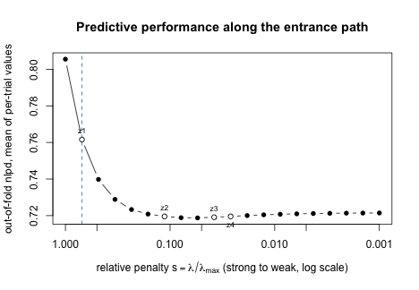

This is a pilot vignette, to be revised and extended. It analyses a
simulated series of trials in two stages and selects trial-level covariates
in the second stage.

In the first stage each trial is fitted on its own and returns a mean for
each variety. The second stage models those means across trials. The means
are not equally precise: trials differ in their number of blocks and lost
plots. The second stage should therefore carry each mean's variance from the
first stage.

# The trials

Twenty trials, six varieties, three or four blocks per trial, and a few lost
plots. Four covariates are measured on each trial. `z1` shifts the trial
mean, and `z2`, `z3` and `z4` have no effect.


``` r
set.seed(20260920)

n_var <- 6L
n_trial <- 20L
trials <- sprintf("t%02d", seq_len(n_trial))

alpha <- seq(-1, 1, length.out = n_var)
z <- matrix(stats::rnorm(n_trial * 4L), n_trial, 4L)
colnames(z) <- paste0("z", 1:4)
trial_mean <- 4 + 1.2 * z[, "z1"] + stats::rnorm(n_trial, 0, 0.35)

plots <- do.call(rbind, lapply(seq_len(n_trial), function(i) {
  n_block <- sample(3:4, 1L)
  d <- expand.grid(
    variety = factor(paste0("v", seq_len(n_var))),
    block = factor(paste0("b", seq_len(n_block)))
  )
  d <- d[-sample.int(nrow(d), max(1L, floor(0.08 * nrow(d)))), ]
  b <- stats::rnorm(n_block, 0, 0.3)
  d$yield <- trial_mean[i] + alpha[as.integer(d$variety)] +
    b[as.integer(d$block)] + stats::rnorm(nrow(d), 0, 0.45)
  d$trial <- trials[i]
  d
}))

head(plots)
#>   variety block    yield trial
#> 1      v1    b1 4.031727   t01
#> 2      v2    b1 5.211888   t01
#> 3      v3    b1 4.944964   t01
#> 4      v4    b1 5.703127   t01
#> 5      v5    b1 6.137920   t01
#> 6      v6    b1 6.376713   t01
```

# Stage one: variety means per trial

`yield ~ 0 + variety` gives one mean per variety, and `random = ~block`
accounts for the blocks.


``` r
stage1 <- do.call(rbind, lapply(trials, function(tr) {
  dt <- plots[plots$trial == tr, ]
  dt$variety <- droplevels(dt$variety)
  fit <- flexybayes(
    yield ~ 0 + variety,
    random = ~block,
    data = dt,
    backend = "inla",
    verbose = FALSE
  )
  est <- tidy(fit)
  data.frame(
    trial = tr,
    variety = sub("^variety", "", est$term),
    ybar = est$estimate,
    v = est$std.error^2,
    stringsAsFactors = FALSE
  )
}))

stage1$trial <- factor(stage1$trial)
stage1$variety <- factor(stage1$variety)
stage1 <- cbind(stage1, z[match(stage1$trial, trials), ])

rnd(head(stage1, 4))
#>   trial variety  ybar     v    z1     z2     z3    z4
#> 1   t01      v1 4.464 0.328 1.946 -0.898 -0.659 0.365
#> 2   t01      v2 5.353 0.407 1.946 -0.898 -0.659 0.365
#> 3   t01      v3 5.491 0.328 1.946 -0.898 -0.659 0.365
#> 4   t01      v4 5.640 0.328 1.946 -0.898 -0.659 0.365
round(range(stage1$v), 3)
#> [1] 0.083 0.902
```

`v` is the squared standard error of each mean, and it varies between trials.

# Stage two: carrying the variances

With `known_variance`, row $i$ has variance $\sigma^2 + v_i$: one residual
variance shared by all rows, plus the variance from the first stage.


``` r
base <- flexybayes(
  ybar ~ variety,
  random = ~trial,
  data = stage1,
  known_variance = stage1$v,
  backend = "inla",
  verbose = FALSE
)

rnd(tidy(base))
#>          term estimate std.error conf.low conf.high
#> 1 (Intercept)    2.864     0.401    2.072     3.656
#> 2   varietyv2    0.342     0.149    0.049     0.634
#> 3   varietyv3    0.775     0.148    0.484     1.066
#> 4   varietyv4    1.133     0.149    0.841     1.426
#> 5   varietyv5    1.637     0.149    1.344     1.930
#> 6   varietyv6    2.079     0.148    1.789     2.369
```

The simulated variety effects are 0.4 apart, so `v6` is 2.0 above `v1`.

# Selecting trial-level covariates

The four covariates are declared in two blocks, each with a Laplace prior.
The folds hold out whole trials, because the covariates are constant within
a trial.


``` r
pen <- fb_penalty(
  term(z1, z2) ~ laplace(scale = 0.3),
  term(z3, z4) ~ laplace(scale = 0.3)
)
```

`fb_select()` needs the covariance of each fold. The default estimates it
with one residual variance for all rows, which ignores the known variances,
so it stops:


``` r
refused <- tryCatch(
  fb_select(
    base, ~ z1 + z2 + z3 + z4,
    penalty = pen,
    workflow = "penalized_optimizer",
    resamples = fb_resamples(unit = ~trial, v = 5L),
    seed = 20260920L
  ),
  error = function(e) e
)
cat(conditionMessage(refused))
#> fb_select(): the base carries a known variance per row, which the REML plug-in (covariance = "reml_plugin"), which estimates one residual variance common to every row, would leave out. The penalised optimiser and the unpenalised benchmark carry it into the fold covariance with covariance = "base_model".
```

`covariance = "base_model"` refits the base model on each fold's training
trials, known variances included, and uses that covariance.
`ablation = TRUE` also measures what each block adds.


``` r
sel <- fb_select(
  base, ~ z1 + z2 + z3 + z4,
  penalty = pen,
  workflow = "penalized_optimizer",
  resamples = fb_resamples(unit = ~trial, v = 5L),
  covariance = "base_model",
  ablation = TRUE,
  seed = 20260920L
)

rnd(glance(sel)[, c("metric", "protected_only", "full", "improvement",
                    "chosen_size", "n_units", "n_folds")])
#>   metric protected_only  full improvement chosen_size n_units n_folds
#> 1   nlpd          0.806 0.722       0.084           1      20       5
```

# When each covariate entered

The penalised path runs from the strongest penalty to the weakest, indexed
by `s = lambda / lambda_max`. A covariate with an effect enters early, at a
high `s`. `entry_s_median` is the value of `s` by which half of the folds had
included it.


``` r
tab <- tidy(sel)
rnd(tab[tab$role == "candidate", c("term", "block", "retained",
                                  "entry_s_median")])
#>    term block retained entry_s_median
#> 7    z1     1     TRUE          0.695
#> 8    z2     1    FALSE          0.113
#> 9    z3     2    FALSE          0.038
#> 10   z4     2    FALSE          0.026
```


``` r
plot(sel, type = "entrance_path")
```



# What each block adds

With `ablation = TRUE`, each block is dropped in turn and the path is
refitted on the same folds. `ablation_loss_difference` is the increase in
held-out loss per trial when the block is dropped, with its standard error
over trials.


``` r
ab <- tidy(sel, level = "group")
rnd(ab[, c("group", "columns", "ablation_loss_difference",
           "ablation_loss_se")])
#>     group columns ablation_loss_difference ablation_loss_se
#> 1 block_1  z1, z2                    0.044            0.016
#> 2 block_2  z3, z4                    0.000            0.000
```

Dropping `z1` and `z2` increases the loss by
0.044 (standard error
0.016). Dropping `z3` and `z4` changes it by
0. The differences do not add up
to the improvement of the full model.

# Bayesian comparison of the chosen covariates

`refit = list(method = "bayes")` refits the chosen covariates as a Bayesian
model in each fold. It does not take known variances, so on this base it
stops:


``` r
refused_value <- tryCatch(
  fb_select(
    base, ~ z1 + z2 + z3 + z4,
    penalty = pen,
    workflow = "penalized_optimizer",
    resamples = fb_resamples(unit = ~trial, v = 5L),
    covariance = "base_model",
    refit = list(method = "bayes"),
    seed = 20260920L
  ),
  error = function(e) e
)
class(refused_value)[1]
#> [1] "flexybayes_refusal_known_variance_not_supported"
```

It runs on a second stage without known variances.
